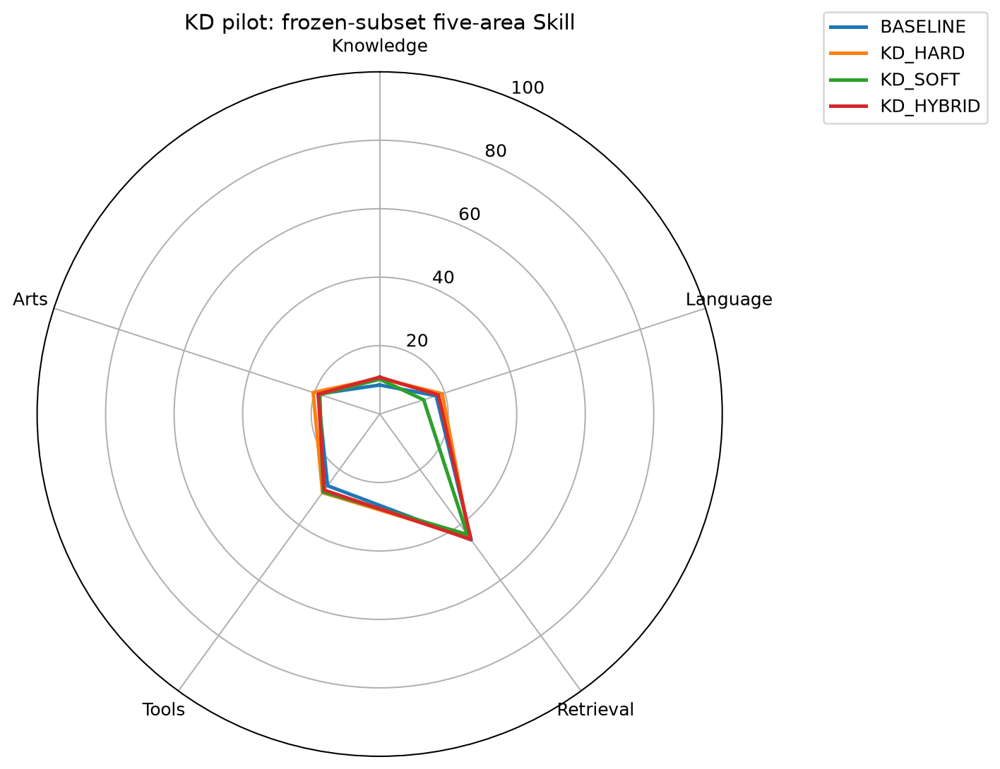
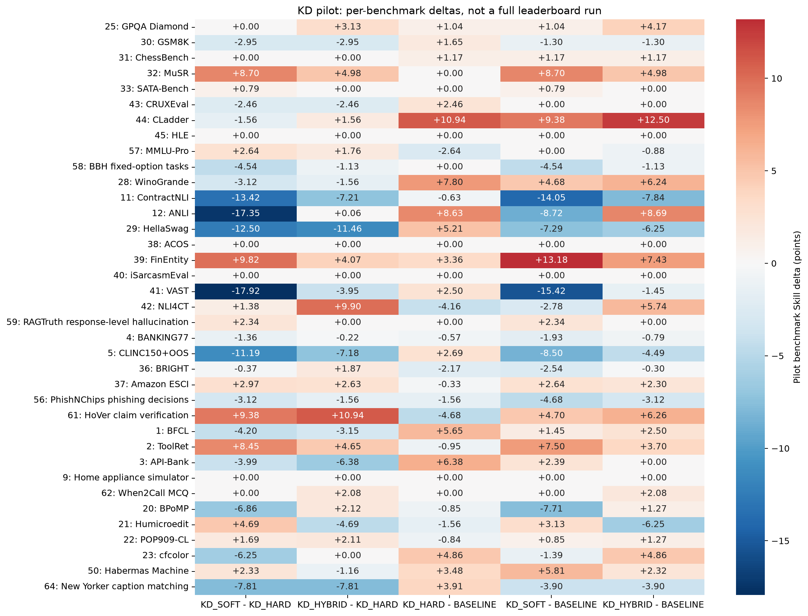

# 蒸馏 idea 快速对照：100k pilot

训练每组 100,000 pairs，一遍；同一起点、同样本和顺序、同有效 batch128。
评测采用冻结37项的 4,786 个完整 case、5,935 个请求、163,671 个完整候选 pair。
本报告是固定子集上的 pilot，不是完整公共榜单成绩，不是私测 Full；原生指标不能统一叫 accuracy。

| 模型 | Knowledge | Language | Retrieval | Tools | Arts | Pilot Index | 子集 coverage |
|---|---:|---:|---:|---:|---:|---:|---:|
| BASELINE | 8.49 | 17.32 | 45.45 | 25.88 | 18.91 | 22.39 | 100.00% |
| KD_HARD | 10.46 | 19.20 | 44.44 | 28.37 | 20.41 | 23.79 | 100.00% |
| KD_SOFT | 10.17 | 13.49 | 43.49 | 28.12 | 18.37 | 21.80 | 100.00% |
| KD_HYBRID | 10.78 | 18.04 | 45.26 | 27.50 | 18.84 | 23.42 | 100.00% |

## 首要比较

- **KD_SOFT - KD_HARD**：Pilot Index **-1.99**；Knowledge -0.29，Language -5.71，Retrieval -0.95，Tools -0.25，Arts -2.04。
- **KD_HYBRID - KD_HARD**：Pilot Index **-0.37**；Knowledge +0.32，Language -1.16，Retrieval +0.82，Tools -0.87，Arts -1.57。
- **KD_HARD - BASELINE**：Pilot Index **+1.40**；Knowledge +1.97，Language +1.88，Retrieval -1.01，Tools +2.49，Arts +1.50。
- **KD_SOFT - BASELINE**：Pilot Index **-0.59**；Knowledge +1.68，Language -3.83，Retrieval -1.96，Tools +2.24，Arts -0.54。
- **KD_HYBRID - BASELINE**：Pilot Index **+1.03**；Knowledge +2.29，Language +0.72，Retrieval -0.19，Tools +1.62，Arts -0.07。

SOFT−HARD 才回答纯软监督是否优于等量原标签续训；不能只凭相对起点提升就判定蒸馏有效。样本较小且仅使用当前已标注来源，弱差异应视为趋势不明确，不能外推为全池结论。

## 收益最大的 benchmark

### KD_SOFT - KD_HARD

| benchmark | Pilot Skill 差值 | 原生指标 | 续训模型 | HARD |
|---|---:|---|---:|---:|
| FinEntity | +9.82 | macro-F1 | 0.6922876248195688 | 0.6254882228459935 |
| HoVer claim verification | +9.38 | accuracy | 0.59375 | 0.546875 |
| MuSR | +8.70 | accuracy | 0.5 | 0.4453125 |
| ToolRet | +8.45 | nDCG@10 | 0.5483749479624627 | 0.4753044468249456 |
| Humicroedit | +4.69 | accuracy | 0.609375 | 0.5859375 |
| Amazon ESCI | +2.97 | macro-F1 | 0.5124860646599777 | 0.48880774580862435 |

### KD_HYBRID - KD_HARD

| benchmark | Pilot Skill 差值 | 原生指标 | 续训模型 | HARD |
|---|---:|---|---:|---:|
| HoVer claim verification | +10.94 | accuracy | 0.6015625 | 0.546875 |
| NLI4CT | +9.90 | macro-F1 | 0.643130389677754 | 0.592156862745098 |
| MuSR | +4.98 | accuracy | 0.4765625 | 0.4453125 |
| ToolRet | +4.65 | nDCG@10 | 0.515490928400226 | 0.4753044468249456 |
| FinEntity | +4.07 | macro-F1 | 0.6531543920142772 | 0.6254882228459935 |
| GPQA Diamond | +3.13 | accuracy | 0.28125 | 0.2578125 |

## 运行时间与吞吐

- Teacher：复用已有概率缓存，pilot 新增 Teacher 调用为0；不表示原先生成缓存没有计算成本。
- KD_HARD：20.7 分钟，80.7 pairs/s，18453 effective tokens/s。
- KD_SOFT：20.7 分钟，80.4 pairs/s，18390 effective tokens/s。
- KD_HYBRID：20.7 分钟，80.5 pairs/s，18408 effective tokens/s。

