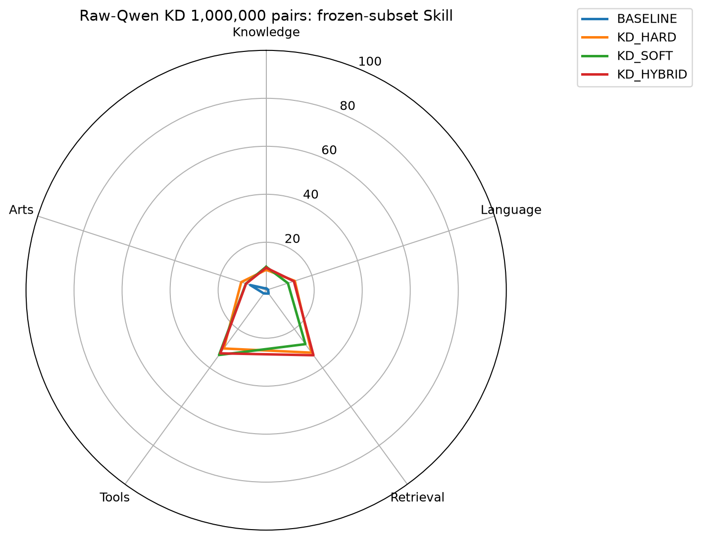
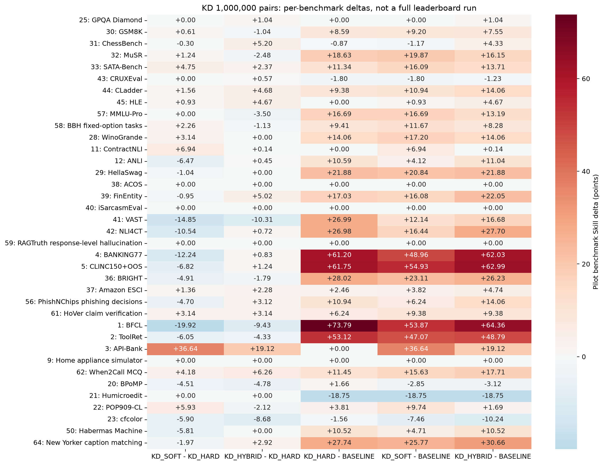

# 原始 Qwen 起点蒸馏对照：1,000,000 pairs

训练每组 1,000,000 pairs，一遍；同一起点、同样本和顺序、同有效 batch128。
本轮仅将起点从已四域训练的MIXED_ALL改成原始Qwen3-0.6B＋同一份未训练LoRA和随机二分类head；不带入旧trained adapter/head。
原始Qwen没有此任务的二分类head，因此RAW BASELINE只是未训练分类器起点，不是原始Qwen语言能力的zero-shot测量。蒸馏收益仍以SOFT−HARD/HYBRID−HARD为主。
评测采用冻结37项的 4,786 个完整 case、5,935 个请求、163,671 个完整候选 pair。
本报告是固定子集上的 pilot，不是完整公共榜单成绩，不是私测 Full；原生指标不能统一叫 accuracy。

| 模型 | Knowledge | Language | Retrieval | Tools | Arts | Pilot Index | 子集 coverage |
|---|---:|---:|---:|---:|---:|---:|---:|
| BASELINE | 0.70 | 0.85 | 1.75 | 1.66 | 7.02 | 1.76 | 100.00% |
| KD_HARD | 8.49 | 12.55 | 32.17 | 30.02 | 10.92 | 18.46 | 100.00% |
| KD_SOFT | 9.78 | 9.52 | 27.78 | 33.38 | 8.88 | 17.54 | 100.00% |
| KD_HYBRID | 9.37 | 12.13 | 33.51 | 32.53 | 8.81 | 19.10 | 100.00% |

## 首要比较

- **KD_SOFT - KD_HARD**：Pilot Index **-0.92**；Knowledge +1.29，Language -3.03，Retrieval -4.39，Tools +3.36，Arts -2.04。
- **KD_HYBRID - KD_HARD**：Pilot Index **+0.64**；Knowledge +0.88，Language -0.42，Retrieval +1.34，Tools +2.51，Arts -2.11。
- **KD_HARD - BASELINE**：Pilot Index **+16.70**；Knowledge +7.79，Language +11.70，Retrieval +30.42，Tools +28.36，Arts +3.90。
- **KD_SOFT - BASELINE**：Pilot Index **+15.78**；Knowledge +9.08，Language +8.67，Retrieval +26.03，Tools +31.72，Arts +1.86。
- **KD_HYBRID - BASELINE**：Pilot Index **+17.34**；Knowledge +8.67，Language +11.28，Retrieval +31.76，Tools +30.87，Arts +1.79。

## 同1M条件：原始起点与已训练起点

| 起点 | BASELINE | HARD | SOFT | HYBRID | SOFT−HARD | HYBRID−HARD |
|---|---:|---:|---:|---:|---:|---:|
| 原始Qwen＋未训练head | 1.76 | 18.46 | 17.54 | 19.10 | -0.92 | +0.64 |
| 四域训练后的MIXED_ALL | 22.39 | 22.49 | 21.36 | 22.38 | -1.13 | -0.11 |
- KD_SOFT的初始化交互差值 `(raw−HARD)−(warm−HARD)`：**+0.21**。
- KD_HYBRID的初始化交互差值 `(raw−HARD)−(warm−HARD)`：**+0.75**。

两轮严格复用同1M样本、epoch顺序、Teacher概率、训练超参及冻结评测case；每轮均从各自的共同起点独立训练三组。单次seed/固定子集结果不能当作统计显著性结论。

SOFT−HARD 才回答纯软监督是否优于等量原标签续训；不能只凭相对起点提升就判定蒸馏有效。各档按四域全池比例构造嵌套样本，优先复用已有标签；评测为固定子集，弱差异应视为趋势不明确，不能外推为完整榜单结论。

## 收益最大的 benchmark

### KD_SOFT - KD_HARD

| benchmark | Pilot Skill 差值 | 原生指标 | 续训模型 | HARD |
|---|---:|---|---:|---:|
| API-Bank | +36.64 | accuracy | 0.4375 | 0.078125 |
| ContractNLI | +6.94 | macro-F1 | 0.3565310456584953 | 0.2909518038460734 |
| POP909-CL | +5.93 | accuracy | 0.109375 | 0.046875 |
| SATA-Bench | +4.75 | case exact accuracy | 0.171875 | 0.125 |
| When2Call MCQ | +4.18 | accuracy | 0.3671875 | 0.3359375 |
| HoVer claim verification | +3.14 | accuracy | 0.546875 | 0.53125 |

### KD_HYBRID - KD_HARD

| benchmark | Pilot Skill 差值 | 原生指标 | 续训模型 | HARD |
|---|---:|---|---:|---:|
| API-Bank | +19.12 | accuracy | 0.265625 | 0.078125 |
| When2Call MCQ | +6.26 | accuracy | 0.3828125 | 0.3359375 |
| ChessBench | +5.20 | accuracy | 0.1484375 | 0.1015625 |
| FinEntity | +5.02 | macro-F1 | 0.4700399477518441 | 0.4359495013237046 |
| CLadder | +4.68 | accuracy | 0.5703125 | 0.546875 |
| HLE | +4.67 | accuracy | 0.203125 | 0.1640625 |

## 运行时间与吞吐

- Teacher：本档训练快照直接读取共享概率缓存；本轮截至该档上游累计新标注 **0 pairs**。快照物化本身不调用 Teacher，不代表标签生成成本为0。
- KD_HARD：206.8 分钟，80.6 pairs/s，18378 effective tokens/s。
- KD_SOFT：207.8 分钟，80.2 pairs/s，18285 effective tokens/s。
- KD_HYBRID：207.5 分钟，80.3 pairs/s，18316 effective tokens/s。

