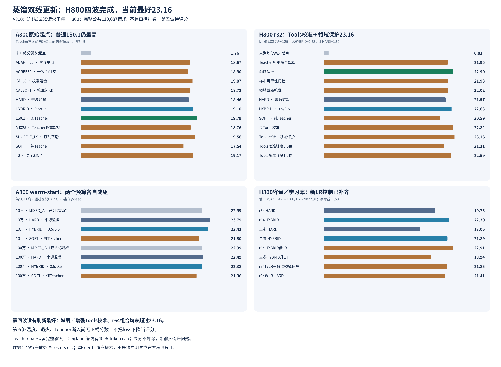

# 蒸馏报告全汇集：A800 / H800

> 只汇集本地已产出材料。A800冻结子集、H800完整公共、Teacher/读出诊断、未完成实验分别标识；不把不同范围放在一个总榜上。原件全部保留。

## 一页结论

- **A800原始起点：普通无Teacher LS0.1为19.79，仍高于已测Teacher方案。** HYBRID19.10、T2 19.17、校准/自适应条件均未超过它，不能只展示HYBRID相对HARD的提升。
- **H800新最好：Tools校准＋领域保护23.16。** 第三／第四波新增8个完成条件；比旧领域保护22.90高0.26，比HYBRID22.63高0.53，比HARD21.57高1.59。仍有领域交换，且尚缺匹配LS对照。
- **r64低LR匹配控制已补齐：HARD21.41、HYBRID22.91，KD净增益+1.50。** 旧LR下+2.45部分来自HARD偏弱；低LR与校准领域保护组合反而只有21.85，未超过r32最佳23.16。
- **纯SOFT两条原始起点线均弱于HARD。** A800低0.92，H800低0.98；warm-start两档亦无纯SOFT优势。
- **Teacher诊断不是训练管线无误的证明。** native68.37、generic pair63.95使用完整评测输入；训练label管线有4096-token head-tail cap，缓存/长输入处理问题仍未排除。
- 所有结论是当前单seed、自适应公共评测探索，不是独立held-out确认、官方私测Full或稳定最优配方；第五波没有正式分数，不填0。

## 总表与大图

- **[全量对照大表PNG](../../../03-证据与图表/01-蒸馏/distillation-collection/figures/distillation-results-table.png)**：45个去重完成条件，逐组列五维、Index和匹配HARD差值。
- **[研究总览PNG](../../../03-证据与图表/01-蒸馏/distillation-collection/figures/distillation-overview.png)**：四个面板分开看预算、线路与容量。
- [可筛选CSV大表](../../../03-证据与图表/01-蒸馏/distillation-collection/results.csv)：初始化/预算/协议/对照/来源均保留，复制到多个诊断表的同一HARD等基线已去重。
- [未完成与边界表](../../../03-证据与图表/01-蒸馏/distillation-collection/pending-and-boundaries.csv)：第五波训练中条件和旧历史缺失结果单列，不造分数。
- [全部相关报告索引](../../../03-证据与图表/01-蒸馏/distillation-collection/report-index.csv)：76份相关文档，含新增第三／第四波结果、方法、实现、历史材料与备份副本角色标记。
- **[全仓81张PNG图库](../../../03-证据与图表/08-综合汇总与历史记录/png-export-20261105/index.html)** · [PNG路径清单](../../../03-证据与图表/08-综合汇总与历史记录/png-export-20261105/png-index.csv)：不只蒸馏图，原有全仓图表也已导出PNG。

## 口径先看清楚

| 组别 | 评测范围 | 必须保留的控制条件 |
|---|---|---|
| A800 warm-start10万/100万 | 冻结37项，5,935请求 | 两个预算分别保留BASELINE与HARD，不能互相去重 |
| A800原始起点与改进轮 | 同冻结37项，5,935请求 | 原始起点、同1M样本；LS0.1是关键无Teacher对照 |
| H800原始起点/领域/容量 | 完整公共37项，110,087请求 | r64与全参各用同容量HARD；不同LR新组需补匹配HARD |
| Teacher/native读出诊断 | 同A800子集，但输入/读出协议不同 | 与Student训练条件分组；不能用完整输入pair高分排除训练cap问题 |

A800的19.79与H800的23.16不能解释成GPU型号导致效果变化。分数列是Skill/Index，不统一叫accuracy；BASELINE随机分类头分数也不代表原始Qwen的zero-shot语言能力。

## A800 · 已训练起点10万

| 条件 | Index | vs匹配HARD | vs LS0.1 |
|---|---|---|---|
| MIXED_ALL已训练起点 | 22.39 | -1.40 | — |
| HARD · 来源监督 | 23.79 | 0.00 | — |
| HYBRID · 0.5/0.5 | 23.42 | -0.37 | — |
| SOFT · 纯Teacher | 21.80 | -1.99 | — |

## A800 · 已训练起点100万

| 条件 | Index | vs匹配HARD | vs LS0.1 |
|---|---|---|---|
| MIXED_ALL已训练起点 | 22.39 | -0.10 | — |
| HARD · 来源监督 | 22.49 | 0.00 | — |
| HYBRID · 0.5/0.5 | 22.38 | -0.11 | — |
| SOFT · 纯Teacher | 21.36 | -1.13 | — |

## A800 · 原始起点100万与两轮改进

| 条件 | Index | vs匹配HARD | vs LS0.1 |
|---|---|---|---|
| 未训练分类头起点 | 1.76 | -16.70 | -18.03 |
| ADAPT_LS · 对齐平滑 | 18.67 | 0.21 | -1.12 |
| AGREE50 · 一致性门控 | 18.30 | -0.16 | -1.49 |
| CAL50 · 校准混合 | 19.07 | 0.61 | -0.72 |
| CALSOFT · 校准纯KD | 18.72 | 0.26 | -1.07 |
| HARD · 来源监督 | 18.46 | 0.00 | -1.33 |
| HYBRID · 0.5/0.5 | 19.10 | 0.64 | -0.69 |
| LS0.1 · 无Teacher | 19.79 | 1.33 | 0.00 |
| MIX25 · Teacher权重0.25 | 18.76 | 0.30 | -1.03 |
| SHUFFLE_LS · 打乱平滑 | 19.56 | 1.10 | -0.23 |
| SOFT · 纯Teacher | 17.54 | -0.92 | -2.25 |
| T2 · 温度2混合 | 19.17 | 0.71 | -0.62 |

## H800 · 原始起点100万 r32与第一波

| 条件 | Index | vs匹配HARD | vs LS0.1 |
|---|---|---|---|
| 未训练分类头起点 | 0.82 | -20.75 | — |
| Teacher权重降至0.25 | 21.95 | 0.38 | — |
| 领域保护 | 22.90 | 1.33 | — |
| 样本可靠性门控 | 21.93 | 0.36 | — |
| 领域截距校准 | 22.02 | 0.45 | — |
| HARD · 来源监督 | 21.57 | 0.00 | — |
| HYBRID · 0.5/0.5 | 22.63 | 1.06 | — |
| SOFT · 纯Teacher | 20.59 | -0.98 | — |

## H800 · r64容量对照

| 条件 | Index | vs匹配HARD | vs LS0.1 |
|---|---|---|---|
| r64 HARD | 19.75 | 0.00 | — |
| r64 HYBRID | 22.20 | 2.45 | — |

## H800 · 全参容量对照

| 条件 | Index | vs匹配HARD | vs LS0.1 |
|---|---|---|---|
| 全参 HARD | 17.06 | 0.00 | — |
| 全参 HYBRID | 21.89 | 4.83 | — |

## A800 · 协议/读出诊断（非新增训练）

| 条件 | Index | vs匹配HARD | vs LS0.1 |
|---|---|---|---|
| HARD backbone native LM | 10.72 | — | — |
| LS backbone native LM | 12.84 | — | — |
| 原始Qwen native LM | 8.01 | — | — |
| Teacher native | 68.37 | — | — |
| Teacher generic pair | 63.95 | — | — |

## H800 · 第三／第四波新增8个完成条件

| 条件 | Knowledge | Language | Retrieval | Tools | Arts | Index | vs匹配HARD |
|---|---:|---:|---:|---:|---:|---:|---:|
| E05 仅Tools校准 | 8.88 | 14.56 | 38.62 | 42.11 | 13.51 | 22.84 | +1.27 |
| **E06 Tools校准＋领域保护** | **8.43** | **14.87** | **38.75** | **44.20** | **12.98** | **23.16** | **+1.59** |
| E07 r64 HYBRID，LR5e-5 | 9.87 | 16.34 | 35.28 | 43.16 | 11.85 | 22.91 | +1.50 |
| E08 全参HYBRID，backbone LR2e-5 | 6.49 | 14.26 | 35.67 | 27.22 | 14.58 | 18.94 | 无匹配新LR HARD |
| E09 Tools校准强度0.5倍 | 8.66 | 14.68 | 36.82 | 34.49 | 15.96 | 21.31 | −0.26 |
| E10 Tools校准强度1.5倍 | 7.93 | 15.54 | 38.24 | 40.49 | 14.63 | 22.59 | +1.02 |
| E11 r64低LR＋校准领域保护 | 8.92 | 14.83 | 35.46 | 39.94 | 13.15 | 21.85 | +0.44 |
| E12 r64低LR HARD | 7.94 | 13.47 | 34.62 | 42.29 | 12.15 | 21.41 | 0.00 |

每组均完成100万pair、7813步及37项110087请求，coverage100%。E07/E11以E12为匹配HARD；E05/E06/E09/E10以r32 HARD21.57为对照。E08未补齐新LR HARD，不填净增益。第四波没有超过23.16；不同rank和LR的改动不能当成纯容量因果效应。

[第三波完成报告与图表](../distillation-exploration-20261104/third-wave-results/report/REPORT.md) · [第四波完成报告与图表](../distillation-exploration-20261104/fourth-wave-results/report/REPORT.md)

## 第五波与诊断边界

第五波E13/E14/E15/E16为静态匹配权重、温度2、温度退火与Teacher权重渐入，已有训练记录，尚无正式分数。训练缓存的候选组机械计数也不等于可用排序监督；完整source/group语义审计见下面原报告。

Teacher pair诊断保留完整评测输入，训练label有4096-token head-tail cap，二者不是同一条输入处理链路。Student native诊断还改变了协议/读出且没有专门训练native协议，因此不能据此宣布分类头无关或已找到根因。

## 原报告按类查找

### 汇总/入口

- [2026-11-03 实验报告与图表入口](../../../02-研究路径/08-综合汇总与历史记录/LATEST_EXPERIMENT_REPORTS_20261103.md)
- [2026-11-04 蒸馏改进实验入口](../../../02-研究路径/08-综合汇总与历史记录/LATEST_EXPERIMENT_REPORTS_20261104.md)
- [2026-11-05 蒸馏研究：最新结果](../../../02-研究路径/08-综合汇总与历史记录/LATEST_EXPERIMENT_REPORTS_20261105.md)
- [A800 × H800 蒸馏研究：阶段结论总汇](../distillation-joint-summary/REPORT.md)

### 相关研究/记录

- [Jev 实验报告与大表总入口](../../../02-研究路径/08-综合汇总与历史记录/历史报告总入口.md)
- [8×A800 新机器：Qwen3-0.6B 蒸馏实验完整规划](../../../02-研究路径/01-蒸馏/a800-8gpu-distillation-20261031/REPORT.md)
- [蒸馏改进第一轮：已完成](../../../02-研究路径/01-蒸馏/a800-kd-improve-round1-20261104/README.md)
- [蒸馏改进第二轮：校准和样本级Teacher信息](../../../02-研究路径/01-蒸馏/a800-kd-improve-round2-20261104/README.md)
- [A800 蒸馏快速实验：本地报告入口](../../../02-研究路径/01-蒸馏/a800-kd-pilot-100k-20261102/README.md)
- [从原始 Qwen 起点重新做 KD 对照](../../../02-研究路径/01-蒸馏/a800-kd-raw-qwen-1m-20261103/README.md)
- [原始Qwen蒸馏：已完成的训练过程记录](../../../02-研究路径/01-蒸馏/a800-kd-raw-qwen-1m-20261103/report/TRAINING_PROGRESS_20261103.md)
- [KD scale series:1M →2M →3M](../../../02-研究路径/01-蒸馏/a800-kd-scale-series-20261102/README.md)
- [SAMerging 四专家合并实验报告](../../03-专科与融合/a800-samerging-four-experts-20261103/report/SAMERGING_DETAILED_REPORT.md)
- [2026-11-01 第二次评测阻塞接手核对](../../../02-研究路径/08-综合汇总与历史记录/cluster-followup-20261031/evaluation-recovery-20261101/DISK-WRITE-RECOVERY-CHECK.md)
- [2026-11-01 公开评分汇总恢复](../../../02-研究路径/08-综合汇总与历史记录/cluster-followup-20261031/evaluation-recovery-20261101/RECOVERY.md)
- [取消 Language 专家：运行调整计划与记录](../../../02-研究路径/08-综合汇总与历史记录/cluster-followup-20261031/four-specialists-change.md)
- [集群环境重建、实验状态还原与后续规划](../../../02-研究路径/08-综合汇总与历史记录/cluster-recovery-and-experiment-plan-20261030.md)
- [Jev 项目工作量明细台账](../../../02-研究路径/08-综合汇总与历史记录/cluster-work-inventory-20261102/WORK-LEDGER.md)
- [实验总规划与当前位置](../../../02-研究路径/08-综合汇总与历史记录/experiment-roadmap-status-20261029.md)
- [Qwen3-0.6B：四专科训练、四科混合与模型融合](../../../02-研究路径/03-专科与融合/five-area-training-plan.md)
- [执行记录：原始Qwen首个100万pair节点](../../../02-研究路径/01-蒸馏/fresh-qwen-1m-distillation-20261103/PROGRESS.md)
- [Jev 决策模型实验工作记录](../../../02-研究路径/08-综合汇总与历史记录/jev-work-log-20261102.md)
- [Qwen3-0.6B Language Understanding 已完成实验报告](../../02-Language/language-understanding-study-20261029.md)
- [Qwen3-0.6B：融合实验结束后的 Teacher 蒸馏规划](../../../02-研究路径/01-蒸馏/next-experiments-plan-20261030/REPORT.md)
- [榜首 Teacher 蒸馏：能否超过人工标签训练？](../teacher-distillation-evidence-20261030/REPORT.md)
- [calibrated-typed-decisions (v2.1)](../../../../jev-辅助归档/2026-11-09整理/辅助文件/research/2026-10-27/raw/calibrated-readme.md)
- [Open-Jev: typed decision datasets](../../../../jev-辅助归档/2026-11-09整理/辅助文件/research/2026-10-27/raw/openjev-readme.md)
- [Typed Decisions](../../../../jev-辅助归档/2026-11-09整理/辅助文件/research/2026-10-27/raw/typed-decisions-readme.md)
- [每数据家族专用模型→融合：首轮阶段报告](../../../02-研究路径/03-专科与融合/lu-specialist-fusion-20261029T152144Z/FUSION-REPORT.md)
- [五族专用模型→融合：首轮结果复核](../../03-专科与融合/lu-specialist-fusion-20261029T152144Z/FUSION-REVIEW.md)
- [Nimble、Together、Tasksource 与 typed-decisions 数据核查](../../04-数据与评测/nimble-together.md)
- [Mapika / Bobcat / Jebadiah 训练数据核查](../../04-数据与评测/notes-mapika-bobcat-jebadiah.md)
- [顶部决策模型训练数据核查（2026-10-27）](../../04-数据与评测/top-models/top-model-training-data-2026-10-27.md)

### 方案/文献研究

- [蒸馏为什么可能变差：研究、实际线索与第一轮在跑实验](../../../02-研究路径/01-蒸馏/a800-kd-improve-round1-20261104/RESEARCH_AND_PLAN.md)
- [集群工作量补充盘点](../../../02-研究路径/08-综合汇总与历史记录/cluster-work-inventory-20261102/PLAN.md)
- [原始Qwen3-0.6B：首个100万pair蒸馏节点](../../../02-研究路径/01-蒸馏/fresh-qwen-1m-distillation-20261103/PLAN.md)
- [榜单决策模型蒸馏方法调研](../../../02-研究路径/01-蒸馏/leaderboard-distillation-20261102/PLAN.md)
- [榜单决策模型如何做蒸馏](../leaderboard-distillation-20261102/REPORT.md)
- [Decision Index 榜单模型蒸馏方法调研报告](../leaderboard-distillation-20261103.md)
- [四专家分层 SLERP 补测执行记录](../../../02-研究路径/03-专科与融合/slerp-supplement-20261102/PLAN.md)

### 结果报告

- [蒸馏改进：第一轮假设验证](../a800-kd-improve-round1-20261104/report/REPORT.md)
- [蒸馏改进第二轮：校准与样本级Teacher信息](../a800-kd-improve-round2-20261104/report/REPORT.md)
- [蒸馏 idea 快速对照：100k pilot](../a800-kd-pilot-100k-20261102/REPORT.md)
- [原始 Qwen 起点蒸馏对照：1,000,000 pairs](../a800-kd-raw-qwen-1m-20261103/report/REPORT.md)
- [蒸馏规模阶段：1,000,000 pairs](../a800-kd-scale-series-20261102/1m/REPORT.md)
- [蒸馏持续探索：四波完成，当前最好23.16，第五波待评分](../distillation-exploration-20261104/REPORT.md)
- [蒸馏快速探索：首波四组](../distillation-exploration-20261104/first-wave-results/report/REPORT.md)
- [第二波：Student容量与蒸馏收益](../distillation-exploration-20261104/second-wave-results/report/REPORT.md)
- [原始Qwen3-0.6B：100万pair蒸馏节点](../fresh-qwen-1m-distillation-20261103/results-20261104/report/REPORT.md)

### 机制诊断/数据审计

- [Qwen native-LM 读出诊断：已完成](../../../02-研究路径/06-五维训练与Readout/a800-qwen-native-readout-20261105/README.md)
- [原始Qwen LM-head/native协议与现有classifier读出诊断](../../06-五维训练与Readout/a800-qwen-native-readout-20261105/report/REPORT.md)
- [Teacher原生协议直接评测：已完成](../../../02-研究路径/06-五维训练与Readout/a800-teacher-native-diagnostic-20261104/README.md)
- [Teacher原生协议直接评测](../../06-五维训练与Readout/a800-teacher-native-diagnostic-20261104/report/REPORT.md)
- [Teacher 原生协议与 pair 改写：已完成](../../../02-研究路径/06-五维训练与Readout/a800-teacher-pair-diagnostic-20261104/README.md)
- [同一Teacher：原生任务协议与candidate-pair改写对照](../../06-五维训练与Readout/a800-teacher-pair-diagnostic-20261104/report/REPORT.md)
- [排序蒸馏可行性：可信关系比表面组数少](../distillation-exploration-20261104/group-ranking-audit/REPORT.md)

### 环境/工程实现

- [执行记录：完整四科 Teacher 蒸馏](../../../02-研究路径/08-综合汇总与历史记录/cluster-followup-20261031/distillation-implementation-20261101/EXECUTION.md)
- [Student 显式 FlashAttention-3](../../../02-研究路径/05-Attention与效率/student-flash-attention3-20261103/CHANGE.md)

### 根目录及其他目录的相关资料

- [决策模型训练数据：核查与可获取清单](../../04-数据与评测/data_sources.md)
- [TL;DR](../../../02-研究路径/07-方法与背景/jev.md)
- [Language Understanding 后续实验路线](../../../02-研究路径/02-Language/language_roadmap.md)
- [给服务器 OpenCode 的后续清单：保留正在运行的 LoRA 基线](../../../02-研究路径/02-Language/opencode_language_checklist.md)
- [1.根据现状来写 ： 目标 硬件 还有 ddl](../../../02-研究路径/07-方法与背景/schedule.md)

## 使用说明

结果表以 comparison_group + condition 为键。同一批模型被多张对照表引用时只保留一次，但保留所有sources；同名模型跨预算/初始化/读出不合并。原生指标、Teacher诊断与私测/Full不偷换。

所有原报告和原图不删不改；这里只新增汇集、CSV、两张总图与全仓PNG副本。本次不重跑模型、测试、烟测或文件哈希，不连接集群，不提交或推送Git。
