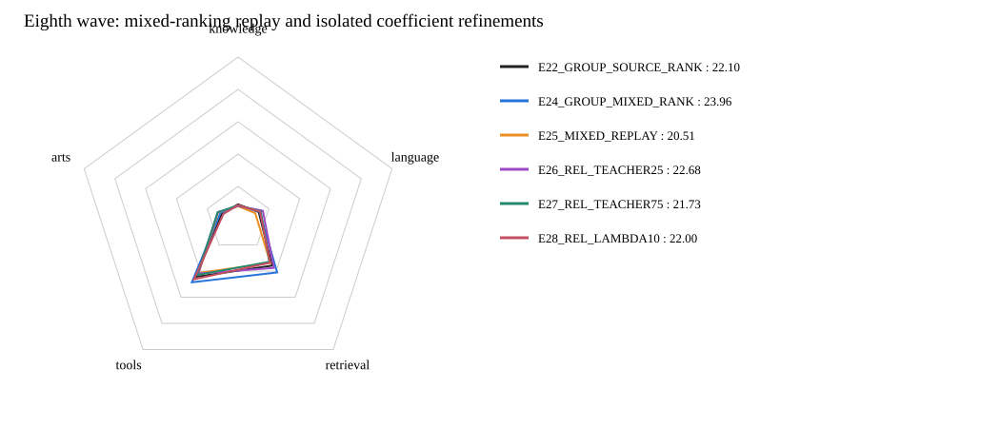

# 第八波：混合排序重跑与局部对照

**累计当前最好：E24_GROUP_MIXED_RANK，公共总分23.96，对历史最好+0.00。**
本波正式评分完成4/4；未评分的模型不作胜出判断。

| 模型 | Knowledge | Language | Retrieval | Tools | Arts | 公共总分 | 对历史最好 | 对本波重跑 |
|---|---:|---:|---:|---:|---:|---:|---:|---:|
| E22_GROUP_SOURCE_RANK | 8.90 | 13.38 | 35.84 | 44.37 | 10.53 | 22.10 | -1.86 | +1.59 |
| E24_GROUP_MIXED_RANK | 8.13 | 13.95 | 41.04 | 48.58 | 11.52 | 23.96 | +0.00 | +3.45 |
| E25_MIXED_REPLAY | 7.72 | 11.14 | 33.86 | 41.38 | 12.95 | 20.51 | -3.45 | +0.00 |
| E26_REL_TEACHER25 | 7.86 | 16.07 | 37.60 | 41.82 | 13.19 | 22.68 | -1.28 | +2.17 |
| E27_REL_TEACHER75 | 8.26 | 14.78 | 32.91 | 43.01 | 13.23 | 21.73 | -2.23 | +1.22 |
| E28_REL_LAMBDA10 | 8.42 | 14.27 | 33.54 | 46.31 | 9.53 | 22.00 | -1.96 | +1.49 |

## 只改变关系混合系数或辅助权重

设p为已保存的Teacher相对概率，r=(1-gamma)+gamma*p；gamma仅作用于关系辅助，不改变全部百万pair的E06有效目标。

- E25_MIXED_REPLAY：gamma0.5、lambda0.05，保留原0.5+0.5*p算式；相同未训练初始化和旧计划，独立重跑。
- E26_REL_TEACHER25：gamma0.25、lambda0.05，来源关系占比更大。
- E27_REL_TEACHER75：gamma0.75、lambda0.05，Teacher相对目标占比更大。
- E28_REL_LAMBDA10：gamma0.5、lambda0.10，只加倍关系辅助。

完全复用第七波已发布的order、tags、macro offsets、3647条K/R关系和Teacher相对概率，不重抽／增删关系、不按Teacher方向过滤。所有百万pair仍参与相同pointwise监督。
归一继续为point_sum/nB + lambda*N/(M*nB)*relation_sum，完整关系不跨micro，立即反传；训练／优化器／FA3循环不变。
全部从原始Qwen与同一未训练r32／分类头开始，不从已训练E24继续；同100万pair、seed42、LR1e-4、batch128、一遍、7813步、实际FA3。
每臂使用新的独立scratch检查点，final和报告NFS保存，原第七波不改动；无新Teacher标注、下载或依赖，不跑额外测试、烟测、哈希。
E25只是一遍同seed重跑，历史同配方出现过分域波动；本波仍为自适应公共评分探索，不宣称统计显著、分域稳定或独立测试收益。

## 实际重跑观察

E25重跑20.51，相对历史23.96为-3.45。
