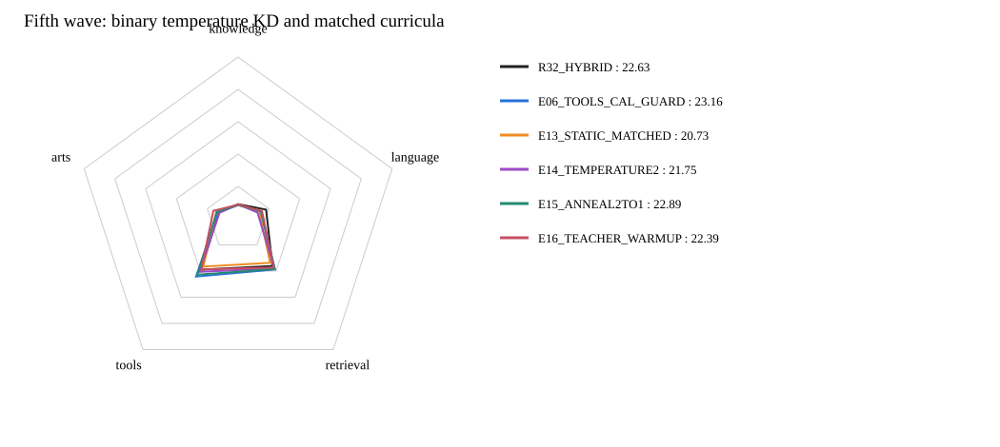

# 第五波：二分类KD温度与Teacher课程

**当前最好：E06_TOOLS_CAL_GUARD，公共总分23.16，对此前最好+0.00。**
本波正式评分完成4/4；未评分的方案不作胜出判断。

| 模型 | Knowledge | Language | Retrieval | Tools | Arts | 公共总分 | 对此前最好 | 覆盖率 |
|---|---:|---:|---:|---:|---:|---:|---:|---:|
| R32_HARD | 8.23 | 14.34 | 36.83 | 38.04 | 14.08 | 21.57 | -1.59 | 100.00% |
| R32_HYBRID | 9.02 | 18.19 | 36.11 | 38.94 | 12.54 | 22.63 | -0.53 | 100.00% |
| E06_TOOLS_CAL_GUARD | 8.43 | 14.87 | 38.75 | 44.20 | 12.98 | 23.16 | +0.00 | 100.00% |
| E13_STATIC_MATCHED | 8.95 | 13.79 | 33.70 | 36.59 | 14.14 | 20.73 | -2.43 | 100.00% |
| E14_TEMPERATURE2 | 8.85 | 12.59 | 37.90 | 40.60 | 12.02 | 21.75 | -1.41 | 100.00% |
| E15_ANNEAL2TO1 | 8.52 | 14.72 | 38.42 | 42.75 | 13.77 | 22.89 | -0.27 | 100.00% |
| E16_TEACHER_WARMUP | 8.64 | 15.51 | 37.33 | 38.69 | 16.03 | 22.39 | -0.77 | 100.00% |

## 四组配方

- E13_STATIC_MATCHED：T1，各域固定Teacher混合权重，匹配E16该域累计名义系数。
- E14_TEMPERATURE2：固定T2，来源分支仍T1，KD师生分支均除T并乘T²。
- E15_ANNEAL2TO1：相同温度KD，T随全局optimizer step从2线性降到1。
- E16_TEACHER_WARMUP：T1，前20%step将Teacher混合乘数从0升到1，此后1；来源系数相应从1降至1-beta。

基础配方均为E06 Tools校准＋领域保护：K/T beta0.5、R0.25、Arts0。T1直接使用E06保存的t0，不把混合目标当Teacher再重复混合。
T>1使用a=logit(clip(q))+Tools bias，再计算sigmoid(a/T)；先加bias再除T，Teacher原生1.44不重复。仅温度分支用1e-6裁剪端点，T1仍保留原有效目标。
E13/E16使用相同原宏批顺序，按w_i=1/实际宏批样本数计算分域匹配，包含最后64条；仅匹配名义系数，不声称匹配实际梯度量或优化路径。

全部从原始Qwen和同一未训练r32／分类头初始化出发，同100万pair、seed42、batch128、一遍、7813步、显式FA3；无新增Teacher标注，不跑额外测试、烟测、哈希。
这是真实训练和37项公共benchmark的单seed自适应搜索，不是accuracy或私测Full，不宣称统计显著。新实现对历史E06的差值是工程候选比较；E16对E13才是匹配累计系数的课程对照。

## 资料与边界

- [Distilling the Knowledge in a Neural Network](https://arxiv.org/abs/1503.02531)：共同温度与T²补偿的依据。
- [Annealing Knowledge Distillation](https://arxiv.org/abs/2104.07163)：退火／渐进转移方向依据；本项目的二分类2→1及20%混合权重warm-up不是原论文完整复现，也不保证涨分。

## 匹配累计系数的课程对照

E16相对E13：+1.66分；静态20.73，渐入22.39。
