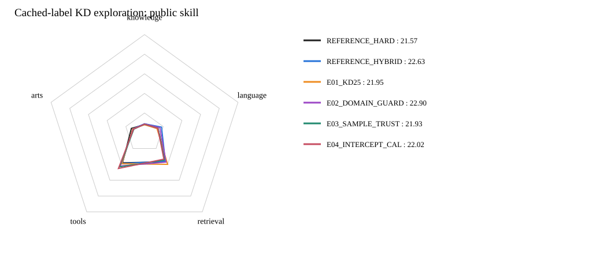

# 蒸馏快速探索：首波四组

**当前最好：E02_DOMAIN_GUARD，公共总分22.90；相对原HYBRID为+0.27。**
新方案正式评测完成4/4组；没有完成评分的方案不作胜出判断。

| 模型 | Knowledge | Language | Retrieval | Tools | Arts | 公共总分 | 对原HYBRID |
|---|---:|---:|---:|---:|---:|---:|---:|
| REFERENCE_HARD | 8.23 | 14.34 | 36.83 | 38.04 | 14.08 | 21.57 | -1.06 |
| REFERENCE_HYBRID | 9.02 | 18.19 | 36.11 | 38.94 | 12.54 | 22.63 | +0.00 |
| E01_KD25 | 8.03 | 13.33 | 40.03 | 39.15 | 12.60 | 21.95 | -0.68 |
| E02_DOMAIN_GUARD | 8.94 | 16.44 | 37.17 | 42.12 | 11.98 | 22.90 | +0.27 |
| E03_SAMPLE_TRUST | 8.58 | 14.45 | 34.67 | 43.21 | 11.40 | 21.93 | -0.70 |
| E04_INTERCEPT_CAL | 8.53 | 14.21 | 33.42 | 45.27 | 11.72 | 22.02 | -0.61 |

## 本波想法

- E01_KD25：把Teacher权重由0.5降至0.25。
- E02_DOMAIN_GUARD：Arts只保留来源监督，Retrieval的Teacher权重0.25，Knowledge/Tools为0.5。
- E03_SAMPLE_TRUST：逐样本Teacher权重为0.5×exp(−2 KL(来源目标‖Teacher))，不丢弃任何样本。
- E04_INTERCEPT_CAL：四科分别拟合logit截距，使Teacher平均概率匹配训练来源目标，再作0.5混合。

四组均从同一个原始Qwen/未训练头与LoRA初始化出发，固定100万同池、seed42、LR1e-4、batch128、一遍与显式FA3。
复用既有Teacher缓存，无新增标注。T=1下，预计算混合目标BCE与相应forward-KL混合目标对Student的梯度等价；不同配方的loss数值不直接比较。

## 训练池诊断（不是Teacher真实准确率）

| 方向 | 来源均值 | Teacher均值 | 与二值来源一致率 |
|---|---:|---:|---:|
| knowledge | 0.25 | 0.34 | 86.51% |
| retrieval | 0.07 | 0.11 | 93.91% |
| tools | 0.35 | 0.43 | 89.63% |
| arts | 0.34 | 0.52 | 59.46% |

原始来源监督包含约1.4%软分数，保留原值。截距校准是对训练来源监督的拟合，不宣称校准到真实正确率或已证明label shift。
全部以相同37项公共benchmark做正式评测，不是统一accuracy或私测Full；快速探索的单次结果不证明全局最优。

## 方法资料

- [Soft/label mixing and KD temperature](https://arxiv.org/abs/1503.02531)
- [Confidence conditioned KD](https://arxiv.org/abs/2107.06993)
- [Teacher biases and subgroup reliability](https://arxiv.org/abs/2106.10494)
- [Calibration by affine logits](https://proceedings.mlr.press/v70/guo17a.html)

这些资料支持研究方向；本波权重、领域保护和软标签门控的组合是本项目待验证改造，不称为原论文复现。

