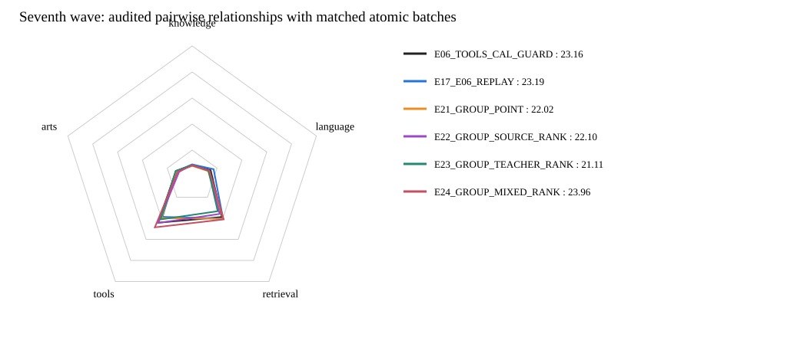

# 第七波：可信候选组关系蒸馏

**累计当前最好：E24_GROUP_MIXED_RANK，公共总分23.96，对历史最好重跑+0.77。**
本波正式评分完成4/4；未评分的方案不作胜出判断。

| 模型 | Knowledge | Language | Retrieval | Tools | Arts | 公共总分 | 对23.19参考 | 覆盖率 |
|---|---:|---:|---:|---:|---:|---:|---:|---:|
| E06_TOOLS_CAL_GUARD | 8.43 | 14.87 | 38.75 | 44.20 | 12.98 | 23.16 | -0.03 | 100.00% |
| E17_E06_REPLAY | 9.06 | 17.28 | 40.27 | 38.60 | 12.69 | 23.19 | +0.00 | 100.00% |
| E21_GROUP_POINT | 7.87 | 12.77 | 40.60 | 39.73 | 12.90 | 22.02 | -1.17 | 100.00% |
| E22_GROUP_SOURCE_RANK | 8.90 | 13.38 | 35.84 | 44.37 | 10.53 | 22.10 | -1.09 | 100.00% |
| E23_GROUP_TEACHER_RANK | 8.50 | 13.21 | 33.26 | 41.07 | 13.26 | 21.11 | -2.08 | 100.00% |
| E24_GROUP_MIXED_RANK | 8.13 | 13.95 | 41.04 | 48.58 | 11.52 | 23.96 | +0.77 | 100.00% |

## 只比较关系目标，不混入不同样本集合

- E21_GROUP_POINT：全部pair继续E06有效目标BCE，采用与其他三臂相同的atomic组批计划，无排序辅助。
- E22_GROUP_SOURCE_RANK：相同pointwise目标，新增来源正例高于负例的BCE辅助，关系目标1。
- E23_GROUP_TEACHER_RANK：相同pointwise目标，用缓存原q构造sigmoid(logit(q_pos)-logit(q_neg))的相对软目标。
- E24_GROUP_MIXED_RANK：关系目标为0.5+0.5*p_teacher；其余完全相同。

关系仅为已审计K/R闭集的3647条、7294个端点，覆盖百万池约0.73%；无Tools、Arts、合成或未判定检索负例，不按Teacher方向筛选。所有百万pair仍参与pointwise监督，来源软分数保留。
单macro目标为point_sum/nB + 0.05*N/(M*nB)*relation_sum，nB为实际行数，尾批64；每个micro立即反传，关系二行不跨micro。0.05是全数据关系均值权重，会集中作用于少量端点，并非每个关系只加0.05。
E21与历史E17差值包含组批／顺序改变，不能冒充Teacher收益；E22−E21看来源排序，E23−E22才比较同关系集下Teacher相对软目标。四臂pointwise本身已包含Teacher，因此不是完整KD对HARD的净收益对照。

全部从同一原始Qwen与未训练r32／head开始，同100万、seed42、LR1e-4、batch128、一遍、7813步、实际FA3。无新增Teacher标注、下载、依赖，不跑额外测试／烟测／哈希。
中间checkpoint和优化器状态放独立临时盘，最终模型、评分和报告仍保留NFS；没有删除旧结果。
同配方历史两次总分23.16／23.19但五维差异明显，本波仍为单次自适应公共评分探索，不宣称统计显著或分域稳定。

## 同组批匹配比较

| 比较 | 分差 |
|---|---:|
| source_rank_minus_group_point | +0.08 |
| teacher_rank_minus_source_rank | -0.99 |
| mixed_rank_minus_source_rank | +1.86 |
