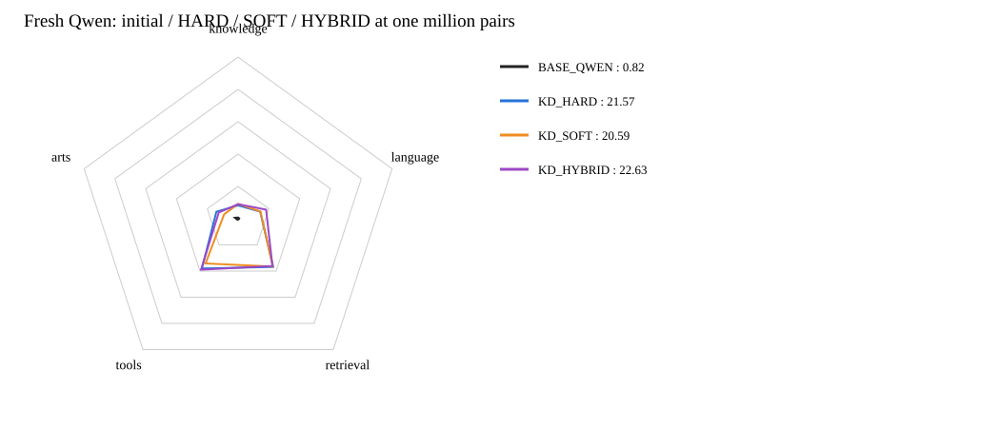
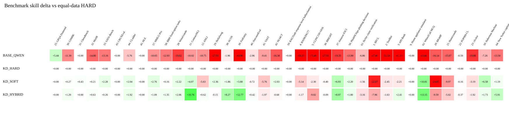

# 原始Qwen3-0.6B：100万pair蒸馏节点

三个分支均从原始Qwen基座和同一未训练分类头／LoRA初始化开始，不继承四科微调模型。
四科各25万pair，共100万，三组使用同一批数据、顺序和训练量。Language不训练，评测仍保留五维37项。

HARD沿用来源提供的原始监督；其中包含0到1之间的概率型标签，保留原值，不擅自取整或丢弃。

| 模型 | Knowledge | Language | Retrieval | Tools | Arts | 公共总分 |
|---|---:|---:|---:|---:|---:|---:|
| BASE_QWEN | 0.76 | 0.72 | 0.50 | 0.77 | 2.01 | 0.82 |
| KD_HARD | 8.23 | 14.34 | 36.83 | 38.04 | 14.08 | 21.57 |
| KD_SOFT | 9.18 | 14.49 | 36.55 | 34.19 | 9.05 | 20.59 |
| KD_HYBRID | 9.02 | 18.19 | 36.11 | 38.94 | 12.54 | 22.63 |

## 相对原始标签监督的收益

- SOFT−HARD：**-0.98**
- HYBRID−HARD：**+1.06**
- Teacher首档标注耗时约 **16.93小时**，不含此前下载与等待。

本报告为累计100万pair节点；没有自动追加到200万。指标为公共Skill／Index，不是统一accuracy或私测Full。

