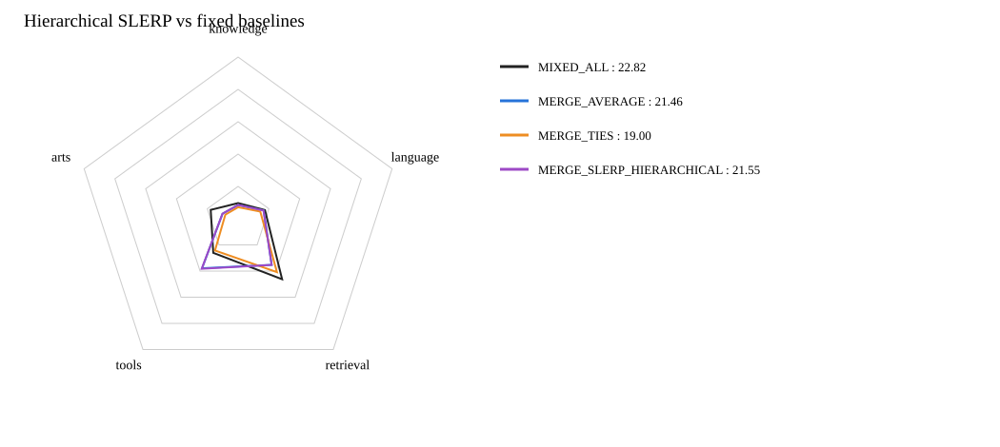

# 四专家分层 SLERP：补充正式评测

**SLERP 公共总分：21.55；相对 MIXED_ALL：-1.27；相对等权平均：+0.09。**

固定树：SLERP(SLERP(Knowledge, Retrieval, 0.5), SLERP(Tools, Arts, 0.5), 0.5)。
这是逐 tensor 的分层 SLERP，结果依赖该固定分组；不是顺序无关的 Multi-SLERP。包含分类头，FP32 计算、最终 BF16 保存，无新增训练。

| 模型 | Knowledge | Language | Retrieval | Tools | Arts | 公共总分 |
|---|---:|---:|---:|---:|---:|---:|
| SPECIALIST_KNOWLEDGE | 12.63 | 14.45 | 17.12 | 36.44 | 7.40 | 17.83 |
| SPECIALIST_RETRIEVAL | 2.71 | 5.17 | 42.58 | 22.91 | 4.21 | 15.17 |
| SPECIALIST_TOOLS | 4.04 | 9.14 | 5.85 | 34.70 | 1.09 | 11.03 |
| SPECIALIST_ARTS | 4.21 | 7.82 | 12.13 | 21.78 | 18.10 | 11.33 |
| MIXED_ALL | 9.69 | 17.44 | 46.26 | 26.08 | 17.78 | 22.82 |
| MERGE_AVERAGE | 8.47 | 16.60 | 35.24 | 37.85 | 10.10 | 21.46 |
| MERGE_TASK_ARITHMETIC | 3.87 | 7.08 | 34.44 | 13.39 | 5.77 | 12.75 |
| MERGE_TIES | 7.14 | 14.40 | 40.81 | 24.29 | 8.27 | 19.00 |
| MERGE_DARE_TASK_ARITHMETIC | 1.56 | 2.88 | 16.55 | 8.67 | 5.38 | 6.58 |
| MERGE_DARE_TIES | 3.83 | 6.40 | 29.77 | 19.22 | 6.33 | 12.75 |
| MERGE_SLERP_HIERARCHICAL | 8.56 | 16.50 | 35.29 | 38.25 | 10.13 | 21.55 |

## 球面插值与线性回退

近共线或零范数采用标准线性回退；以下统计避免把接近等权平均的模型误报为完全不同的方法效果。

```json
{
  "modes": {
    "identical": 342,
    "spherical": 559,
    "linear_collinear": 32
  },
  "comparison_to_average": {
    "different_elements": 249095299,
    "total_elements": 596051968,
    "maximum_absolute_difference": 0.015625
  }
}
```

所有模型使用相同37项公共五维评分，原十个条件直接复用已完成结果；只对新 SLERP 模型重新推理评分，不是私测 Full。


