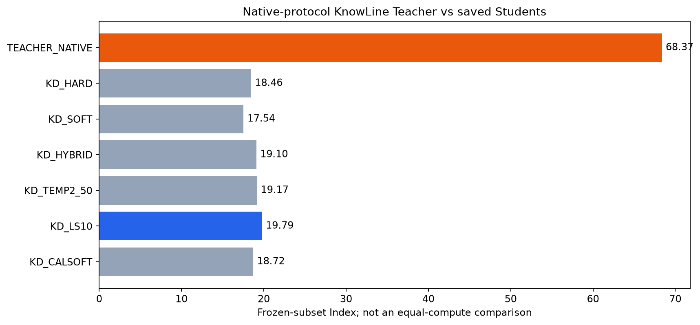

# Teacher原生协议直接评测

**Teacher native Index：68.37；coverage：100.00%；相对LS0.1：+48.58。**

| 模型 | Knowledge | Language | Retrieval | Tools | Arts | Index | coverage |
|---|---:|---:|---:|---:|---:|---:|---:|
| TEACHER_NATIVE | 60.62 | 64.53 | 70.58 | 86.04 | 61.55 | 68.37 | 100.00% |
| KD_HARD | 8.49 | 12.55 | 32.17 | 30.02 | 10.92 | 18.46 | 100.00% |
| KD_SOFT | 9.78 | 9.52 | 27.78 | 33.38 | 8.88 | 17.54 | 100.00% |
| KD_HYBRID | 9.37 | 12.13 | 33.51 | 32.53 | 8.81 | 19.10 | 100.00% |
| KD_TEMP2_50 | 8.77 | 12.19 | 33.85 | 33.92 | 7.75 | 19.17 | 100.00% |
| KD_LS10 | 11.68 | 9.92 | 32.97 | 37.26 | 7.99 | 19.79 | 100.00% |
| KD_CALSOFT | 10.06 | 11.22 | 30.13 | 34.11 | 9.53 | 18.72 | 100.00% |

## 实验意义

Teacher使用原始row.state及row.questions，保留原问题type/instructions/criteria，通过官方KnowLine frontend回答；不把各candidate改写为独立的correct-match二分类。expected/gold/scoring标签从未发给Teacher。
本实验检验Teacher在目标任务原生协议上的能力上界。即便native Teacher更强，也不能自动推出之前独立pair概率足够好；那需要另做协议转换对照。若native Teacher不强，则不应继续假定31B一定能提供优质标签。
这不是等预算模型比较，也不是Student训练或新标注数据生产；不会把这些评测回答用于训练。

## 口径与设置

同37项、4,786完整cases、5,935请求，和Student冻结子集一致；不是完整公共榜单或私测Full。Student参考复用保存的结果，不重新推理。
Teacher原始BF16权重、TP2、triton attention、fp32 LM head、frontend temperature1、read-twice≤3000、原temperatures.json。发布权重已经折叠1.44的readout温度，没有手动改回或重新拟合。原生box渲染使用gemma/yxyx。
原生服务使用8个scoring threads以匹配16CPU资源，HTTP并发32；仅操作新实验自己的服务进程。没有新环境安装、单测、smoke、hash或全局Teacher cache写入。
请求状态计数：`{"ok": 5935}`。超过官方64questions/255criteria限制的请求显式记unsupported，而不是删题或删候选；coverage按实际结果报告。

## 解释边界

原生任务能力与独立candidate-pair二分类能力不是同一个测量。这里不根据模型参数量预设Teacher必须赢，不将coverage不足悄悄隐藏为高分，也不把原训练targets诊断冒充benchmark成绩。

