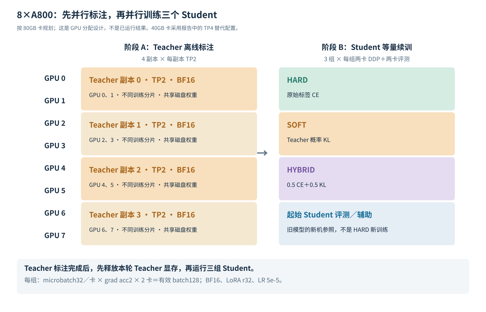

# 8×A800 新机器：Qwen3-0.6B 蒸馏实验完整规划

## 1. 直接采用的方案

**本轮只做融合实验结束后的蒸馏：迁移一个已训练好的 0.6B Student，复用上一阶段训练池，让 KnowLine 31B 离线产生软标签，再训练 HARD、SOFT、HYBRID 三组。** 不重新训练五个专科，不重新做模型融合。

以下按 **8×A800 80GB、Linux x86_64** 安排。若实际是 40GB 卡，按第 9 节降低 microbatch，并将 Teacher 改为每副本 4 卡。

| 部分 | 推荐安排 |
|---|---|
| Teacher | `PelaAI/KnowLine-31B-Gen1`，BF16，约 63 GB 权重 |
| Teacher 标注 | **4 个副本，每副本 TP2，共用 8 张卡** |
| Student | 上一阶段选定的同一个 Qwen3-0.6B checkpoint |
| Student 训练 | **HARD、SOFT、HYBRID 各 2 卡 DDP，同时训练**；其余 2 卡评测起始 Student |
| 每组有效 batch | **32 pair／卡 × grad acc2 × 2 卡＝128 pair** |
| 续训 | LoRA r32/alpha64、BF16、LR **5e-5**，同一训练池完整一遍 |
| 比较 | SOFT−HARD、HYBRID−HARD，以及各组相对起始 Student 的变化 |



## 2. 新机器先准备什么硬件和基础软件

| 项目 | 建议 |
|---|---|
| GPU | 8×A800；本方案默认每卡 80GB |
| 系统 | Ubuntu 22.04／24.04 或其他 glibc≥2.28 的 Linux x86_64 |
| 驱动 | **580 分支或更新**，用于推荐的 CUDA 13 Teacher 镜像；较旧驱动见第 9 节 |
| CPU／RAM | CPU 负责数据准备；RAM 建议 **256GB 起、512GB 更宽裕** |
| 磁盘 | 本地 NVMe 建议 **1TB**；Teacher 约 63GB，另留镜像、原始数据、token 缓存和输出空间 |
| Python | Student 使用 **Python 3.11**；Teacher 主方案使用独立容器 |
| 容器 | Docker＋NVIDIA Container Toolkit；无容器条件时用第 9 节 HF 后端 |
| 通信 | Teacher TP2 优先选择互联较好的卡对；GPU 编号可随实际拓扑调整 |

**A800 是 Ampere：使用 BF16，Student 选 FA2／SDPA fused，Teacher 选 Triton。不要照搬 H800 的 FA3，也不默认用 FP8。** PyTorch wheel 和容器各自带 CUDA runtime；正常运行不要求在宿主机安装两套 CUDA Toolkit，编译额外 CUDA 扩展时才需要对应工具链。

## 3. 模型权重：哪些要下载，哪些必须从旧实验迁移

### 必需资产清单

| 资产 | 从哪里取得 | 具体内容 |
|---|---|---|
| **已训练的 Student checkpoint** | **旧实验机器、你的备份或你自己的模型仓库** | 上一阶段选定的混合模型或某个融合模型，只选一个作为三组共同起点 |
| Student tokenizer／配置 | 与该 checkpoint 一起迁移 | tokenizer、config、标签映射、输入格式；保留训练过的分类头 |
| Qwen3-0.6B 基座 | `Qwen/Qwen3-0.6B`，约 1.2GB | **当 Student 保存为 LoRA adapter 时需要**，版本应与该 adapter 对应 |
| Teacher 全权重 | `PelaAI/KnowLine-31B-Gen1`，约 63GB | 完整模型目录，包含权重、tokenizer、配置和原生概率前端 |
| 可复用软标签 | 旧实验产物，如确有可用版本 | 输入、pair ID 和二分类概率含义与本轮一致时复用 |

**下载官方 `Qwen/Qwen3-0.6B` 不会得到你训练过的 Student。** 它也没有旧实验训练过的分类头。要继续这份“融合之后蒸馏”的实验，必须拿到上一阶段选定的 checkpoint；当前本地报告中的旧路径不是模型文件。

Student 有两种保存形式：

- **Adapter 形式：**迁移 adapter 权重、adapter 配置、已训练分类头和 tokenizer，并准备对应 Qwen 基座。
- **完整／merged 模型：**迁移整个模型目录和 tokenizer，直接作为起点；无需为了加载它额外再下载一份原始基座。

当前本地已能看到 [models/Qwen3-0.6B-common-pair-init-r32/](../../../03-证据与图表/03-专科与融合/共同初始化/Qwen3-0.6B-common-pair-init-r32)，以及 [artifacts/five-specialists-20261030/train/](../../../03-证据与图表/03-专科与融合/five-specialists-20261030/train) 下新同步的部分专科权重。**共同初始化不是训练完成的 Student，专科权重也不自动等于本轮选定起点。** 仍应从上一阶段结束后的结果中指定最终的 `student-parent`。

Teacher 仓库已经是完整权重，**不用再下载 `google/gemma-4-31B-it`**。把 Teacher 仓库中的 `knowline_server.py`、`knowline_layout.py`、`temperatures.json` 等文件一起保留，不只拿权重分片。

### 目录与下载命令

下列命令在**新 A800 机器**执行。把本报告目录复制过去后，先设置：

```bash
export ROOT="$HOME/jev-distill"
mkdir -p "$ROOT/models" "$ROOT/data" "$ROOT/code" "$ROOT/runs" "$ROOT/envs"
```

安装下节的 Student 环境后，使用它提供的 `hf`：

```bash
source "$ROOT/envs/student/bin/activate"

hf download PelaAI/KnowLine-31B-Gen1 \
  --local-dir "$ROOT/models/teacher"

# 仅在 Student 为 adapter、且新机缺对应基座时下载。
hf download Qwen/Qwen3-0.6B \
  --local-dir "$ROOT/models/Qwen3-0.6B"
```

Student 迁移示例，旧地址和路径需替换为实际位置：

```bash
OLD_HOST="user@old-host"
OLD_PARENT="/absolute/path/to/selected-student"
rsync -a --info=progress2 "$OLD_HOST:$OLD_PARENT/" "$ROOT/models/student-parent/"
```

已有 Teacher 权重完整可用时也可直接迁移，避免重新下载。

## 4. 环境怎么配

### 4.1 Student 训练与评测环境

优先采用历史实验用过的训练包版本，PyTorch 改用官方提供的 **CUDA 12.8 wheel**，适用于 A800；与 Teacher 容器分开。

| 组件 | 版本／方式 |
|---|---|
| Python | **3.11** |
| PyTorch | **2.11.0＋cu128** |
| Transformers | **5.5.0** |
| PEFT | **0.18.1** |
| datasets | **4.3.0** |
| accelerate | **1.15.0** |
| huggingface_hub | **1.33.0**，提供 `hf` 命令 |
| pyarrow | **23.0.1** |
| Attention | 先用现成 SDPA fused；已有兼容 FA2 时复用 |
| 其他 | safetensors、numpy、scipy、scikit-learn、pandas、pyyaml、tqdm、httpx、requests |

随报告提供了 [requirements-student.txt](../../../../jev-辅助归档/2026-11-09整理/辅助文件/reports/a800-8gpu-distillation-20261031/requirements-student.txt)。假设本机已有 Python 3.11，将文件放到新机 `$ROOT/code/` 后执行：

```bash
python3.11 -m venv "$ROOT/envs/student"
source "$ROOT/envs/student/bin/activate"
python -m pip install --upgrade pip
python -m pip install 'torch==2.11.0' \
  --index-url https://download.pytorch.org/whl/cu128
python -m pip install -r "$ROOT/code/requirements-student.txt"
```

**不必为了开始这轮实验安装 Unsloth、DeepSpeed、FSDP 或 vLLM。** 0.6B 的 LoRA 续训用普通 DDP 即可。FA2 优先复用匹配当前 PyTorch 的现成包；没有时先使用 SDPA，不把编译新 attention 扩展作为启动前提。

### 4.2 Teacher 推荐环境：独立 SGLang 容器

| 组件 | 推荐版本／方式 |
|---|---|
| 镜像 | **`lmsysorg/sglang:v0.5.21-cu130`** |
| SGLang | **0.5.21** |
| 对应软件组合 | 作者文档／该版本依赖使用 PyTorch **2.13.0**、Transformers **5.12.1**、CUDA **13.0** |
| Teacher 权重 | BF16，不做 FP8 量化 |
| A800 attention | **`triton`** |
| 并行 | 每副本 **TP2**，4 副本 |

```bash
docker pull lmsysorg/sglang:v0.5.21-cu130
```

采用现成镜像，不让 Teacher 安装过程升级 Student 的 PyTorch 和 Transformers。没有 Docker 或驱动不适合 CUDA 13 时，使用第 9 节的原生 Transformers 后端。

## 5. 数据：优先迁移处理池，不重新建设五科数据

### 5.1 这次真正必需的数据

| 数据资产 | 本轮用途 | 准备方式 |
|---|---|---|
| **上一阶段最终训练池** | 三组共同的 `D_DISTILL` | 从旧实验复制处理后的 train，不只复制原始下载文件 |
| 原始标签 | HARD 和 HYBRID 的监督 | 与 train 一起保留；包含人工、程序 gold 或来源已有监督 |
| pair／原题／来源／方向映射 | 关联软标签，拆分五方向结果 | 随训练池迁移 |
| Student 编码缓存 | 避免重复 tokenization | 复用原 tokenizer 和编码方式对应的缓存 |
| dev／留出集 | 观察续训与关键任务表现 | 沿用上一阶段划分，不与 train 合并 |
| 冻结的五方向评测请求 | 对比起始 Student 与三组新结果 | 连同原评分程序、分类 Engine 迁移 |
| Teacher 二分类软标签 | SOFT 和 HYBRID 的监督 | 已有语义一致的直接使用，否则对同一训练池生成 |

旧缓存能迁移时，**不需要为了蒸馏重新下载所有五科原始数据**。这也是新机器最快进入有效实验的方式。

建议落盘为以下逻辑结构，实际可以沿用旧工程原有格式：

```text
data/distill/
  train.*                 # 原始训练正文／候选／原始标签
  dev.*                   # 已有验证划分
  pair-mapping.*          # pair_id、原题组、source、area
  student-cache/          # input_ids、attention_mask 等
  teacher-probs.*         # pair_id、P(match)、P(non-match)
data/eval/                # 同一冻结评测请求与分组
```

### 5.2 缓存确实拿不到时，原始数据从哪里补

**以下是补下载清单，不是要求重新加入所有来源。仅恢复上一阶段确实使用过的部分。** 原缓存丢失、只能重建时，三组统一使用新整理的 `D_DISTILL`，不把它声称为原缓存的逐条复现。

| 数据／方向 | 下载位置 | 训练选择 |
|---|---|---|
| Tasksource 主底池 | [`tasksource/zero-shot-label-nli`](https://huggingface.co/datasets/tasksource/zero-shot-label-nli) | **default／train**，原始约 190 万 pair；不使用 triplet |
| Knowledge | [`openai/gsm8k`](https://huggingface.co/datasets/openai/gsm8k)、[`allenai/winogrande`](https://huggingface.co/datasets/allenai/winogrande)、[`allenai/ai2_arc`](https://huggingface.co/datasets/allenai/ai2_arc)、[`tau/commonsense_qa`](https://huggingface.co/datasets/tau/commonsense_qa) | `main/train`、`winogrande_xl/train`、ARC 两个配置的 train、CommonsenseQA train；其他来源按旧清单恢复 |
| Language：HF 来源 | [`facebook/anli`](https://huggingface.co/datasets/facebook/anli)、[`Rowan/hellaswag`](https://huggingface.co/datasets/Rowan/hellaswag) | ANLI 的 train_r1/r2/r3，HellaSwag train |
| Language：官方文件 | [ContractNLI](https://stanfordnlp.github.io/contract-nli/)、[ACOS](https://github.com/NUSTM/ACOS)、[iSarcasmEval](https://github.com/iabufarha/iSarcasmEval)、[VAST](https://github.com/emilyallaway/zero-shot-stance)、[NLI4CT](https://github.com/ai-systems/Task-2-SemEval-2024)、[RAGTruth](https://github.com/ParticleMedia/RAGTruth)、[SEntFiN](https://github.com/pyRis/SEntFiN) | 只恢复原训练部分；当前本地已有这些来源的多份原始文件，可随项目复制 |
| Retrieval：意图 | [`PolyAI/banking77`](https://huggingface.co/datasets/PolyAI/banking77)、[`clinc/clinc_oos`](https://huggingface.co/datasets/clinc/clinc_oos) | BANKING77 train；CLINC **plus/train** |
| Retrieval：相关性 | [Amazon ESCI](https://github.com/amazon-science/esci-data)、[HoVer](https://github.com/hover-nlp/hover) | ESCI 训练 query-product pair＋products；HoVer 训练 claim＋配套文档 |
| Tools | [`nvidia/When2Call`](https://huggingface.co/datasets/nvidia/When2Call)、[`liminghao1630/API-Bank`](https://huggingface.co/datasets/liminghao1630/API-Bank)、[`glaiveai/glaive-function-calling-v2`](https://huggingface.co/datasets/glaiveai/glaive-function-calling-v2) | When2Call **train_sft/train**，按旧清单决定是否保留 train_pref；API-Bank training-data；Glaive train |
| Arts | [`SemEvalWorkshop/humicroedit`](https://huggingface.co/datasets/SemEvalWorkshop/humicroedit)、[`jmhessel/newyorker_caption_contest`](https://huggingface.co/datasets/jmhessel/newyorker_caption_contest) | **subtask-2/train**；**matching/train、fold0**，使用文本，不混不同 fold 的训练视图 |
| 其他已用补充／程序数据 | 上一阶段本地数据和生成产物 | 优先直接复制；不能靠重下一个 HF 仓库恢复旧程序数据 |

Tasksource 补下载命令：

```bash
source "$ROOT/envs/student/bin/activate"
hf download tasksource/zero-shot-label-nli --repo-type dataset \
  --include 'data/*' 'README.md' \
  --local-dir "$ROOT/data/raw/tasksource-zero-shot-label-nli"
```

其他 HF 来源使用相同方式，例如：

```bash
hf download facebook/anli --repo-type dataset \
  --local-dir "$ROOT/data/raw/anli"
hf download Rowan/hellaswag --repo-type dataset \
  --local-dir "$ROOT/data/raw/hellaswag"
```

下载整个仓库可能同时得到 train/dev/test；转换时仍只选择表中的训练部分。若重建 Tasksource default，原始标签 `{0,2}` 需按语义映射到最终 Student 的 `{0,1}`，不是直接交给二分类头。

**标签顺序沿用最终 checkpoint。** 本次已看到的新五科共同初始化配置为 `0=not_match、1=match`；若最终模型沿用该配置，Tasksource 原标签应映射为 `{0:1, 2:0}`。这与旧 R0 报告的类别顺序不同，不沿用旧顺序硬填。

## 6. 代码也要迁移，不能只装包和下载模型

| 代码／资产 | 需要的内容 |
|---|---|
| Student 加载器 | 正确加载旧 adapter／完整权重及已训练 score 头 |
| PairEncoder／数据转换 | 沿用原 premise＋hypothesis 的编码与标签语义 |
| 训练入口 | DDP、LoRA＋score 训练、保存和继续加载 |
| 三种 loss | HARD：CE；SOFT：KL；HYBRID：0.5 CE＋0.5 KL，均按实际 pair 数平均 |
| Teacher 标注器 | 把 pair 转成原生 yes/no 请求，按 pair_id 保存概率；支持分片与接续 |
| 评测工程 | Decision Index kit、冻结 suite、已有自定义分类 Engine、评分和汇总脚本 |

**规划、结果归档和若干 checkpoint 不等于完整可启动的训练工程。** 应从旧机器一并迁移上述代码；没有旧代码时，需要补齐这些入口，不能假定装完 requirements 就已经有一个可运行的 `train_distill.py`。新机优先使用正常的 **NCCL／DDP GPU 通信**，不把旧机器临时采用的 CPU 梯度同步路径原样带过来。

Decision Index 公共代码来自 [`apolinario/decision-index`](https://github.com/apolinario/decision-index)。优先迁移原 kit 与 suite；只缺源码时可补下载：

```bash
git clone https://github.com/apolinario/decision-index "$ROOT/code/decision-index"
source "$ROOT/envs/student/bin/activate"
python -m pip install -e "$ROOT/code/decision-index"
```

新的 kit 下载不替代旧冻结请求或你的自定义分类 Engine。评测继续使用原来的请求与评分方式，而不是重新生成另一套测试后混用旧成绩。

分类 Engine 的候选分数应为 **`logit(match) − logit(non-match)`**，类别索引从最终模型的标签映射取得，不固定照抄旧代码的 `logit[0]−logit[1]`。

## 7. Teacher 标注：8 卡怎么用，服务怎么启动

### 7.1 A800 80GB 推荐配置

Teacher 每副本使用两卡，四个独立副本读同一份磁盘权重，对 `D_DISTILL` 的不同分片标注。

| 副本 | GPU | TP | SGLang 端口 | 原生前端端口 |
|---|---|---:|---:|---:|
| 0 | 0、1 | 2 | 9080 | 8080 |
| 1 | 2、3 | 2 | 9180 | 8180 |
| 2 | 4、5 | 2 | 9280 | 8280 |
| 3 | 6、7 | 2 | 9380 | 8380 |

这样每卡只承担约一半 Teacher 权重，给 KV cache 和计算工作区留余量，不强行让 31B 在单卡 80GB 上高并发运行。

### 7.2 启动一个两卡副本的命令

作者默认启动脚本采用单卡。这里手动启动 **TP2 后端＋原生概率前端**，不直接套用单卡 wrapper。

```bash
docker run -d --name jev-teacher-0 \
  --gpus '"device=0,1"' --ipc=host --network host \
  -v "$ROOT:/work" -w /work \
  lmsysorg/sglang:v0.5.21-cu130 \
  python -m sglang.launch_server \
  --model-path /work/models/teacher \
  --served-model-name m \
  --tp-size 2 --dtype bfloat16 \
  --attention-backend triton --enable-fp32-lm-head \
  --mem-fraction-static 0.85 \
  --context-length 16384 --max-running-requests 16 \
  --host 127.0.0.1 --port 9080

docker exec -d jev-teacher-0 \
  python /work/models/teacher/knowline_server.py \
  --model /work/models/teacher \
  --backend sglang --url http://127.0.0.1:9080 \
  --served-model-name m --temperature 1 \
  --temperatures /work/models/teacher/temperatures.json \
  --workers 16 --host 127.0.0.1 --port 8080
```

第二条命令在后端模型加载完成后执行。其余三个副本按表修改容器名、GPU 和两个端口；每个副本只处理自己的训练分片。

这里的 16,384 是 **Teacher 训练数据标注服务**的上下文配置，不是正式 benchmark 的截断长度；训练请求若超出它，应增加服务容量或调整既定输入处理，而不是在服务端静默裁剪。

### 7.3 软标签怎样生成

每个最终训练 pair 对应一个独立 yes/no 判断，保存：

```text
pair_id、area、source、原始label、P(match)、P(non-match)
```

计算 KL 时按 Student 类别顺序组成概率向量：若 `id2label` 是 `0=not_match、1=match`，则使用 **`[P(non-match), P(match)]`**，不是反过来。

- Teacher 和 Student 使用相同的可见正文；Student 训练前删掉的内容不额外喂给 Teacher。
- 使用原生概率前端，保留作者 read-twice 与温度处理；不生成长段思维链后再解析答案。
- Teacher 已将 **1.44** 温度折入权重，前端 temperature 保持 **1**，不重复缩放。
- 固定请求分组方式，再按长度组织批量请求；共享正文可复用前缀，三组 Student 最终仍对应同一批 pair。
- 一次生成完整软标签缓存，供 SOFT 和 HYBRID 共用。缺失项补齐，不只挑 Teacher 高置信度或答对的题。

本轮不要求保存 Teacher 隐藏层或全词表 logits，两类概率已经足够。旧 9,998 对标注只有在输入和二分类概率语义一致时复用，不作为正式规模上限。

## 8. 三组 Student 续训：固定两卡一组

Teacher 标注完成、软标签落盘后，停止**本轮创建的 Teacher 副本**，释放权重和 KV cache 占用，再切换为 Student 训练。仅停止下面这些本轮容器，不影响机器上其他任务：

```bash
docker stop jev-teacher-0 jev-teacher-1 jev-teacher-2 jev-teacher-3
```

若采用 HF 后端，则退出本轮对应的 Teacher 进程。Teacher 不做前向但仍驻留显存，不算已经释放。随后使用：

| 任务 | GPU | 每卡 microbatch | Grad acc | 有效 batch |
|---|---|---:|---:|---:|
| HARD | 0、1 | 32 | **2** | **128** |
| SOFT | 2、3 | 32 | **2** | **128** |
| HYBRID | 4、5 | 32 | **2** | **128** |
| 起始 Student 的新机评测／辅助任务 | 6、7 | 按评测组织 | — | — |

**两卡训练不能继续照抄单卡的 grad acc4，否则有效 batch 会变成 256。** 各 DDP 作业使用独立通信端口，例如 29500、29600、29700。GPU6–7 在新机重评起始 Student，得到相同硬件环境下的未续训参照。

| 训练项 | 本轮设置 |
|---|---|
| 共同起点 | 同一份 `student-parent`，分类头不重新随机初始化 |
| 模型与微调 | Qwen3-0.6B 二分类，LoRA **r32/alpha64**，score 一起训练 |
| 精度 | BF16，不使用 4-bit／FP8 Student 训练 |
| 学习率 | **5e-5**，三组相同 |
| 优化器 | AdamW、cosine、warmup 3%、weight decay 0.01 |
| 长度 | 沿用旧处理方式，通常 max_length4096，三组相同 |
| 梯度 checkpointing | 新机首轮采用 **On** 作为稳定起点；显存充分且高效路径成熟后再统一关闭 |
| 数据组织 | 长度分桶＋动态 padding；成熟 FA2／varlen 可复用，packing 保留逐 pair 独立读出 |
| 训练量 | 三组同一训练池完整一遍，实际非 padding tokens 相同 |
| HARD | 原始标签 CE |
| SOFT | Teacher 二分类分布 KL |
| HYBRID | **0.5 CE＋0.5 KL** |
| 归一化 | CE、KL 均按 pair 平均；动态 microbatch 不改变样本权重 |

优先继承旧 Student 的训练结构。若只有完整 merged 权重，可在这份相同模型上为三组建立相同的 r32 适配结构；不需要恢复旧 optimizer，三组都用新的 optimizer 开始续训。

首轮先用一个共同 seed 完成三组。主结果有收益时，SOFT／HYBRID 与 HARD 一起补到三个续训 seed，而不是只给赢家增加训练。

## 9. 两种常见机器差异的调整

### 如果是 A800 40GB

- Teacher 改为 **2 个副本×每副本 TP4**：GPU0–3、GPU4–7。起步使用 context8192、max-running-requests8、BF16＋Triton；长输入需要时相应增加容量。
- Student 仍然三组各两卡，改为 **每卡 microbatch16 × grad acc4 × 2 卡＝128**，保留梯度 checkpointing。
- 不为了把 Teacher 塞进单卡而临时改成另一种量化模型。

### 如果宿主机不能使用 CUDA 13 镜像

保留 Student 的 CUDA12.8 环境。Teacher 可另建 **Transformers 原生后端**环境，使用同一权重和同一原生前端；这是较慢但不依赖 SGLang 的替代方案。建议驱动支持 CUDA12.8 对应运行环境；若机器驱动很旧，使用管理员提供的适配环境，不直接套本组新版本。

```bash
python3.11 -m venv "$ROOT/envs/teacher-hf"
source "$ROOT/envs/teacher-hf/bin/activate"
python -m pip install --upgrade pip
python -m pip install 'torch==2.11.0' \
  --index-url https://download.pytorch.org/whl/cu128
python -m pip install -r "$ROOT/code/requirements-teacher-hf.txt"

CUDA_VISIBLE_DEVICES=0,1 python "$ROOT/models/teacher/knowline_server.py" \
  --model "$ROOT/models/teacher" --backend hf \
  --temperatures "$ROOT/models/teacher/temperatures.json" \
  --temperature 1 --workers 1 --host 127.0.0.1 --port 8080
```

[requirements-teacher-hf.txt](../../../../jev-辅助归档/2026-11-09整理/辅助文件/reports/a800-8gpu-distillation-20261031/requirements-teacher-hf.txt) 已随报告提供。HF 后端使用 `device_map=auto`，不是 SGLang 的 TP2，不能套用前面的并行吞吐预期。一轮标注固定使用一种后端，不把两种后端的概率随意混在一起。

## 10. 评测、耗时与交付

新机上比较 **起始 Student＋HARD＋SOFT＋HYBRID**，沿用原五方向、37 项评测和同一分类 Engine。正式评测保持全部输入与候选，不用训练长度4096裁剪评测。

主要结果：

1. **SOFT−HARD、HYBRID−HARD：**Teacher 监督相对原始标签的增益。
2. **三组各自减起始 Student：**新增本轮训练带来的提升或退化。
3. 五维雷达图、逐 benchmark 差值热力图、公开总分柱状图。
4. Teacher 标注耗时、Student 有效 tokens/s、训练时间和同硬件推理成本。

单模型推理耗时在 Teacher 和训练作业结束后统一测量，避免把并行任务干扰误算成蒸馏提速。

若一遍训练为 `T` 个实际 tokens，三组共新增 **3T**。训练 wall time按每组两卡合计有效吞吐估算，Teacher 时间单列。不要用旧 H800 吞吐保证 A800 的完成小时数，也不把旧两小时小跑限制套到这轮充分数据实验。

### 最简执行顺序

1. **把选定 Student、处理后的训练池、评测资产和旧训练代码迁到新机。**
2. **创建 Student 环境，准备 Teacher 镜像，下载缺少的模型权重。**
3. **8 卡完成 Teacher 离线标注，生成同一份软标签缓存。**
4. **三组各两卡同时续训，另两卡评起始 Student。**
5. **用同协议评测三个新模型，输出四组对照与图表。**

本报告是 [原蒸馏规划](../next-experiments-plan-20261030/REPORT.md) 的新机落地版；不安排重训专科或重新融合。本次只整理环境和执行方案，未连接新机、未安装这些环境、未下载大权重或启动作业。

### 配置依据

- [KnowLine 原生推理说明](https://huggingface.co/PelaAI/KnowLine-31B-Gen1/blob/main/INFERENCE.md)：权重、概率前端、温度与作者环境。
- [SGLang 镜像](https://hub.docker.com/r/lmsysorg/sglang/tags?name=v0.5.21-cu130)、[Gemma4 后端选择](https://github.com/sgl-project/sglang/blob/v0.5.21/python/sglang/srt/arg_groups/model_overrides/gemma4.py)：独立 Teacher 容器与 Triton 路径。
- [PyTorch 官方 CUDA12.8 wheel 索引](https://download.pytorch.org/whl/cu128/torch/)、[NVIDIA 驱动兼容说明](https://docs.nvidia.com/deploy/cuda-compatibility/minor-version-compatibility.html)：PyTorch 安装与 CUDA13 驱动要求。
- [FlashAttention 官方说明](https://github.com/Dao-AILab/flash-attention)：FA2 支持 Ampere，FA3 面向 Hopper。
- [本项目现有 Language 原始来源](../../../03-证据与图表/02-Language/language-axis/manifest.json)、[五方向数据规划](../../03-专科与融合/five-area-training-plan.md)：旧数据资产与补下载来源对照。
