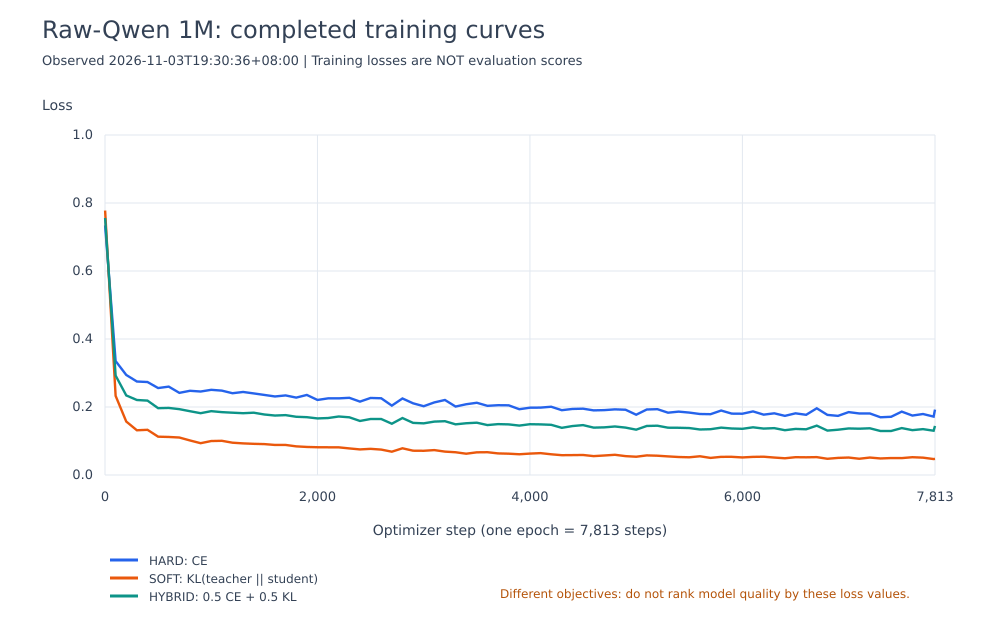

# 原始Qwen蒸馏：已完成的训练过程记录

**观测时间：2026-11-03T19:30:36+08:00。最终质量结果见[REPORT.md](../../../../01-研究结论/01-蒸馏/a800-kd-raw-qwen-1m-20261103/report/REPORT.md)。**

原始Qwen3-0.6B＋共用未训练LoRA/head；严格复用原1M样本、顺序、Teacher概率和冻结评测。

| 组别 | 当前阶段 | steps／请求 | pairs |
|---|---|---:|---:|
| KD_HARD | 训练已完成 | 7,813/7,813 | 1,000,000 |
| KD_SOFT | 训练已完成 | 7,813/7,813 | 1,000,000 |
| KD_HYBRID | 训练已完成 | 7,813/7,813 | 1,000,000 |
| RAW BASELINE | 评测已完成，Index 1.76 | 5,935/5,935 | — |

RAW BASELINE接的是未训练随机分类头，其分数不能当作原始Qwen的zero-shot语言能力。

## 训练曲线

三条曲线对应不同loss定义，不能据此直接比较模型质量。效果以训练后评测的SOFT−HARD/HYBRID−HARD及与warm-start的交互差值为主。

完整日志提取与进度JSON：[training-progress-snapshot.json](../../../../03-证据与图表/01-蒸馏/a800-kd-raw-qwen-1m-20261103/report/training-progress-snapshot.json)。
最终报告由原watcher保存至同目录的REPORT.md；本记录保留其明确的观测时间。
