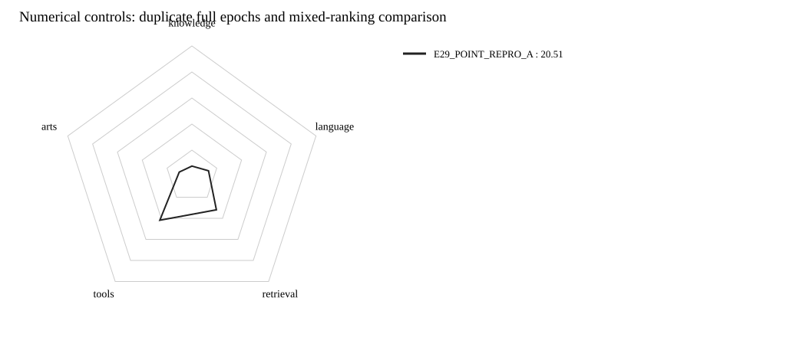

# 第九波：数值控制后的完整重复与混合排序对照

历史最高单次23.96，但相同配方重跑为20.51；不能把23.96当作已经稳定复现的机制收益。
本波正式评分完成1/4；未评分方案不作质量判断。

| 模型 | Knowledge | Language | Retrieval | Tools | Arts | 公共总分 | 覆盖率 |
|---|---:|---:|---:|---:|---:|---:|---:|
| E29_POINT_REPRO_A | 7.74 | 13.38 | 31.92 | 41.82 | 10.19 | 20.51 | 100.00% |

## 重复轨迹观察（不是权重逐位证明）

| 条件 | 已记录progress窗口 | 窗口数值是否一致 | 首个不同窗口step |
|---|---:|---|---:|
| point | 392 | 是 | — |
| mixed | 392 | 是 | — |

## 控制及边界

- 四组都是完整100万pair、seed42、LR1e-4、batch128、一遍、7813步，原始Qwen及共享未训练r32／分类头起点；不从旧模型继续。
- point A/B无关系辅助；mixed A/B保持gamma0.5、lambda0.05。精确复用旧atomic计划、E06有效目标、3647关系与Teacher相对数组，不新增Teacher标注。
- runner在Python／CUDA启动前设置CUBLAS_WORKSPACE_CONFIG=:4096:8和FLASH_ATTENTION_DETERMINISTIC=1；trainer显式启用严格Torch deterministic algorithms。
- 新进程内FA3包装强制deterministic=True，并核验native backward实际参数；未改旧适配器或kernel，不允许SDPA／FA2回退。未知／不支持的确定性算子明确blocked。
- 实际backward计数非零才证明该参数进入了真实训练；仅设置开关、静态审查或文档不能替代运行证据。
- 本波改变的是一组数值控制，不是只改FA3；即使重复性改善也不能由此断言过去唯一根因。与历史23.96比较不是同数值regime。
- 报告只比较记录的loss窗口、macro梯度范数及正式分数，没有做文件／模型哈希，不证明全部权重逐位相等，不从两次同seed观测估计方差或统计显著。
- FA3执行计数随checkpoint累计恢复，完成记录另列当前进程计数；调用数审计与loss／梯度轨迹判等分开，避免把恢复后的计数归零误判为训练数值分叉。
- 正式评测仍用原37项wrapper；若训练记录一致而分数不同，还需定位推理／评分链路，不宣称全流程已经可复现。
- 无额外测试、烟测、哈希、依赖安装或模型下载；中间checkpoint在独立scratch，final／评分／报告NFS，旧结果不动。

