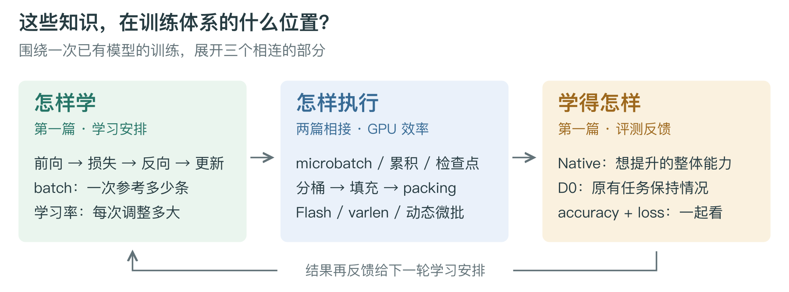
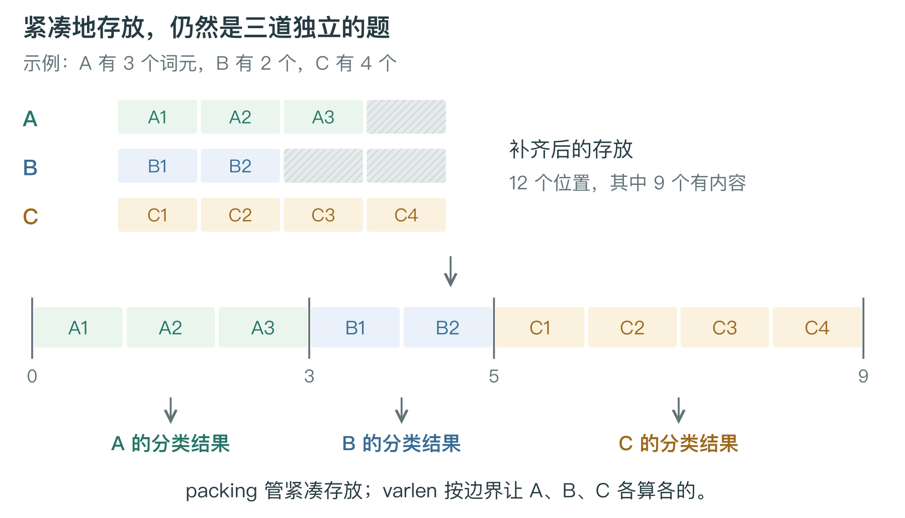

# 第二篇｜同样的训练，怎样跑得更高效

第一篇讲清了模型怎样学习。这一篇接着看训练流程里的 GPU 执行部分：学习任务已经确定，怎样让显卡少花时间在空位上，让注意力计算更利索，并且让长短不同的样本都能得到合适的处理。

这些技术可以沿着一条线理解：**先把样本组得更合适，减少补齐；再把计算做得更高效；进一步把空位从存储和计算里移出去；最后按工作量调整每趟装多少。** 它们分别改变不同环节，因此可以组合使用。

## 先把数据摆好：分桶和动态填充是一套配合

沿用第一篇的例子，三条文本分别有 100、200、1000 个 tokens。普通批处理把每条文本放在独立的一行，并要求这些行一样长。于是三行都占 1000 个位置：第三行正好装满，前两行的大部分位置只能填空。这些空位就是 padding。

**长度分桶决定“谁和谁放在同一批”，动态填充决定“这一批每行补到多长”。** 分桶会尽量让短文本和短文本一起、长文本和长文本一起；动态填充则看当前批里最长的一条，其他样本只补到这个长度。两者配合，才能把“找到了合适的同伴”真正变成“少补一些空位”。

你的当前做法正是这套组合：先拿出 **1024 条样本作为一个局部窗口**，在窗口里寻找长度接近的组合，每个 microbatch 放 **32 条**，再补到当前微批的最长长度，并对齐到 **8 的倍数**。例如最长 205，就补到 208；最长 2807，就补到 2808。

这个 1024 条窗口可以理解为挑选同伴的范围。范围里有更多候选，就更容易凑出长度相近的 32 条，同时也不用把整个训练集完全排成从短到长。对齐到 8 则是最后再把边缘修整一下，给计算提供更规整的形状。

分桶以后仍有 padding 很正常：同一批的长度只能接近，不会恰好一样；少见的超长样本也不容易找到足够多的同伴。你两次完整训练序列里的 **20.6% 和 22.6% padding**，说明这套方案已经做过整理，仍留下了大约五分之一的位置空间可以继续研究。

这里也就能分清三件事：分桶让各行原本的长度更接近，动态填充让每批只补到需要的长度，而下一步的 packing／去填充，会进一步改变“每条样本必须占一整行”的存放方式。

## 再看计算本身：Flash 怎样让注意力更快

数据摆好之后，模型开始计算。Transformer 里一个重要环节是**注意力**：当前词元应该从哪些词元那里取信息，各取多少。你看到的 Q、K、V，可以简单理解为当前要找什么、其他位置提供什么线索，以及真正取回什么内容。**SDPA 是这类注意力运算的名称，Flash 是把它高效算出来的一套方法，cuDNN 则提供了你当前使用的底层实现。**

用一个直观画面理解普通注意力：先做一张很大的“词元之间关系表”，再把这张表加工成权重，最后据此汇总信息。序列越长，关系表越大。除了计算本身，把大型中间结果写进显存、再读回来，也会花很多时间和空间。

Flash 的思路是分块处理，边算边汇总，尽量在 GPU 内部较快的小块存储里完成局部工作，避免把完整的大关系表反复搬进搬出。**少保存大型中间结果，就能省显存；少搬运这些结果，就能省时间。** 它保留了原来的注意力计算含义，所以可以作为执行方式的优化接进训练。

这也解释了它的作用范围：Flash 改善的是注意力怎么执行，长文本需要处理的大量词元关系仍然存在；而且模型还有前馈网络、投影、归一化等其他计算。即使注意力已经很快，padding 仍可能经过其他部分，消耗资源。

你现有的 profile 已经确认，三种代表性输入的前向和反向都走了 **cuDNN Flash 类内核**。所以，Flash 已经是当前执行路径的一部分。继续做去填充，是顺着数据布局再往前优化；两者能够配合。

## 把空位挤掉：packing、varlen 和样本边界是一件连贯的事

下面用三条很短的样本说明，长度分别是 3、2、4。普通批处理要把三行都补到 4，总共占 12 个位置；真实内容只有 9 个。去掉空位，再把三条样本紧凑地放在一起，就只需要存这 9 个真实词元。

**packing 解决怎样紧凑存放，varlen 让注意力按真实长度和样本边界来计算。** 图里的 A、B、C 虽然挨着存放，仍然是三道独立的题。给内核一份边界说明，它就知道哪里是一条样本的开头和结尾。这个例子的边界写成 `[0, 3, 5, 9]`，意思是从 0 开始，走到 3 结束 A，走到 5 结束 B，走到 9 结束 C。这就是常见的 `cu_seqlens`，把它理解为一份分段目录即可。

最关键的关系是：**存放在一起，计算时仍各算各的。** 因果遮挡要求每条样本内部只能看当前位置及之前的内容；padding 遮挡要求空位不能被当作真实内容；样本隔离要求 B 不能因为排在 A 后面，就偷偷读到 A。仅有“只能看前文”的规则，挡不住 B 看前面的 A，因此打包之后必须把样本边界交给计算过程。

插入 EOS、SEP 这类分隔符，像在两道题之间写一条分割线，能表达“这里结束了”，但不会自动建立禁止跨题阅读的屏障。给每条样本重新从 0 编位置编号，也只是恢复各题自己的坐标；真正的隔离仍由边界和注意力执行方式负责。

对你的分类任务，这份边界还要一直保留到输出端。**A、B、C 各自要产生一个分类结果，分别对照自己的标签。** 如果原来用每条样本最后一个有效词元来分类，打包后就分别找到 A、B、C 的结尾，而不能只取整条打包序列的最后一个位置。样本在内存里连起来了，三个答案仍然要分别交出来。一个句对若共同构成一道分类题，边界就包住整个句对，保留题目内部原本的信息联系。

样本的权重也一样：原来每题一票，打包以后仍每题一票，长题不会因为占的位置多就自动拥有更多话语权。边界、输出和权重都保留下来，改变的才是数据的组织与执行方式。

接下来要看去填充覆盖多远。一种实现只在注意力内部临时去掉空位，算完再放回原来的长方形；其他层仍处理带空位的张量。另一种实现让模型主干全程保持紧凑存储，前馈网络等部分也只处理真实词元。**前者省掉注意力里的部分空位工作，后者能覆盖更多层的空位工作。** 固定容量的打包块尾部还可能剩一点空位，所以看到 packing 这个名字时，要看它具体采用哪种布局、接通了哪些层。

至于 `seqlen_q/k/v`、`max_seqlen` 这些参数，它们就是这份长度说明书的一部分。上例总共存了 9 个词元，最长的一条样本却只有 4 个；总量、最长单条和各段边界，描述的是不同信息。它们要忠实描述数据，不能把数字调小来省算力；能去掉的是没有内容的空位，真实内容要完整保留。

## 每趟装多少，也应该跟着文本长短变化

前面的分桶、填充和 packing，主要围绕数据怎样摆。另一个维度是每趟给 GPU 多少工作，这就是**动态 microbatch**要处理的问题。

固定每趟 32 条，只固定了题目数量。32 条每条补到 208，和 32 条每条补到 2808，词元位置数相差 **13.5 倍**。显卡遇到的工作量很不一样：短文本批次可能还装得下更多，长文本批次却可能撑满显存。

动态 microbatch 的做法就是**短文本多装一些，长文本少装一些**。可以先给每趟设置一个大致的词元预算，凑到预算附近就处理。仍用长方形布局时，预算要把 padding 占的位置算进去；主干已经全程去填充时，真实词元总数更能反映很多层的工作量。长序列的注意力还会额外增加词元之间的关系计算，所以最终仍要结合实际显存和耗时来选。

这时候，第一篇的有效 batch 又接回来了。你可以继续让一次更新参考 128 条，只改变中间的拆法。举个例子，原来是 `32 + 32 + 32 + 32`，现在根据长度拆成 `64 + 32 + 24 + 8`；各趟累积完，仍只更新一次模型。

但大小不同的微批不能简单地每批算一票。64 条所在的一趟，应该汇总 64 条样本的影响；8 条所在的一趟，汇总 8 条的影响。**最终每条样本的话语权保持一样，不能因为最后一趟人少，就让其中每条样本被额外放大。** 这也是动态调度与学习目标之间的连接：可以灵活搬运题目，原来的评分规则继续保留。

最后，把实际收益落回完整训练。20.6% 或 22.6% 的 padding，告诉你还有多少空位；它不能直接换算成同样比例的加速，因为训练里还有参数更新、数据准备，以及已经由高效内核省掉的部分工作。可以把当前方案作为起点，分别尝试动态 microbatch 和 packing，先确认每条样本的分类结果、损失和梯度保持原来的含义，再比较每秒真实词元数和峰值显存。

profile 在这里像看机器内部的慢镜头，帮助你确认实际跑了哪些内核、时间花在哪。不修改权重，也能执行前向和反向来观察这些过程；但要知道整场训练快了多少，计时就需要覆盖数据准备、前向、反向和参数更新。布局改变以后，再看一次 profile，才能知道新方案实际走上了什么计算路径。

把这些技术放回开头的全景图，就能沿着一条完整的线读下去：**分桶挑同伴，动态填充决定行宽，packing 挤掉空位，varlen 保留各题边界，Flash 高效完成注意力，动态 microbatch 决定每趟装多少。** 它们共同服务于同一场训练，并通过有效 batch、样本权重和最终评测，与模型怎样学习连在一起。
