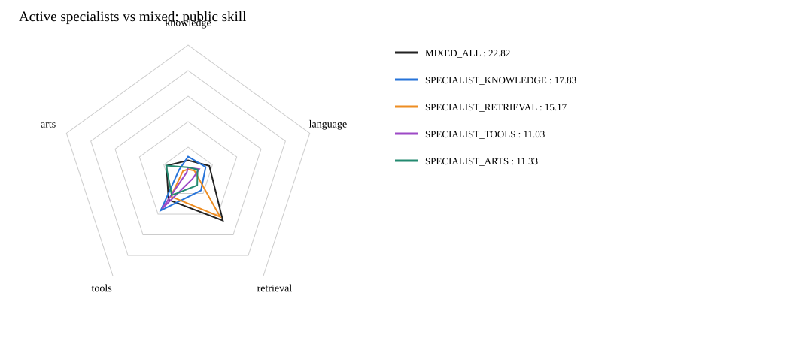
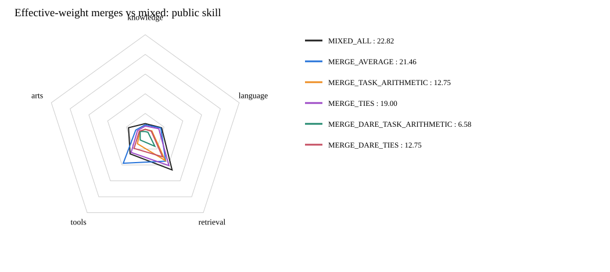

# 四专科、四科混合训练与模型融合结果

| 模型 | Knowledge | Language | Retrieval | Tools | Arts | 公共总分 |
|---|---:|---:|---:|---:|---:|---:|
| SPECIALIST_KNOWLEDGE | 12.63 | 14.45 | 17.12 | 36.44 | 7.40 | 17.83 |
| SPECIALIST_RETRIEVAL | 2.71 | 5.17 | 42.58 | 22.91 | 4.21 | 15.17 |
| SPECIALIST_TOOLS | 4.04 | 9.14 | 5.85 | 34.70 | 1.09 | 11.03 |
| SPECIALIST_ARTS | 4.21 | 7.82 | 12.13 | 21.78 | 18.10 | 11.33 |
| MIXED_ALL | 9.69 | 17.44 | 46.26 | 26.08 | 17.78 | 22.82 |
| MERGE_AVERAGE | 8.47 | 16.60 | 35.24 | 37.85 | 10.10 | 21.46 |
| MERGE_TASK_ARITHMETIC | 3.87 | 7.08 | 34.44 | 13.39 | 5.77 | 12.75 |
| MERGE_TIES | 7.14 | 14.40 | 40.81 | 24.29 | 8.27 | 19.00 |
| MERGE_DARE_TASK_ARITHMETIC | 1.56 | 2.88 | 16.55 | 8.67 | 5.38 | 6.58 |
| MERGE_DARE_TIES | 3.83 | 6.40 | 29.77 | 19.22 | 6.33 | 12.75 |

分数为统一公共五维评分，不是私测Full。Language 专家及其训练数据已按用户要求取消；Language 评测仍保留以维持公开总分口径。

