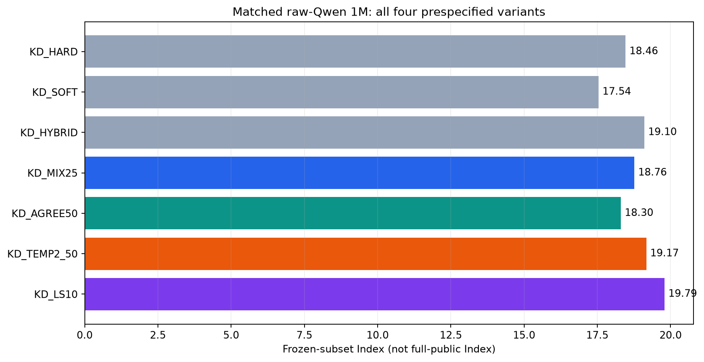
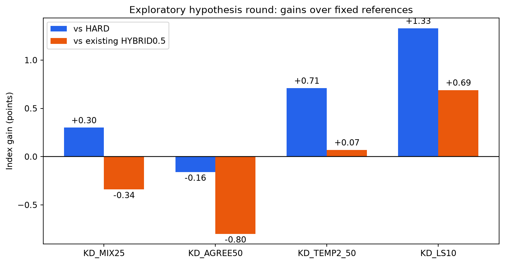

# 蒸馏改进：第一轮假设验证

**所有预先指定的四组均完整报告，不只展示赢家。** 本轮使用已知冻结子集进行探索性模型选择，不是独立held-out确认。

## 完整结果

| 条件 | Knowledge | Language | Retrieval | Tools | Arts | Index | coverage |
|---|---:|---:|---:|---:|---:|---:|---:|
| BASELINE | 0.70 | 0.85 | 1.75 | 1.66 | 7.02 | 1.76 | 100.0% |
| KD_HARD | 8.49 | 12.55 | 32.17 | 30.02 | 10.92 | 18.46 | 100.0% |
| KD_SOFT | 9.78 | 9.52 | 27.78 | 33.38 | 8.88 | 17.54 | 100.0% |
| KD_HYBRID | 9.37 | 12.13 | 33.51 | 32.53 | 8.81 | 19.10 | 100.0% |
| KD_MIX25 | 8.88 | 10.65 | 31.96 | 34.26 | 10.53 | 18.76 | 100.0% |
| KD_AGREE50 | 7.29 | 10.57 | 33.05 | 34.13 | 8.26 | 18.30 | 100.0% |
| KD_TEMP2_50 | 8.77 | 12.19 | 33.85 | 33.92 | 7.75 | 19.17 | 100.0% |
| KD_LS10 | 11.68 | 9.92 | 32.97 | 37.26 | 7.99 | 19.79 | 100.0% |

## 相对固定对照的收益

| 新条件 | vs HARD | vs HYBRID0.5 | vs LS0.1 |
|---|---:|---:|---:|
| KD_MIX25 | +0.30 | -0.34 | -1.03 |
| KD_AGREE50 | -0.16 | -0.80 | -1.49 |
| KD_TEMP2_50 | +0.71 | +0.07 | -0.62 |
| KD_LS10 | +1.33 | +0.69 | +0.00 |

## 本轮假设与目标函数

- MIX25：0.75CE＋0.25KL(T1)，检验Teacher权重过大。
- AGREE50：(1−0.5w)CE＋0.5wKL，w为Teacher与原标签方向一致指示；冲突时回到完整CE，不丢样本，不改原始连续标签。改善也可能来自平均KD强度降低，不能单独归因于过滤。
- TEMP2_50：0.5CE＋0.5×4KL(q_T||p_T)，T2。对缓存二类概率重新温度缩放，不声称恢复原始LM vocabulary logits；T²保留标准梯度尺度，不保证错误Teacher梯度更小。
- LS10：针对0.9×原始分布＋0.1×uniform做CE，不使用Teacher。它区分Teacher信息与普通smoothing，但单个epsilon不代表所有smoothing设置。

## Teacher-target科学诊断

以下是Teacher与原训练target的对照，不是Teacher在目标benchmark上的准确率；原target本身也可能有噪声。

| 领域 | pairs | 原target均值 | Teacher匹配概率均值 | 判断冲突率 | 高置信冲突占比 |
|---|---:|---:|---:|---:|---:|
| knowledge | 169,116 | 21.45% | 32.34% | 15.98% | 1.74% |
| retrieval | 607,890 | 3.00% | 5.67% | 1.92% | 0.32% |
| tools | 86,923 | 19.48% | 20.91% | 3.90% | 0.22% |
| arts | 136,071 | 47.11% | 75.05% | 46.09% | 6.68% |

## 共同实验条件

原始Qwen3-0.6B＋同一份未训练LoRA/head；同1M样本和epoch顺序，r32/alpha64，BF16/SDPA，batch128，lr5e-5，AdamW/cosine，warmup3%，wd0.01，seed42，一遍。每组7,813steps、228,021,289 effective tokens。复用所有已标Teacher概率，不重新调用Teacher。
评测同37项、4,786完整cases、5,935请求、163,671完整候选pairs。未用训练截断过滤评测候选；不是完整公共榜单或私测Full。原始四组对照直接复用已完成结果，没有重跑。

## 数学与经验依据

二分类margin梯度：CE为p−y，T1 KL为p−q；hybrid等价于对(1−alpha)y＋alphaq做CE，差一个不影响Student梯度的常数。q有偏时，纯KD不保证优于原标签。
- Yuan et al., Revisiting Knowledge Distillation via Label Smoothing Regularization: https://arxiv.org/abs/1909.11723
- Cho & Hariharan, On the Efficacy of Knowledge Distillation: https://openaccess.thecvf.com/content_ICCV_2019/html/Cho_On_the_Efficacy_of_Knowledge_Distillation_ICCV_2019_paper.html
- Hinton et al., Distilling the Knowledge in a Neural Network: https://arxiv.org/abs/1503.02531

## 图表

