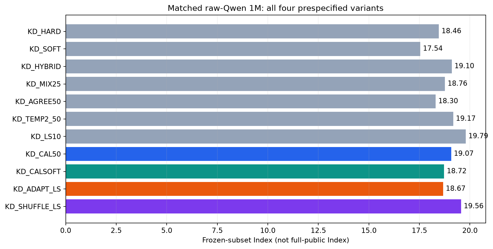
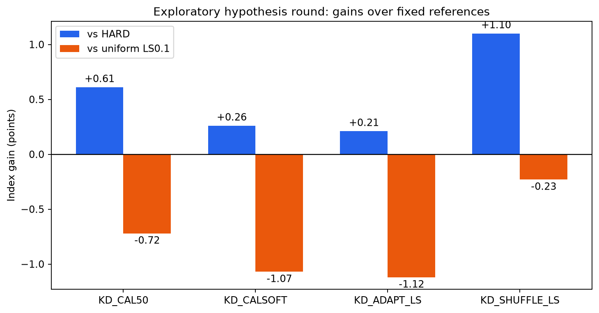

# 蒸馏改进第二轮：校准与样本级Teacher信息

**所有预先指定的四组均完整报告，不只展示赢家。** 本轮使用已知冻结子集进行探索性模型选择，不是独立held-out确认。

## 完整结果

| 条件 | Knowledge | Language | Retrieval | Tools | Arts | Index | coverage |
|---|---:|---:|---:|---:|---:|---:|---:|
| BASELINE | 0.70 | 0.85 | 1.75 | 1.66 | 7.02 | 1.76 | 100.0% |
| KD_HARD | 8.49 | 12.55 | 32.17 | 30.02 | 10.92 | 18.46 | 100.0% |
| KD_SOFT | 9.78 | 9.52 | 27.78 | 33.38 | 8.88 | 17.54 | 100.0% |
| KD_HYBRID | 9.37 | 12.13 | 33.51 | 32.53 | 8.81 | 19.10 | 100.0% |
| KD_MIX25 | 8.88 | 10.65 | 31.96 | 34.26 | 10.53 | 18.76 | 100.0% |
| KD_AGREE50 | 7.29 | 10.57 | 33.05 | 34.13 | 8.26 | 18.30 | 100.0% |
| KD_TEMP2_50 | 8.77 | 12.19 | 33.85 | 33.92 | 7.75 | 19.17 | 100.0% |
| KD_LS10 | 11.68 | 9.92 | 32.97 | 37.26 | 7.99 | 19.79 | 100.0% |
| KD_CAL50 | 9.26 | 10.29 | 34.62 | 32.33 | 11.75 | 19.07 | 100.0% |
| KD_CALSOFT | 10.06 | 11.22 | 30.13 | 34.11 | 9.53 | 18.72 | 100.0% |
| KD_ADAPT_LS | 8.03 | 12.09 | 31.16 | 36.29 | 5.99 | 18.67 | 100.0% |
| KD_SHUFFLE_LS | 9.32 | 12.64 | 32.94 | 34.37 | 10.09 | 19.56 | 100.0% |

## 相对固定对照的收益

| 新条件 | vs HARD | vs HYBRID0.5 | vs LS0.1 |
|---|---:|---:|---:|
| KD_CAL50 | +0.61 | -0.03 | -0.72 |
| KD_CALSOFT | +0.26 | -0.38 | -1.07 |
| KD_ADAPT_LS | +0.21 | -0.43 | -1.12 |
| KD_SHUFFLE_LS | +1.10 | +0.46 | -0.23 |

## 本轮假设与目标函数

- CAL50：每域拟合正slope＋intercept，将Teacher binary log-odds校准到原训练targets，再0.5CE＋0.5KL。
- CALSOFT：同一校准概率做纯KL，不使用Student CE；但calibration本身使用原训练标签，不称作完全label-free KD。
- ADAPT_LS：按每个(domain,exact original target)组内Teacher置信度rank设置epsilon0.05–0.15；高置信少平滑，组平均epsilon0.1。它是Teacher-guided smoothing，不是vanilla Hinton KL。
- SHUFFLE_LS：在相同组内随机排列同一组epsilon，保持完整分布与平均平滑强度，却破坏Teacher与具体样本的对应。
- 样本级Teacher对应信息的配对差值 ADAPT−SHUFFLE：**-0.89**。不是统计显著性声明。

## Teacher-target科学诊断

以下是Teacher与原训练target的对照，不是Teacher在目标benchmark上的准确率；原target本身也可能有噪声。

| 领域 | pairs | 原target均值 | Teacher匹配概率均值 | 判断冲突率 | 高置信冲突占比 |
|---|---:|---:|---:|---:|---:|
| knowledge | 169,116 | 21.45% | 32.34% | 15.98% | 1.74% |
| retrieval | 607,890 | 3.00% | 5.67% | 1.92% | 0.32% |
| tools | 86,923 | 19.48% | 20.91% | 3.90% | 0.22% |
| arts | 136,071 | 47.11% | 75.05% | 46.09% | 6.68% |

## 只在训练targets上拟合的校准

拟合8个scalars：q_cal=sigmoid(a_d logit(q)+b_d)，a_d保持正值；不使用评测输入/标签。以下CE是对原训练target的拟合诊断，不是独立泛化结果。

| 领域 | slope | intercept | 原始CE | 校准CE | epsilon均值aligned / shuffled |
|---|---:|---:|---:|---:|---|
| knowledge | 0.9562 | -1.1008 | 0.3479 | 0.2889 | 0.100000 / 0.100000 |
| retrieval | 1.1028 | -1.7379 | 0.0563 | 0.0360 | 0.100000 / 0.100000 |
| tools | 1.4104 | -0.2706 | 0.1047 | 0.0962 | 0.100000 / 0.100000 |
| arts | 0.5439 | -0.8467 | 0.8954 | 0.6537 | 0.100000 / 0.100000 |

## 共同实验条件

原始Qwen3-0.6B＋同一份未训练LoRA/head；同1M样本和epoch顺序，r32/alpha64，BF16/SDPA，batch128，lr5e-5，AdamW/cosine，warmup3%，wd0.01，seed42，一遍。每组7,813steps、228,021,289 effective tokens。复用所有已标Teacher概率，不重新调用Teacher。
评测同37项、4,786完整cases、5,935请求、163,671完整候选pairs。未用训练截断过滤评测候选；不是完整公共榜单或私测Full。原始四组对照直接复用已完成结果，没有重跑。

## 数学与经验依据

二分类margin梯度：CE为p−y，T1 KL为p−q；hybrid等价于对(1−alpha)y＋alphaq做CE，差一个不影响Student梯度的常数。q有偏时，纯KD不保证优于原标签。
- Yuan et al., Revisiting Knowledge Distillation via Label Smoothing Regularization: https://arxiv.org/abs/1909.11723
- Cho & Hariharan, On the Efficacy of Knowledge Distillation: https://openaccess.thecvf.com/content_ICCV_2019/html/Cho_On_the_Efficacy_of_Knowledge_Distillation_ICCV_2019_paper.html
- Hinton et al., Distilling the Knowledge in a Neural Network: https://arxiv.org/abs/1503.02531

## 图表

