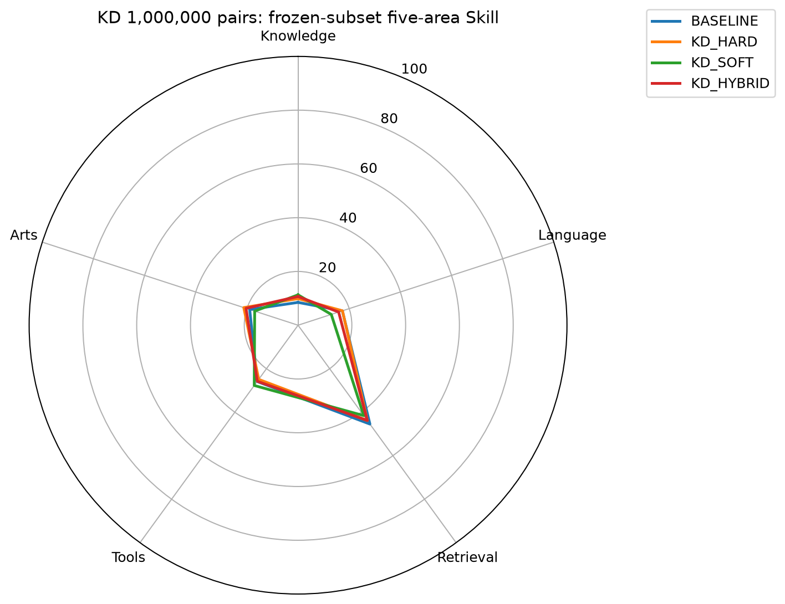
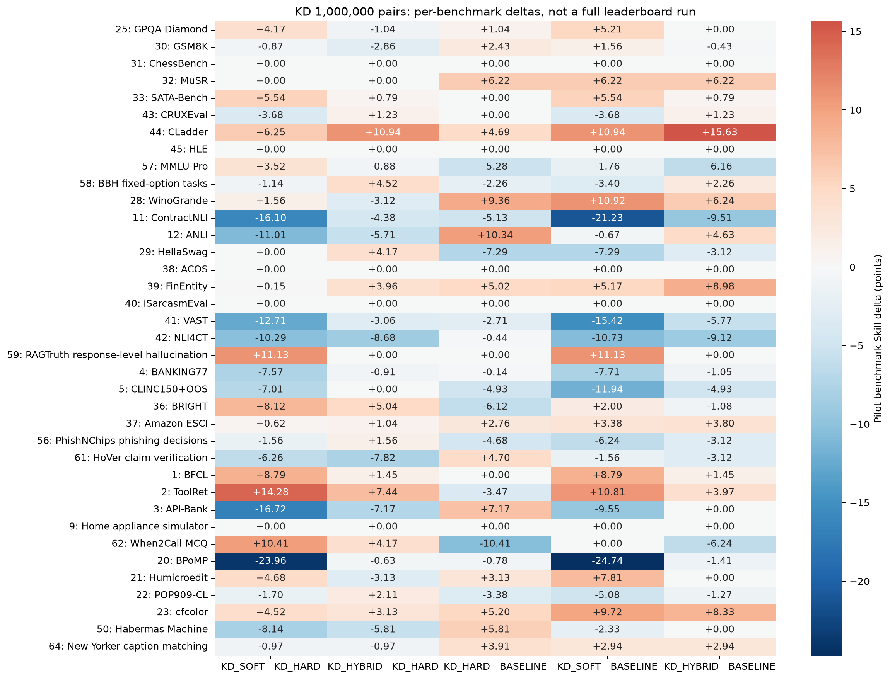

# 蒸馏规模阶段：1,000,000 pairs

训练每组 1,000,000 pairs，一遍；同一起点、同样本和顺序、同有效 batch128。
评测采用冻结37项的 4,786 个完整 case、5,935 个请求、163,671 个完整候选 pair。
本报告是固定子集上的 pilot，不是完整公共榜单成绩，不是私测 Full；原生指标不能统一叫 accuracy。

| 模型 | Knowledge | Language | Retrieval | Tools | Arts | Pilot Index | 子集 coverage |
|---|---:|---:|---:|---:|---:|---:|---:|
| BASELINE | 8.49 | 17.32 | 45.45 | 25.88 | 18.91 | 22.39 | 100.00% |
| KD_HARD | 9.89 | 17.36 | 43.84 | 24.90 | 21.22 | 22.49 | 100.00% |
| KD_SOFT | 11.30 | 12.99 | 41.57 | 27.71 | 16.96 | 21.36 | 100.00% |
| KD_HYBRID | 10.68 | 15.87 | 43.80 | 25.78 | 20.34 | 22.38 | 100.00% |

## 首要比较

- **KD_SOFT - KD_HARD**：Pilot Index **-1.13**；Knowledge +1.41，Language -4.37，Retrieval -2.27，Tools +2.81，Arts -4.26。
- **KD_HYBRID - KD_HARD**：Pilot Index **-0.11**；Knowledge +0.79，Language -1.49，Retrieval -0.04，Tools +0.88，Arts -0.88。
- **KD_HARD - BASELINE**：Pilot Index **+0.10**；Knowledge +1.40，Language +0.04，Retrieval -1.61，Tools -0.98，Arts +2.31。
- **KD_SOFT - BASELINE**：Pilot Index **-1.03**；Knowledge +2.81，Language -4.33，Retrieval -3.88，Tools +1.83，Arts -1.95。
- **KD_HYBRID - BASELINE**：Pilot Index **-0.01**；Knowledge +2.19，Language -1.45，Retrieval -1.65，Tools -0.10，Arts +1.43。

SOFT−HARD 才回答纯软监督是否优于等量原标签续训；不能只凭相对起点提升就判定蒸馏有效。各档按四域全池比例构造嵌套样本，优先复用已有标签；评测为固定子集，弱差异应视为趋势不明确，不能外推为完整榜单结论。

## 收益最大的 benchmark

### KD_SOFT - KD_HARD

| benchmark | Pilot Skill 差值 | 原生指标 | 续训模型 | HARD |
|---|---:|---|---:|---:|
| ToolRet | +14.28 | nDCG@10 | 0.5770169096486878 | 0.45353097099992135 |
| RAGTruth response-level hallucination | +11.13 | F1 on hallucinated class | 0.5714285714285714 | 0.39622641509433965 |
| When2Call MCQ | +10.41 | accuracy | 0.640625 | 0.5625 |
| BFCL | +8.79 | case exact accuracy | 0.3203125 | 0.171875 |
| BRIGHT | +8.12 | nDCG@10 | 0.34420909947541994 | 0.2726589542780311 |
| CLadder | +6.25 | accuracy | 0.5625 | 0.53125 |

### KD_HYBRID - KD_HARD

| benchmark | Pilot Skill 差值 | 原生指标 | 续训模型 | HARD |
|---|---:|---|---:|---:|
| CLadder | +10.94 | accuracy | 0.5859375 | 0.53125 |
| ToolRet | +7.44 | nDCG@10 | 0.5178994652982488 | 0.45353097099992135 |
| BRIGHT | +5.04 | nDCG@10 | 0.31704943568908994 | 0.2726589542780311 |
| BBH fixed-option tasks | +4.52 | accuracy | 0.453125 | 0.421875 |
| HellaSwag | +4.17 | accuracy | 0.4296875 | 0.3984375 |
| When2Call MCQ | +4.17 | accuracy | 0.59375 | 0.5625 |

## 运行时间与吞吐

- Teacher：本档训练快照直接读取共享概率缓存；本轮截至该档上游累计新标注 **0 pairs**。快照物化本身不调用 Teacher，不代表标签生成成本为0。
- KD_HARD：206.8 分钟，80.6 pairs/s，18373 effective tokens/s。
- KD_SOFT：207.7 分钟，80.2 pairs/s，18298 effective tokens/s。
- KD_HYBRID：207.6 分钟，80.3 pairs/s，18310 effective tokens/s。

