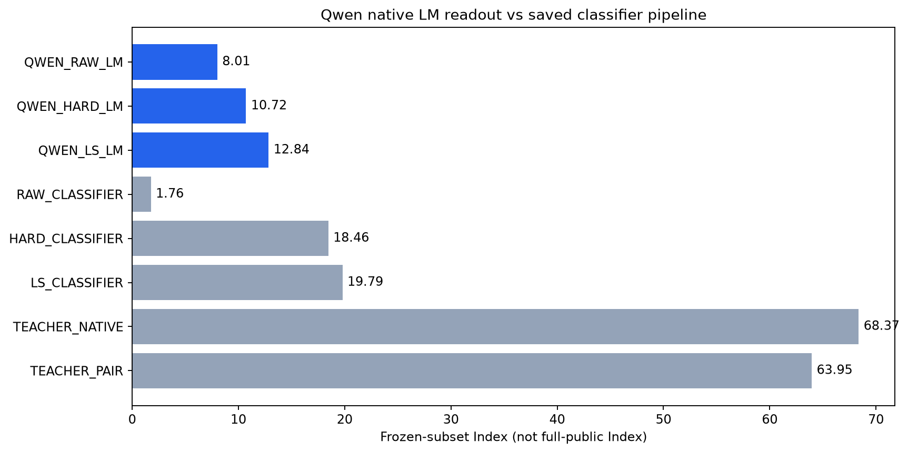

# 原始Qwen LM-head/native协议与现有classifier读出诊断

本次只有已有checkpoint导出及推理，没有新梯度更新。所有条件同37项、4,786完整cases、5,935请求；不是完整公共榜单或私测Full。

| 条件 | Knowledge | Language | Retrieval | Tools | Arts | Index | coverage |
|---|---:|---:|---:|---:|---:|---:|---:|
| QWEN_RAW_LM | 5.61 | 9.63 | 5.84 | 12.57 | 6.01 | 8.01 | 100.00% |
| QWEN_HARD_LM | 7.63 | 7.63 | 11.89 | 18.43 | 10.29 | 10.72 | 100.00% |
| QWEN_LS_LM | 8.54 | 7.92 | 13.93 | 25.81 | 10.78 | 12.84 | 100.00% |
| RAW_CLASSIFIER | 0.70 | 0.85 | 1.75 | 1.66 | 7.02 | 1.76 | 100.00% |
| HARD_CLASSIFIER | 8.49 | 12.55 | 32.17 | 30.02 | 10.92 | 18.46 | 100.00% |
| LS_CLASSIFIER | 11.68 | 9.92 | 32.97 | 37.26 | 7.99 | 19.79 | 100.00% |
| TEACHER_NATIVE | 60.62 | 64.53 | 70.58 | 86.04 | 61.55 | 68.37 | 100.00% |
| TEACHER_PAIR | 53.21 | 63.43 | 66.05 | 82.23 | 55.42 | 63.95 | 100.00% |

## 实际条件

- QWEN_RAW_LM：原始发布Qwen3-0.6B，保留原LMhead，未做本项目四域训练。此前RAW_CLASSIFIER1.76是随机二分类head，不是这个条件。
- QWEN_HARD_LM/LS_LM：已完成raw1M HARD/LS的LoRA在FP32中合并，严格恢复全部decoder backbone到原始CausalLM，保留原LMhead；原分类head不用于预测。没有原生协议SFT或再训练。
- 三组都使用原始state/questions、自己的Qwen tokenizer/chat template、thinkingoff和native label-token scoring，BF16/triton/TP1，每组一张卡；前端T1/read-twice≤3000，不使用Gemma专属折叠温度或temperatures文件。
- 跟旧classifier相比，同时改变输入包装、读出位置和输出head，不将差值单独归因为head权重。三组新native条件之间保持这些因素一致，仅backbone历史不同。
- 不把Teacher分数当Student必须达到的数学上界；不发送expected/gold标签，不在评测数据训练，不筛候选；coverage如实报告。

## 描述性交互差值

- hard_backbone_native_minus_raw_native: **+2.71**
- ls_backbone_native_minus_raw_native: **+4.83**
- raw_native_minus_random_classifier: **+6.25**
- ls_native_minus_ls_classifier: **-6.95**

## 本轮结论

- 原始 native-LM 为8.01；HARD/LS backbone在同一native读出下为10.72/12.84，分别比raw提高2.71/4.83。不能把原始随机classifier的1.76当作原始Qwen的LM能力，也不能把总分改善解释成所有能力均无遗忘。
- HARD/LS的native读出仍分别低于其已训练classifier pipeline 7.74/6.95分。直接恢复原LMhead并切换native协议没有补回Teacher–Student差距；本次不是head-only消融，未做native协议SFT，不能据此排除native协议训练或断言0.6B容量上限。
- Teacher native68.37/pair63.95均很强；当前优先区分Student对训练target的拟合和泛化/覆盖问题，不继续盲扫loss。当前未有Teacher方案超过匹配的普通LS0.1对照19.79。
- 实际step275711.69于2026-11-05 02:40–02:50（北京时间）运行并退出0；三组各5935请求全部ok、coverage1.0。报告、预测、日志及PNG/SVG已下载jev；旧规模系列保持暂停，allocation未取消。
- 单次、反复使用的冻结子集结果属于探索性机制诊断，不等于因果组件隔离、多seed显著性或完整公共榜单。

