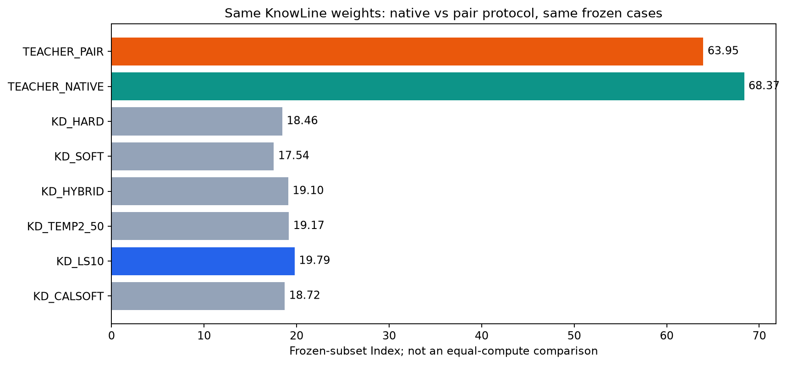

# 同一Teacher：原生任务协议与candidate-pair改写对照

**Teacher pair Index：63.95；coverage：100.00%；pair−native：-4.42；相对LS0.1：+44.16。**

| 模型 | Knowledge | Language | Retrieval | Tools | Arts | Index | coverage |
|---|---:|---:|---:|---:|---:|---:|---:|
| TEACHER_PAIR | 53.21 | 63.43 | 66.05 | 82.23 | 55.42 | 63.95 | 100.00% |
| TEACHER_NATIVE | 60.62 | 64.53 | 70.58 | 86.04 | 61.55 | 68.37 | 100.00% |
| KD_HARD | 8.49 | 12.55 | 32.17 | 30.02 | 10.92 | 18.46 | 100.00% |
| KD_SOFT | 9.78 | 9.52 | 27.78 | 33.38 | 8.88 | 17.54 | 100.00% |
| KD_HYBRID | 9.37 | 12.13 | 33.51 | 32.53 | 8.81 | 19.10 | 100.00% |
| KD_TEMP2_50 | 8.77 | 12.19 | 33.85 | 33.92 | 7.75 | 19.17 | 100.00% |
| KD_LS10 | 11.68 | 9.92 | 32.97 | 37.26 | 7.99 | 19.79 | 100.00% |
| KD_CALSOFT | 10.06 | 11.22 | 30.13 | 34.11 | 9.53 | 18.72 | 100.00% |

## 实验意义

Pair条件从同一eval cache的input/question/criteria/candidate重建render_pair文本，并用原训练标签生成时的通用noul提示独立判断correct match。没有expected/gold/scoring标签进入Teacher payload。
Native条件直接复用已完成的原始state/questions协议结果。两者权重相同、case IDs相同；本实验改变的是问题序列化、通用二分类问法/输出类型及候选聚合，不单独隔离其中某一个因素。不能把pairedTeacher称作所有Student的数学上界。
这不是等预算模型比较，也不是Student训练或新标注数据生产；不会把这些评测回答用于训练。

## 口径与设置

同37项、4,786完整cases、5,935请求，和Student冻结子集一致；不是完整公共榜单或私测Full。Student参考复用保存的结果，不重新推理。
Teacher原始BF16权重、TP2、triton attention、fp32 LM head、frontend temperature1、read-twice≤3000、原temperatures.json。发布权重已经折叠1.44的readout温度，没有手动改回或重新拟合。Pair均为noul；Native保留原question types及对应官方per-type温度。
Pair使用两个TP2副本、每副本8scoring threads、HTTP并发64，合计现有四GPU。相同input state的candidates交给同一副本，复用完全相同的(state,candidate)输入。没有安装环境、单测、smoke、hash或canonical训练概率cache写入。
本次保留全部evaluation输入，不使用训练时4096token head-tail cap，因此不是长输入上的逐字节训练label管线重放。它给pair条件保留更多原始信息；该差异明确披露，不静默丢弃长样本。
概率按原annotation的float32[P(notmatch),P(match)]两列保存。margin使用log(Pmatch)−log(Pnotmatch)，数值下限1e−30；不从round-to1的单个Pmatch列重建小概率。随后复用原Student候选softmax及native scorer。
请求状态计数：`{"ok": 5935}`。所有请求/candidates均保留，scope及coverage按实际完成记录报告。

## 解释边界

若pair也强，下一步应关注Student容量/优化/数据覆盖；若pair明显下降，优先修正监督目标或任务协议，而非继续盲扫loss。这只是机制诊断，未证明任何新Student一定获益。评测回答不会用于训练。

