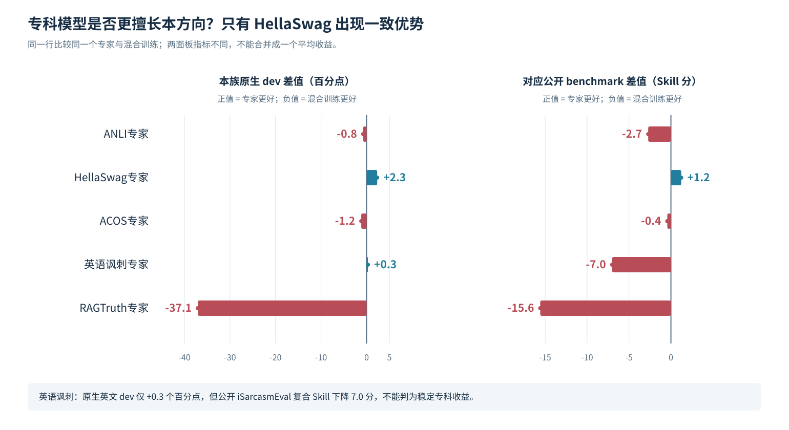
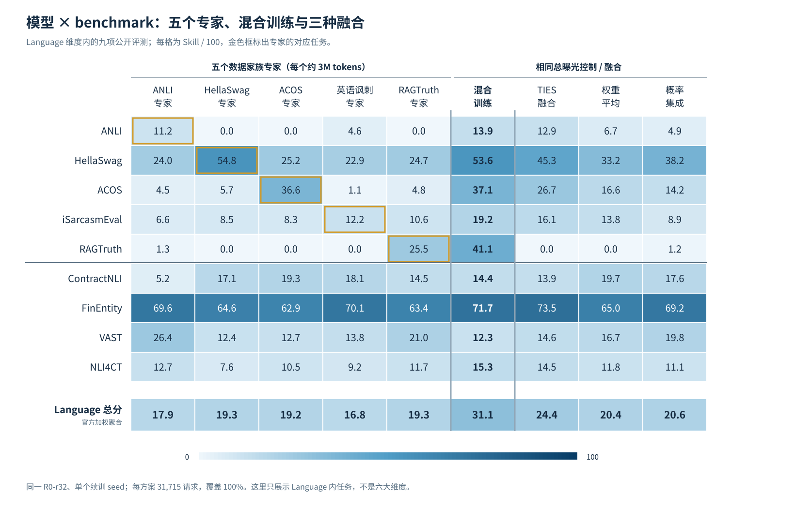
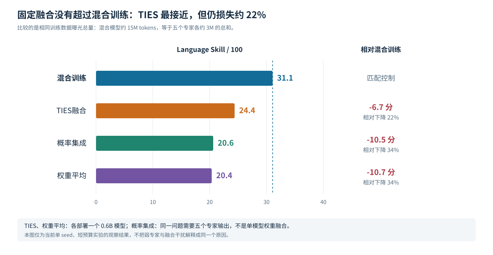
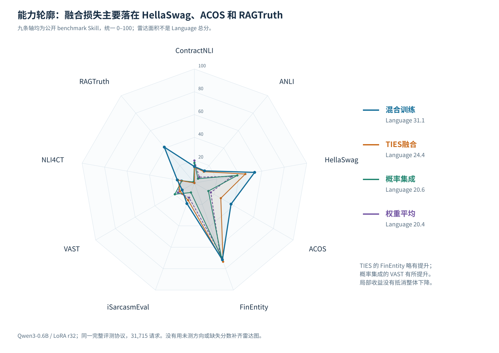
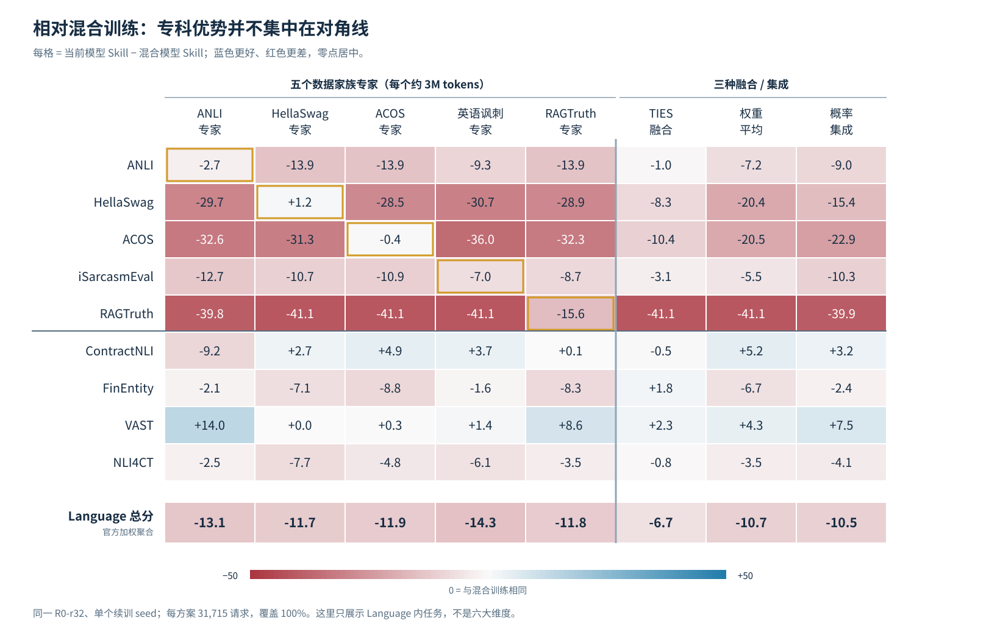

# 专科训练与模型融合：现有结果能回答什么

## 核心结论

**现有资料能对研究问题做初步分析。** 已完成的是 **Language Understanding 内五个数据家族** 的专科训练与融合，而不是六个大维度的实验。

- **专科训练没有普遍优于混合训练。** 五个家族中，只有 HellaSwag 专家同时在本族 dev 和对应公开 benchmark 上超过混合模型：accuracy 高 **2.3 个百分点**，公开 Skill 高 **1.2 分**。英语讽刺仅在原生英文 dev 略高，在公开复合评测上反而下降。
- **本轮固定融合均不如相同总训练曝光的混合模型。** 混合训练 Language Skill 为 **31.1**，TIES 为 **24.4**，概率集成为 **20.6**，权重平均为 **20.4**；分别下降约 **22%、34%、34%**。其中，TIES 和权重平均都能部署为单个 0.6B 模型，概率集成仍需五个模型的输出。
- **融合并非所有任务都退步。** TIES 的 FinEntity、概率集成的 VAST，以及三种融合的 D0 迁移代理均有改善，但没有抵消总体损失。当前还不能把下降完全解释为“专家知识相互干扰”，因为部分专家本身未形成优势，且只做了一个短预算续训 seed。

## 一、目前是 Language 内五族实验，不是六个方向实验

### 榜单定义六类，但只有五类独立计分

2026-10-30 核对的官方原始数据中，`categories` 定义了六类，`suite.categories` 则为 5。第六类 Games & Strategy 标有 `folded_into: knowledge`；ChessBench 已计入 Knowledge。对应线上数据快照生成于 2026-10-29 14:04 UTC。

| 方向                       | 独立计分 benchmark 数 | 与本地研究相关的已完成结果                           |
| -------------------------- | ---------------------:| ---------------------------------------------------- |
| Knowledge & Reasoning      | 11                    | 未见本方向专用模型与匹配混合/融合对照                |
| Language Understanding     | 9                     | 已有五个数据家族专家、混合训练和三种融合/集成        |
| Retrieval & Classification | 6                     | 未见本方向专用模型与匹配混合/融合对照                |
| Tools & Automation         | 5                     | 未见本方向专用模型与匹配混合/融合对照                |
| Arts & Human Taste         | 6                     | 未见本方向专用模型与匹配混合/融合对照                |
| Games & Strategy           | 不独立计分            | Games 合入 Knowledge；如单列第六方向，须另定研究口径 |

因此，可以选择按官方做**五方向研究**，也可以按原设想做**自定义六方向研究**。后一种需要单列 Games 的训练与评测集合，并处理 ChessBench 与 Knowledge 的重叠，不能把同一项重复计入六维平均分。

### “约 180 万条 Tasksource”指清洗后的文本对，不是已分好的六份数据

| 数据阶段                                    | 规模               | 实际用途                                       |
| ------------------------------------------- | ------------------:| ---------------------------------------------- |
| 原始 `tasksource/zero-shot-label-nli` train | 1,899,993 pair     | 原始来源；不是 Tasksource 生态全部数据的总规模 |
| 清洗后的 D0 train                           | **1,813,810 pair** | 训练共同起始模型 R0；约 181 万条的说法对应这里 |
| 后续 Language 小池                          | 117,353 pair       | 22,909 条 Language 相关 D0＋94,444 条 D2       |
| 本轮五专家使用的 D2 小池                    | **94,444 pair**    | ANLI、HellaSwag、ACOS、英语讽刺、RAGTruth 五族 |

一条 pair 是一次文本匹配判断，不等于一道原始 benchmark 题；多候选题会展开为多个 pair。当前未见“将完整 181 万条 D0 按六方向划分并分别训练”的完成证据。

本轮所有分支都从**已用宽 Tasksource 数据训练过的共同 R0** 扩容到 rank32 后开始。因此，准确说法是“**共同通用起点上的专科续训**”，不是六个模型分别从原始 Qwen3 仅学习自己方向的数据。

| 原研究设想                                         | 已有实验实际做了什么                                    |
| -------------------------------------------------- | ------------------------------------------------------- |
| 每个大方向一个专家                                 | 仅 Language 内五个数据家族各一个专家                    |
| 每个专家使用自己方向的 Tasksource＋benchmark train | 本轮新增训练只用各族 D2；Tasksource 知识主要来自共同 R0 |
| 所有方向的数据混在一起训练                         | 混合这五族 D2，未覆盖其他大方向的新增训练数据           |
| 融合六个方向专家                                   | 融合五个 Language 数据家族专家                          |
| 在所有方向上交叉评测                               | 九项 Language benchmark 完整交叉评测                    |

归档所说的“六个新训练模型”，指的是**五个专家＋一个混合控制**，不是六个维度专家。下面的分析使用这组已完成对照。归档中另有大量 Language 配方实验，但它们不能补成缺失的六方向模型或分数。

## 二、只训本族数据，不保证在本族表现更好

本轮统一使用 Qwen3-0.6B 二分类匹配模型、causal attention、LoRA rank32/alpha64、共同 R0、续训 seed3407、LR 5e-5、effective batch128。每个专家新增约 **3M 非 padding tokens**，混合控制新增 **15M tokens**。

混合控制实际使用 **14,995,340 tokens**，恰好等于五专家之和；归档曝光审计还核对了源 row 出现次数及 task×标签计数。因此，**混合模型见到的每族训练内容与曝光量都与对应专家匹配，同时额外接触其他四族数据**。

### HellaSwag 有专科优势，其他家族没有一致优势

| 专家方向  | 原生 dev 指标           | 专家      | 混合模型 | 专家−混合，百分点 | 对应公开 Skill 差值 |
| --------- | ----------------------- | ---------:| --------:| -----------------:| -------------------:|
| ANLI      | 三轮 Macro-F1 均值      | 41.7%     | 42.5%    | −0.8              | −2.7                |
| HellaSwag | accuracy                | **66.2%** | 63.8%    | **+2.3**          | **+1.2**            |
| ACOS      | 两域 per-review F1 均值 | 39.4%     | 40.5%    | −1.2              | −0.4                |
| 英语讽刺  | 讽刺正类 F1             | 39.6%     | 39.3%    | +0.3              | −7.0                |
| RAGTruth  | 三任务幻觉 F1 均值      | 30.8%     | 67.9%    | −37.1             | −15.6               |

**HellaSwag 是当前最值得进一步确认的专科收益信号。** 

### 对角线体现“学到了什么”，但不自动代表“胜过混合”

**列是模型，行是 benchmark**。前五列为专家，金色对角框是各专家对应任务；右侧加入混合模型和融合模型，底部保留官方加权 Language 总分。其余四行用于观察跨任务迁移。

## 三、固定融合总体落后，但保留了部分任务与迁移能力

### TIES 是本轮最好的融合方案，仍比混合训练低 6.7 分

| 方案                | Language Skill | 相对混合，分 | 相对下降 | 推理所需模型数 |
| ------------------- | --------------:| ------------:| --------:| --------------:|
| 相同总曝光混合训练  | **31.1**       | —            | —        | 1              |
| TIES，保留 20%、λ=1 | 24.4           | **−6.7**     | **22%**  | 1              |
| 五专家等权概率集成  | 20.6           | −10.5        | 34%      | 5              |
| 等权有效权重平均    | 20.4           | −10.7        | 34%      | 1              |

相对下降按原始精度的 `(混合分数−融合分数) / 混合分数` 计算。

权重平均使用共同 R0 加五专家的有效权重差值均值；TIES 在有效差值上保留大幅值参数、选择一致符号并合并，参数预先固定。两者都包括训练过的分类头，**没有直接平均 LoRA A/B 矩阵**。概率集成则平均同一问题完整候选上的输出概率，不合并成一个模型。上述方案已有实际结果；本次不重新执行融合。

### 自然 dev 同样支持混合训练，不是只看公开总分

| 方案     | 自然 dev pair Macro-F1 | 原生 10 任务宏均值 | D0 任务宏 pair-F1 |
| -------- | ----------------------:| ------------------:| -----------------:|
| 混合训练 | **91.1%**              | **0.52**           | 77.7%             |
| TIES     | 88.5%                  | 0.37               | 79.1%             |
| 概率集成 | 89.7%                  | 0.39               | **80.3%**         |
| 权重平均 | 84.2%                  | 0.31               | 79.9%             |

自然 dev 共 **67,202 pair**，包含 2,840 条 Language 相关 D0 validation 和完整 D2 dev 64,362 条。原生 10 任务宏均值平均各任务自己的原生指标，不是统一 accuracy；D0 任务宏 pair-F1 是迁移代理，与全体 pair Macro-F1 的聚合方式不同。

三种融合的自然 dev 总体和原生任务宏均值均低于混合控制；D0 迁移代理则分别高 **1.3、2.5、2.2 个百分点**。因此，更准确的判断是：**本轮混合训练的目标任务能力更强，融合方案在部分原有任务代理上有所保留。** 没有同面板的新 R0 对照，尚不能将其写成“已经证明减少了相对 R0 的遗忘”。

### 融合损失集中在若干任务，并非全线退化

雷达图统一使用 0–100 Skill；轴代表九个 benchmark，而不是九个大维度。

相对混合训练，TIES 的 HellaSwag 低 **8.3 分**、ACOS 低 **10.4 分**、RAGTruth 低 **41.1 分**，而 FinEntity 高 **1.8 分**。概率集成的 VAST 高 **7.5 分**，权重平均的 ContractNLI 高 **5.2 分**；局部收益不足以抵消总体损失。

下面将每格改成“当前模型减混合模型”，更便于直接观察你的研究问题：**蓝色为收益，红色为损失**。前五列仍为专家，可以直接检查金色对角线是否为正。

TIES 与权重平均的公开 RAGTruth Skill 都为 **0**；这是随机水平校正后的分数，不是零题答对。本轮没有将弱专家、融合干扰和概率校准差异做因果分解，也没有通过调融合权重或稀疏率追逐公开分数。
