# JEV Decision Index：37 项 benchmark 全量数据画像

**日期：2026-10-31｜公开面板：decision-index-0.3｜统一 tokenizer：Qwen3-0.6B**

这份报告分析的是**实际公开评测输入**，不是训练池，也不是只抽几条样例估计。37 项主榜和 6 项归档展示项分开；37 项的全部请求均进入统计。

## 先看最重要的结论

1. **全榜约 11 万请求、27 万道问题、219 万候选匹配对。** 分别约为 11.01万、27.22万、218.69万，完整整数见明细。候选展开以后，已知标签中匹配正例只有 **11.24%**，正例占编码 token 仅 **7.17%**；但这不是原生语义正类比例。

2. **4k 并不能完整覆盖所有任务。** 当前真实 Pair 输入还有 **590 条请求**放不下，其中 **508 条全是 API-Bank**。8k 仍有 **3 条**超长请求；16k 还有 **1 条**。32k 可覆盖本轮所有 Pair 输入。Joint 联合内容则有不同的长尾，不能混用。

3. **计算量极不均衡。** POP909 仅 2,000 请求，却占全榜 Pair token 的 **55.76%**；与 API-Bank 合计约 **73.68%**，两项公开分数权重合计只有 **5.73%**。这比按请求数均匀分配优化时间更值得关注。

4. **ACOS 的真正 yes 率仅 0.56%。** 相同数据展开成候选匹配后正负却是 50:50；其全答 no 的逐字段正确率可达 99.44%，但识别不出任何正组合。

5. **可见构造痕迹很强的任务存在。** BPoMP 仅“选择 token 较长的候选、同长均分”的描述性命中率就是 **79.07%**；Habermas 同一参照为 **56.53%**。这不是新模型效果，也不是官方宏平均成绩，而是候选长度与答案的结构性关联。

6. **名义样本数明显大于独立来源数。** RAGTruth 的 2,700 回答来自 450 个源 prompt；GSM8K 的 2,638 请求来自 1,319 题；ACOS 的 1,565 请求来自 400 评论；BPoMP 的 5,000 请求来自 811 原诗。

7. **两个工具 benchmark 的来源高度重合。** 当前 When2Call 的 1,295 个唯一 BFCL 来源 ID，全部出现在当前 BFCL。它们提供不同任务目标，但不能视为互相独立的新来源。

8. **还发现少量“同一可见输入、不同标签”。** VAST 为 10 组、21 次请求展示；BBH 为 2 组；NLI4CT、HoVer 各 1 组。另有 Pair 表示造成的辅助字段语义丢失，详见后文。

9. **长不等于难，短也不等于容易。** 接入榜单 247 个模型的已有逐项公开分数后，37 项之间的长度 P95 与完整覆盖模型的 Skill 中位数相关接近零；这是跨任务观察，不代表长文本在同一任务里不会掉分。

## 1. 统计范围和长度口径

| 范围 | 数量 | 说明 |
| --- | --- | --- |
| 当前主榜 | 37 项 | 五大领域；下文所有主图均使用此范围 |
| 主榜有效请求 | 11.01万 | 已应用当前版本选择与统一排除 |
| 主榜问题字段 | 27.22万 | 一个请求可有多道问题 |
| 主榜候选匹配对 | 218.69万 | 一道 K 候选题展开为 K 对 |
| 其中没有可确认硬标签的 Pair | 7.52万 | 检索未判断候选及无 gold 的辅助字段；不记为负例 |
| 归档完整范围 | 14.02万 请求 / 43 项 | 6 项仅展示，不进入主榜统计 |
| 主榜排除前后 | 11.05万 → 11.01万 | 当前主榜移除 433 条；不要再机械扣一次旧排除数 |

| 长度口径 | 具体测量 | 如何使用 |
| --- | --- | --- |
| State | 仅 state 的统一 tokenizer 长度 | 解释文档体积；不能单独当输入长度 |
| Joint 联合请求 | 紧凑 JSON 中的 state + 全部 questions，包括 instructions 与全部 criteria | 跨任务统一内容长度；不是所有模型实际聊天模板 |
| 实际 Pair | 现有分类器 prefix + candidate suffix + EOS 的缓存长度 | 当前候选匹配分类器的真实单次输入长度 |
| Request Pair max | 一条请求的全部候选 Pair 中的最大长度 | 判断整条请求是否能全部容纳 |
| Pair token 总量 | 所有候选 Pair 长度相加 | 不共享前缀的编码负担；不是墙钟时间 |

**P50 / P95 / P99** 分别表示中位数、第 95 / 99 百分位。本文分位数按请求或 Pair 的实际完整数据计算；全部展示最多两位小数。完整请求编码不包含 expected、scoring 或来源信息。当前实测题型只有 choice / noul，**没有 score 输入题型**。

统计依据是服务器已落盘的公开 suite 和现有 Pair 缓存。GSM8K 是沿用官方语义的本地重建候选；不同引擎、tokenizer 或模板的长度会变化。当前 Full 来自私有任务，这份报告不把公开画像冒充私有题面统计。细节和一手链接见 [SOURCES.md](SOURCES.md)。

## 2. 五大领域：样本量、长度、候选量和分数权重

| 领域 | 项数 | 请求 | 问题 | Pair | Joint P95 | 分数权重 | Pair token 占比 |
| --- | --- | --- | --- | --- | --- | --- | --- |
| 知识与推理 | 11 | 3.51万 | 4.9万 | 35.66万 | 954 | 25.85% | 7.83% |
| 语言理解 | 9 | 3.17万 | 13.14万 | 29.32万 | 3,980 | 25.85% | 5.56% |
| 检索与分类 | 6 | 1.98万 | 4.26万 | 114.57万 | 1,323 | 20.02% | 7.88% |
| 工具与自动化 | 5 | 6,627 | 3.24万 | 9.91万 | 8,014.1 | 18.28% | 21.89% |
| 艺术与人类偏好 | 6 | 1.68万 | 1.68万 | 29.22万 | 5,088.45 | 10% | 56.85% |

[打开 SVG 放大查看](figures/07-five-domain-data-profile-radars.svg)

雷达图每个轴按五领域最大值归一化，仅比较**数据形状**：请求量、Joint P95、候选数/题、题数/请求、Joint 超 4k 比例、Pair/Joint 总 token 比。图形面积不是模型能力或综合难度评分。

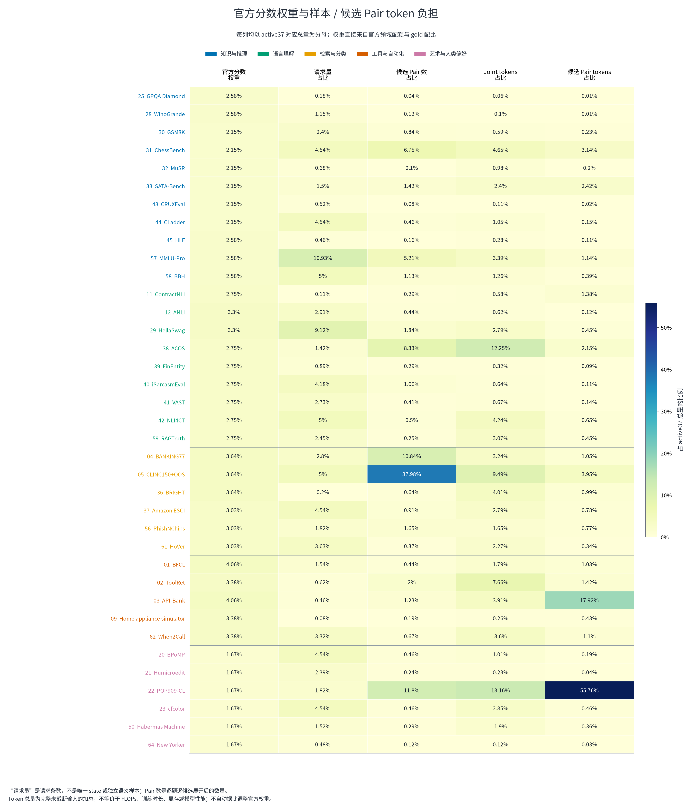

[打开 SVG 放大查看](figures/08-official-weight-vs-sample-token-burden.svg)

**不能按请求量或 Pair 数理解榜单权重。** 同领域 ★项权重 1.20，普通项 1.00，再乘固定领域权重。ContractNLI 只有 123 份合同，仍约占公开总指数 2.75%；POP909 的分支很多，也不会因此增加指数权重。

## 3. 输入长度：整体覆盖率与最值得处理的长尾

| 上下文上限 | Pair 整请求覆盖率 | 仍放不下的请求 | Joint 内容覆盖率 | 仍放不下的 Joint |
| --- | --- | --- | --- | --- |
| 512 | 84.53% | 1.7万 | 68.16% | 3.51万 |
| 1,024 | 93.92% | 6,692 | 86.03% | 1.54万 |
| 2,048 | 98.13% | 2,060 | 94.97% | 5,540 |
| 4,096 | 99.46% | 590 | 95.69% | 4,743 |
| 8,192 | 100% | 3 | 99.57% | 469 |
| 16,384 | 100% | 1 | 99.91% | 94 |
| 32,768 | 100% | 0 | 100% | 0 |
| 40,960 | 100% | 0 | 100% | 0 |

**显示为 100% 不总是零遗漏。** 例如 8k 的 Pair 覆盖率四舍五入后为 100%，实际还有 3 条；16k 还有 1 条。因此这里同时给整数超限数量，避免为了少保留小数而掩盖长尾。

| 整体分布 | P50 | P90 | P95 | P99 | 最大值 |
| --- | --- | --- | --- | --- | --- |
| Joint / 请求 | 268 | 1,317 | 2,080 | 6,650 | 3.26万 |
| Request Pair max | 154 | 711 | 1,158 | 2,721 | 2.27万 |
| Pair / 候选 | 58 | 1,771 | 2,491 | 6,556 | 2.27万 |

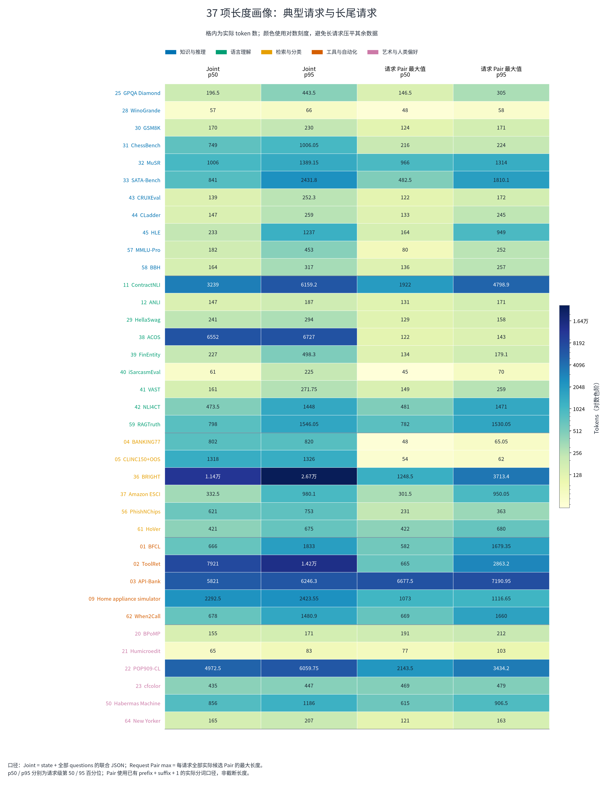

[打开 SVG 放大查看](figures/01-length-quantiles-heatmap.svg)

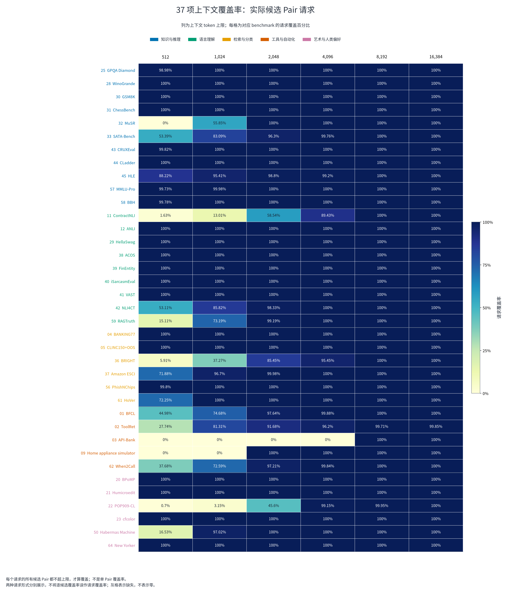

[打开 SVG 放大查看](figures/02-pair-request-coverage.svg)

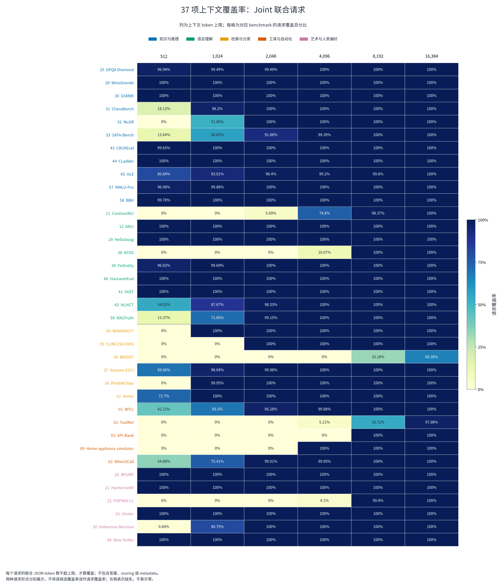

[打开 SVG 放大查看](figures/03-joint-request-coverage.svg)

### 4k 的 590 条 Pair 超限请求来自哪里

| Benchmark | 超限请求 | 该项覆盖率 | 主要原因 |
| --- | --- | --- | --- |
| API-Bank | 508 | 0% | 完整 53 API catalog |
| ToolRet | 26 | 96.2% | 个别工具文档极长 |
| POP909-CL | 17 | 99.15% | 个别音符窗口长 |
| ContractNLI | 13 | 89.43% | 完整合同 |
| BRIGHT | 10 | 95.45% | 个别 query/文档长 |
| When2Call | 6 | 99.84% | 工具 schema 长 |
| SATA-Bench | 4 | 99.76% | 长段落 |
| HLE | 4 | 99.2% | 极长题面/候选 |
| BFCL | 2 | 99.88% | 长 schema |

**数据配置上的直接判断：**短输入主力和长尾回退应分开规划。512/1k/2k 是吞吐分桶，不是全榜统一硬裁剪。当前 Pair 需要至少覆盖 22,659 token 的极端请求；32k 有余量。Joint 最大为 32,575，接近 32k，换成带聊天模板的联合引擎后仍需另算模板余量，不能直接宣称它也必然完整容纳。

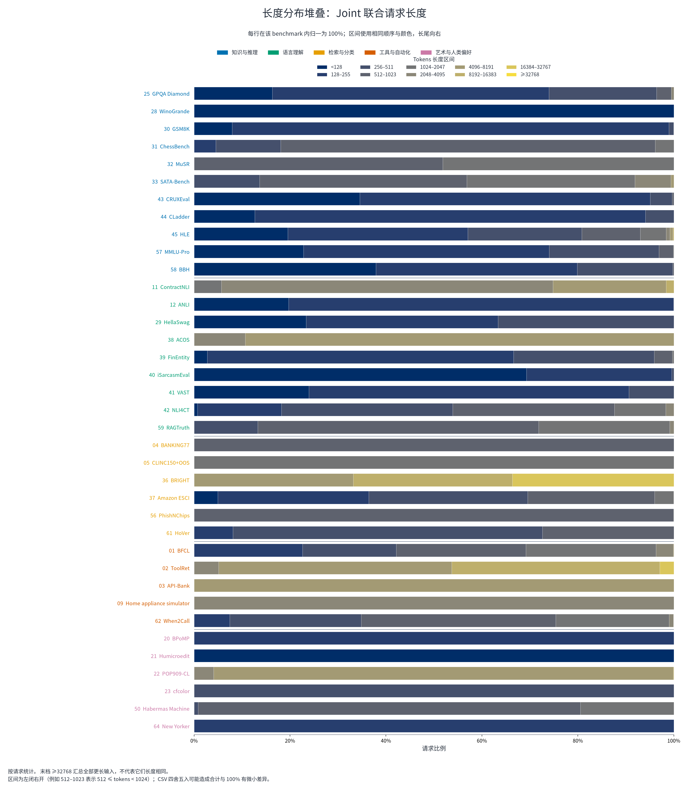

[打开 SVG 放大查看](figures/10-joint-length-distribution.svg)

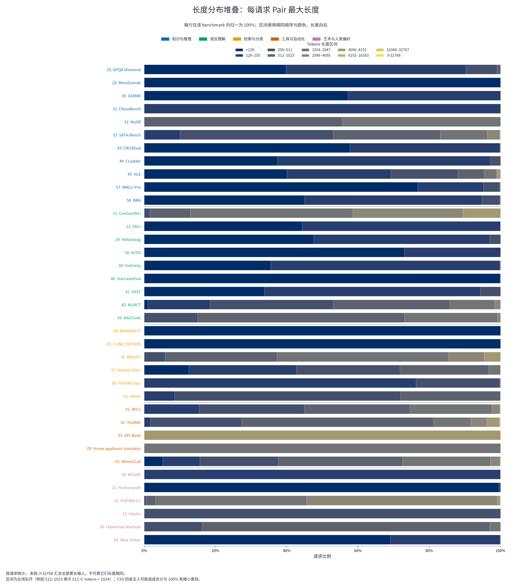

[打开 SVG 放大查看](figures/11-pair-request-length-distribution.svg)

## 4. 正反比例：必须区分原生语义与候选匹配

一个二元问题的 gold 若为 no，展开候选后，“no”是一个匹配正例，“yes”是一个匹配负例。因此 **yes/no 比例、匹配/不匹配比例、情感 Positive/Negative 比例不是同一个统计量**。普通 K 选 1 的匹配密度约为 1/K；NLI 三类不能随便合成正负。

| Benchmark | 语义正类定义 | 语义正 | 语义负 | 原生正类率 | 匹配正例率 |
| --- | --- | --- | --- | --- | --- |
| BFCL | 应调用工具 | 1,694 | 3,074 | 35.53% | 50% |
| SATA-Bench | 候选答案正确 | 5,949 | 9,568 | 38.34% | 50% |
| ACOS | 评论出现该类别×情感 | 508 | 9.06万 | 0.56% | 50% |
| iSarcasmEval | 讽刺；仅 A-English | 200 | 1,200 | 14.29% | 50% |
| NLI4CT | 试验证据蕴含声明 | 1,841 | 3,659 | 33.47% | 50% |
| CLadder | 因果问题回答 yes | 2,495 | 2,505 | 49.9% | 50% |
| PhishNChips | 主 verdict 为 phishing | 1,000 | 1,000 | 50% | 50% |
| RAGTruth | 回答存在幻觉 | 943 | 1,757 | 34.93% | 50% |
| HoVer | 证据支持 claim | 2,000 | 2,000 | 50% | 50% |

**ACOS 是最典型的例子：** 508 个语义 yes 对 90,584 个 no，而匹配展开后正反各 91,092。先改变 Pair 正负采样，并不会自动改变模型看到的 ACOS 原生 yes 稀疏性；要同时记录问题级类别、候选密度与 token 曝光。

**iSarcasm 主榜：**14.29% 的讽刺正类；如果总预测 no，准确率有 85.71%，但讽刺 F1 为零。**RAGTruth：**正类是“有幻觉”，不是“回答可靠”；当前机会校正基线是全判幻觉的 F1 51.77%，不是公平硬币的 50%。

### 多分类的原生类别分布

| Benchmark | 已观察语义类数 | 分布 |
| --- | --- | --- |
| BANKING77 | 77 | 77 类各 40 条（各 1.30%） |
| CLINC150+OOS | 151 | OOS 1,000 条（18.18%）；150 个普通意图各 30 条（各 0.55%） |
| ContractNLI | 3 | Entailment: 46.29%；NotMentioned: 43.19%；Contradiction: 10.52% |
| ANLI | 3 | Entailment: 33.44%；Neutral: 33.38%；Contradiction: 33.19% |
| POP909-CL | 87 | 129 个候选类中观察到 87 类；最大类 GM 102 条（5.10%），最小已观察类 1 条 |
| Amazon ESCI | 4 | Exact: 61.64%；Substitute: 24.04%；Irrelevant: 11.04%；Complement: 3.28% |
| FinEntity | 3 | Neutral: 53.03%；Positive: 23.58%；Negative: 23.39% |
| VAST | 3 | neutral: 34.73%；against: 33.87%；favor: 31.4% |
| When2Call | 3 | cannot_answer: 35.46%；tool_call: 35.46%；request_for_info: 29.08% |

When2Call 仍给出 direct 候选，但本样本 gold 为零；不能因为该类没有样本就推断现实请求里 direct 不存在。原生类别完整表见 [native-classes.csv](tables/native-classes.csv)，原始答案键及轨道表见 [answer-labels-by-track.csv](tables/answer-labels-by-track.csv)。

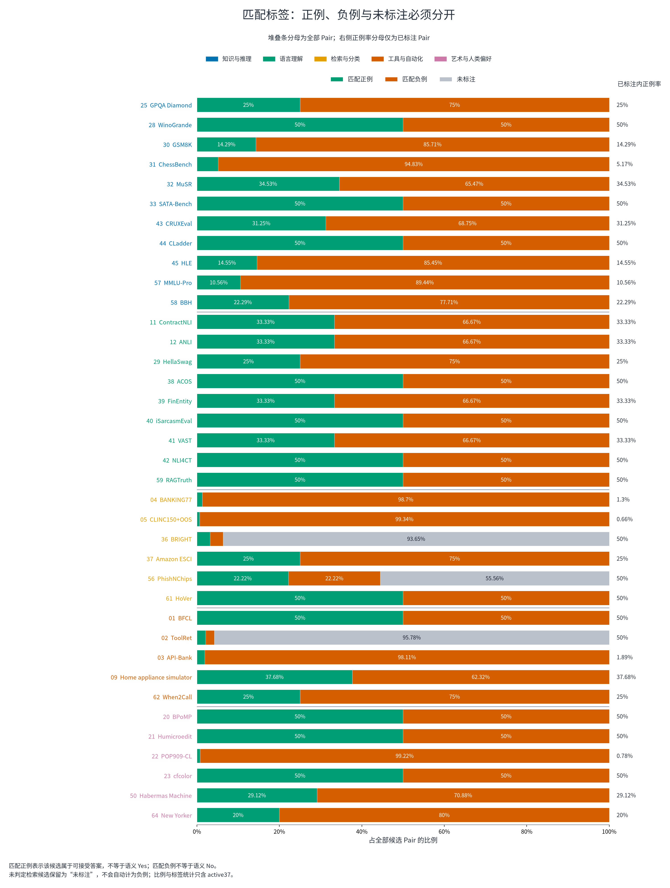

[打开 SVG 放大查看](figures/04-matching-label-composition.svg)

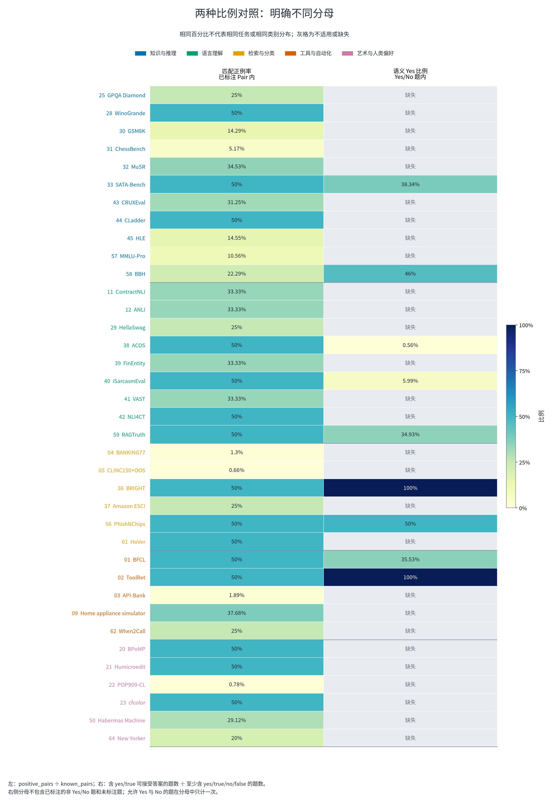

[打开 SVG 放大查看](figures/06-matching-vs-semantic-rates.svg)

上图右列只识别字面键 yes/true，不猜测 A/B 的语义；所以 CLadder、HoVer 等应使用上面的显式语义表，而不是把图中灰色当成没有语义标签。各任务原生标签的定义始终以表中说明为准。

### 检索与没有标签的辅助题

| 范围 | 有确认答案的字段 | 未判断/无标签字段 | 说明 |
| --- | --- | --- | --- |
| ToolRet | 924 | 2.1万 | 21,919 个候选相关性判断，仅 924 个有明确正相关答案 |
| BRIGHT | 447 | 6,593 | 7,040 个候选相关性判断，仅 447 个有明确正相关答案 |
| PhishNChips | 8,000 | 1万 | 九问题中四个有 gold、五个信号没有 gold；主榜只用 verdict |

ToolRet / BRIGHT 在已标注字段里几乎只有相关文档；剩余候选是 **unjudged**，不能把它们写成可靠负例。nDCG 的候选池召回限制另列在 [retrieval-pools.csv](tables/retrieval-pools.csv)，按 query 解释，不能仅用候选池中的相关项重建理想分母。

## 5. 计算负担：候选数、问题数和重复编码

| Benchmark | 请求 | 平均候选/题 | Pair token 总量 | 全榜 Pair token 占比 | Pair/Joint token 比 | 公开权重 |
| --- | --- | --- | --- | --- | --- | --- |
| POP909-CL | 2,000 | 129 | 5.65亿 | 55.76% | 56.18× | 1.67% |
| API-Bank | 508 | 53 | 1.82亿 | 17.92% | 60.8× | 4.06% |
| CLINC150+OOS | 5,500 | 151 | 4003.11万 | 3.95% | 5.52× | 3.64% |
| ChessBench | 5,000 | 29.53 | 3180.98万 | 3.14% | 8.95× | 2.15% |
| SATA-Bench | 1,650 | 2 | 2456.5万 | 2.42% | 13.38× | 2.15% |
| ACOS | 1,565 | 2 | 2176.26万 | 2.15% | 2.32× | 2.75% |
| ToolRet | 685 | 2 | 1440.16万 | 1.42% | 2.46× | 3.38% |
| ContractNLI | 123 | 3 | 1403.19万 | 1.38% | 31.8× | 2.75% |
| MMLU-Pro | 1.2万 | 9.47 | 1155.54万 | 1.14% | 4.45× | 2.58% |
| When2Call | 3,652 | 4 | 1113.08万 | 1.1% | 4.04× | 3.38% |

合计 Joint 内容约 **7644.3万 token**，当前候选 Pair 展开编码约 **10.13亿 token**，相差 **13.26×**。这个比值同时包含格式差异、候选展开和 state 复用，并不等于某个共享前缀实现已经测得的加速倍数。

**优先方向：**POP909 和 API-Bank 最值得研究共享 state/candidate 编码、联合候选打分与前缀复用；CLINC/BANKING 则是大量很短分支。不能用同一 batch/request 策略覆盖这三种形态，也不应为省计算悄悄删除原始候选。这里给的是后续配置建议，本轮未修改训练或推理。

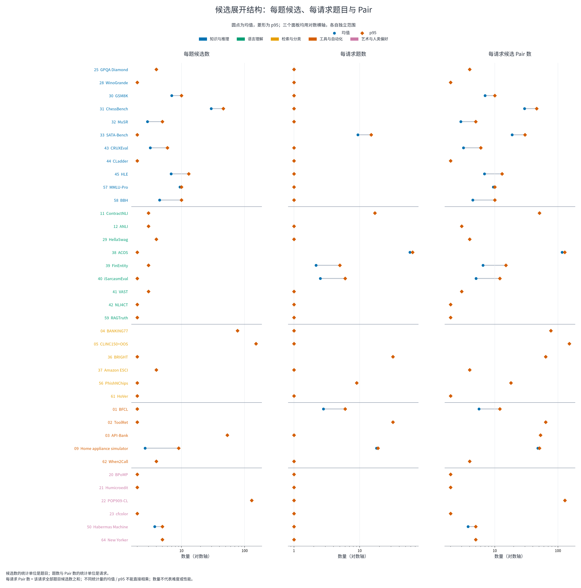

[打开 SVG 放大查看](figures/09-candidates-fields-and-pairs-per-request.svg)

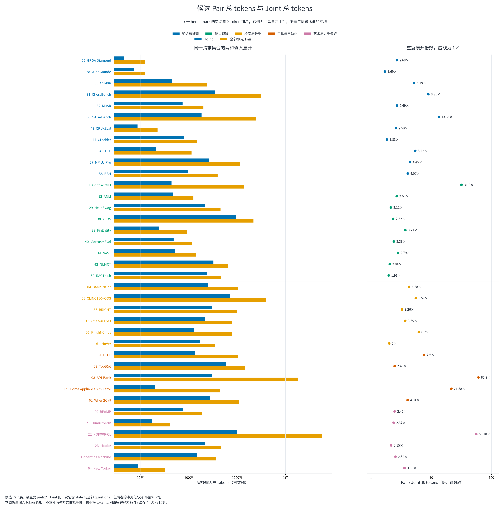

[打开 SVG 放大查看](figures/13-total-candidate-pair-vs-joint-tokens.svg)

### 整组完全正确指标会放大字段错误

| 任务 | 平均字段/请求 | 最多字段 | 原生要求 |
| --- | --- | --- | --- |
| BFCL | 2.81 | 37 | 对话和函数 schema；逐工具 yes/no，但最终要求整组工具选择完全正确。 |
| Home appliance simulator | 18.07 | 19 | 家居设备状态、命令和策略，混合设备成员、处理状态、数值与结果判断。 |
| SATA-Bench | 9.4 | 16 | 同一源题对多个答案分别判断 yes/no。 |

仅作数学示意：若每字段正确率为 95%，且错误独立，15 个字段全部正确约为 **46.33%**，18 个约为 **39.72%**。真实错误可能相关，所以这不是实际成绩预测；它说明字段准确率与整案例准确率为什么不能互换。ACOS 又不同，它按评论 F1，不应套用整组 exact。

## 6. 来源关联、重复展示和可见输入歧义

| Benchmark | 来源关联键 | 来源组数 | 请求成员数 | 最大组 | 解释 |
| --- | --- | --- | --- | --- | --- |
| BPoMP | group_id | 811 | 5,000 | 41 | 相同来源组可含多条请求 |
| POP909-CL | song_id | 792 | 2,000 | 8 | 相同来源组可含多条请求 |
| cfcolor | user_id | 669 | 5,000 | 190 | 相同来源组可含多条请求 |
| ACOS | group_id | 400 | 1,565 | 6 | 相同来源组可含多条请求 |
| NLI4CT | trial_ids | 249 | 8,447 | 71 | 一个请求可关联多个 trial，成员数不是独立请求数 |
| Habermas Machine | group_id | 1,676 | 1,676 | 1 | 相同来源组可含多条请求 |
| Habermas Machine | question_id | 728 | 1,676 | 20 | 相同来源组可含多条请求 |
| When2Call | bfcl_source_id | 1,295 | 3,652 | 3 | 相同来源组可含多条请求 |
| New Yorker | contest_number | 141 | 528 | 6 | 相同来源组可含多条请求 |
| RAGTruth | source_task_id | 450 | 2,700 | 6 | 相同来源组可含多条请求 |
| HoVer | hpqa_id | 1,592 | 4,000 | 18 | 相同来源组可含多条请求 |
| GSM8K | group_id | 1,319 | 2,638 | 2 | 相同来源组可含多条请求 |
| GSM8K | answer_group | 132 | 2,638 | 20 | 相同来源组可含多条请求 |

**When2Call 与 BFCL：**全部 1,295 个唯一来源 ID 交集为 1,295，覆盖 When2Call 来源的 **100%**。输入格式和目标不同，所以没有发现相同非平凡 state 文本并不能否定这种关联。源 ID 连接比“直接比较 JSON 文本”更有解释力。

| Benchmark | 请求 | 不同完整可见输入 | 重复展示比例 |
| --- | --- | --- | --- |
| CLadder | 5,000 | 4,545 | 9.1% |
| BPoMP | 5,000 | 4,753 | 4.94% |
| VAST | 3,006 | 2,917 | 2.96% |
| ToolRet | 685 | 679 | 0.88% |
| ContractNLI | 123 | 122 | 0.81% |
| FinEntity | 979 | 972 | 0.72% |
| HoVer | 4,000 | 3,982 | 0.45% |
| iSarcasmEval | 4,600 | 4,588 | 0.26% |
| RAGTruth | 2,700 | 2,693 | 0.26% |
| NLI4CT | 5,500 | 5,495 | 0.09% |
| BBH | 5,507 | 5,503 | 0.07% |
| POP909-CL | 2,000 | 1,999 | 0.05% |

完整输入相同的定义是 state + 全部 questions 相同，忽略答案与元数据。**state 相同不是样本重复**：例如 ANLI 的 state 都是空对象，真正内容在 instructions；New Yorker 共享漫画场景而 caption 候选不同。反过来，CLadder 9.10% 的完整输入重复是真实的重复展示，不能当作独立新题。

| Benchmark | 完整输入标签冲突组 | 涉及请求 | 实际 Pair 标签冲突组 | 涉及 Pair 展示 | 解释 |
| --- | --- | --- | --- | --- | --- |
| VAST | 10 | 21 | 21 | 45 | 同一可见输入或当前表示可能对应不同目标 |
| NLI4CT | 1 | 2 | 2 | 4 | 同一可见输入或当前表示可能对应不同目标 |
| PhishNChips | 0 | 0 | 2,000 | 4,000 | 仅极简辅助字段；不是主 verdict |
| MMLU-Pro | 0 | 0 | 1 | 2 | 同一可见输入或当前表示可能对应不同目标 |
| BBH | 2 | 4 | 5 | 10 | 同一可见输入或当前表示可能对应不同目标 |
| HoVer | 1 | 2 | 2 | 4 | 同一可见输入或当前表示可能对应不同目标 |
| When2Call | 0 | 0 | 16 | 32 | 同一可见输入或当前表示可能对应不同目标 |

**这里的“冲突”不自动等于上游标错。** 它可能来自原标签歧义、任务转换省略条件，或同一候选在不同完整选项集合中的角色变化。VAST 等是完整可见输入相同而 gold 不同；MMLU-Pro / When2Call 的部分冲突只在现有 Pair 表示中出现，不能直接归罪原始多选题。

**已确认的一个表示局限：**PhishNChips 的 `verdict_alt_minimal` 只有 phishing/legitimate 选项键、没有说明文字。现有候选匹配缓存只取说明文字，两个候选变成同一个空字符串，2,000 条该辅助题因此不能靠当前 Pair 输入区分两种选项。主评分 `verdict` 有完整的不同说明文字，缓存候选也不同，**没有这个问题**。本轮只记录发现，没有修改缓存或影响正在运行的会话。

### 只测 state 会漏掉大量真实输入

以下任务的 state 全部为空，但真实题面在 instructions 或候选：BANKING77、CLINC150+OOS、ANLI、Humicroedit、GPQA Diamond、WinoGrande、HellaSwag、MuSR、VAST、CLadder、HLE。因此旧的 state 字符长度或混合 proxy_tokens 不适合作为统一输入长度分布。

语言覆盖另外保留了元数据 locale 分布和阿拉伯/CJK 字符出现率。字符出现只是脚本线索，不等于整条输入的语言分类；iSarcasmEval 的阿拉伯文轨道也不能混入 A-English headline。

## 7. 候选长度与答案位置：数据捷径有多强

| Benchmark | 选最长候选命中率 | 选最短候选命中率 | 第一位置可接受率 | 说明 |
| --- | --- | --- | --- | --- |
| BPoMP | 79.07% | 20.93% | 49.74% | 二选一；长度痕迹最突出 |
| Habermas Machine | 56.53% | 9.79% | 31.92% | 可并列最佳；请求微平均参照 |
| MMLU-Pro | 19.07% | 10.02% | 11.66% | 不同学科 3–10 选 |
| HellaSwag | 24.13% | 25.2% | 25.04% | 四选一；长度参照接近随机 |
| When2Call | 17.96% | 29.13% | 0% | 第一位置 direct 从未为 gold |
| CLINC150+OOS | 18.18% | 0.55% | 0.55% | 第一类不是多数类 OOS |

计算只看**候选文本 token 数**；最长或最短有并列时按并列候选均匀选择，正确答案允许官方 accepted 集合。它是数据结构参照，不是训练后的模型分数。BPoMP 原生按扰动类别宏平均，因此 79.07% 的请求微平均也不能直接当作官方成绩。

位置分布用于识别数据的答案先验，不表示应该给模型写逐 benchmark 固定答案。固定语义类（如 NLI、intent）与随机位置类（如一般 MCQ）分开解释；混合轨道的答案键熵也不当作语义类别熵。

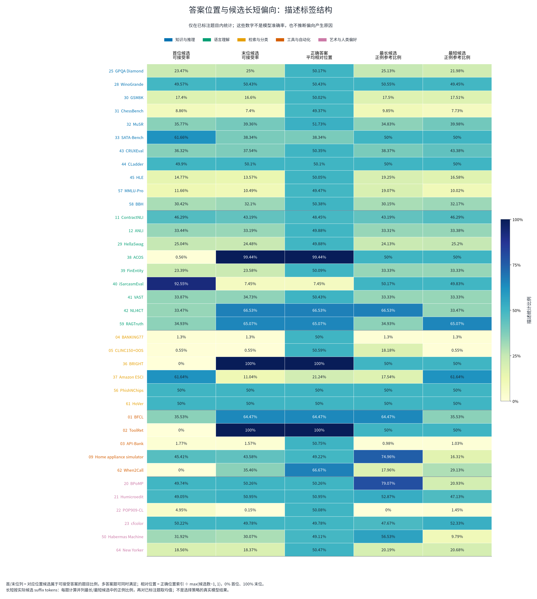

[打开 SVG 放大查看](figures/12-answer-position-and-candidate-length-bias.svg)

## 8. 与已有模型表现的关联：能说什么、不能说什么

读取官方榜单 **2026-10-29T14:04:16Z** 快照，共 **247 个模型条目**，没有新增模型推理。每项取已有公开 Skill；完整覆盖模型的定义是该项 coverage 至少 99.99%。37 项之间使用 Spearman 相关，只作描述。

| 数据特征 | 与完整覆盖模型 Skill 中位数的相关 | 项数 |
| --- | --- | --- |
| Joint P95 | 0.01 | 37 |
| 实际最大 Pair 的 P95 | -0.03 | 37 |
| 平均候选数 | 0.04 | 37 |
| 平均题数/请求 | 0.02 | 37 |
| 匹配正例率 | -0.04 | 37 |
| Pair/Joint token 比 | 0.03 | 37 |
| 第一位置答案比例 | -0.14 | 37 |

这些数整体很弱：**跨任务的长度、候选数或标签密度，都不能单独解释模型表现。** 任务技能、原生指标、训练覆盖、模型结构和题面构造一起变化。分模型规模（<2B、2–10B、≥10B）的表也已保存；它们仍不是控制变量实验，更不是“长度没有影响”的证明。

| 当前较难项 | 完整覆盖模型 Skill 中位数 | 参与模型 | 完整覆盖模型 |
| --- | --- | --- | --- |
| HLE | 0 | 247 | 222 |
| ChessBench | 8.13 | 247 | 238 |
| POP909 | 16.61 | 247 | 206 |
| Habermas | 19.12 | 247 | 245 |
| ACOS | 19.75 | 247 | 244 |
| GPQA Diamond | 21.77 | 247 | 245 |
| Humicroedit | 22.37 | 247 | 246 |
| cfcolor | 22.44 | 247 | 245 |
| CRUXEval | 26.24 | 247 | 244 |
| SATA-Bench | 26.86 | 247 | 245 |

HLE 的典型输入不特别长，但 222 个完整覆盖模型的原始准确率中位数仅 **12.28%**，低于其机会基线 **16.41%**。它的 Skill 中位数为 0；由于 Skill 会把低于随机的部分截到 0，**Skill=0 不能解释成原始表现恰好接近随机**。POP909 和 API-Bank 虽然编码很重，难点也不只有长度。逐项模型与数据连接表见 [data-vs-public-skill.csv](tables/data-vs-public-skill.csv)。

## 9. 37 项逐项数据卡

以下每张卡都使用完整公开输入范围。**iSarcasm 的长度是全部套件输入，headline 标签另取 A-English；Phish 的长度含九问题，但主指标只取 verdict。** 原生指标已按当前面板覆盖旧 catalog 文案，ACOS 使用逐评论 F1。

### 知识与推理

| Benchmark | 请求 | 问题 | 平均候选 | Joint P50 / P95 | 实际 Pair 最大值 P95 | 匹配正例率 |
| --- | --- | --- | --- | --- | --- | --- |
| GPQA Diamond | 196 | 196 | 4 | 196.5 / 443.5 | 305 | 25% |
| WinoGrande | 1,267 | 1,267 | 2 | 57 / 66 | 58 | 50% |
| GSM8K | 2,638 | 2,638 | 7 | 170 / 230 | 171 | 14.29% |
| ChessBench | 5,000 | 5,000 | 29.53 | 749 / 1,006.05 | 224 | 5.17% |
| MuSR | 752 | 752 | 2.9 | 1,006 / 1,389.15 | 1,314 | 34.53% |
| SATA-Bench | 1,650 | 1.55万 | 2 | 841 / 2,431.8 | 1,810.1 | 50% |
| CRUXEval | 570 | 570 | 3.2 | 139 / 252.3 | 172 | 31.25% |
| CLadder | 5,000 | 5,000 | 2 | 147 / 259 | 245 | 50% |
| HLE | 501 | 501 | 6.87 | 233 / 1,237 | 949 | 14.55% |
| MMLU-Pro | 1.2万 | 1.2万 | 9.47 | 182 / 453 | 252 | 10.56% |
| BBH | 5,507 | 5,507 | 4.49 | 164 / 317 | 257 | 22.29% |

#### 25. GPQA Diamond

**任务与指标：**GPQA Diamond 原始 4 选 1 问题，主要内容在 instructions。 原生指标：accuracy；公开权重约 **2.58%**。

- **数据规模：**196 请求、196 问题、784 Pair；每请求平均 1 题、最多 1 题；每题平均 4 候选、最多 4。

- **Joint 长度：**P50 **196.5**；P95 **443.5**；P99 **788.45**；最大 **2,789** token。

- **实际 Pair：**请求最大分支的 P50 **146.5**、P95 **305**、P99 **462.25**；该项最长单 Pair **944** token。

- **匹配标签：**正 196、负 588、未标注 0；已标注内正例 **25%**，正例 token 份额 **24.99%**。

- **编码量：**Pair 共 **12.28万 token**，约为本项 Joint 总 token 的 **2.68×**。

- **上下文余量：**1,024 上限仍有 0 条 Pair 请求超限；2,048 上限仍有 0 条 Pair 请求超限；4,096 上限仍有 0 条 Pair 请求超限；8,192 上限仍有 0 条 Pair 请求超限。

- **数据解读：**当前有效 196 题，不沿用 198；state 为空。知识难度与题面长度不是同一维度。

#### 28. WinoGrande

**任务与指标：**填空句与两个原始候选；二选一，不是语义正负分类。 原生指标：accuracy；公开权重约 **2.58%**。

- **数据规模：**1,267 请求、1,267 问题、2,534 Pair；每请求平均 1 题、最多 1 题；每题平均 2 候选、最多 2。

- **Joint 长度：**P50 **57**；P95 **66**；P99 **68**；最大 **74** token。

- **实际 Pair：**请求最大分支的 P50 **48**、P95 **58**、P99 **63**；该项最长单 Pair **69** token。

- **匹配标签：**正 1,267、负 1,267、未标注 0；已标注内正例 **50%**，正例 token 份额 **50.01%**。

- **编码量：**Pair 共 **12.4万 token**，约为本项 Joint 总 token 的 **1.69×**。

- **上下文余量：**1,024 上限仍有 0 条 Pair 请求超限；2,048 上限仍有 0 条 Pair 请求超限；4,096 上限仍有 0 条 Pair 请求超限；8,192 上限仍有 0 条 Pair 请求超限。

- **数据解读：**当前归入知识与推理。长度很短，正确答案位置接近平衡。

#### 30. GSM8K

**任务与指标：**1,319 道原始数学题，各做 4 选和 10 选两个版本。 原生指标：accuracy, 4- and 10-choice tracks averaged；公开权重约 **2.15%**。

- **数据规模：**2,638 请求、2,638 问题、1.85万 Pair；每请求平均 1 题、最多 1 题；每题平均 7 候选、最多 10。

- **Joint 长度：**P50 **170**；P95 **230**；P99 **255.63**；最大 **328** token。

- **实际 Pair：**请求最大分支的 P50 **124**、P95 **171**、P99 **193.63**；该项最长单 Pair **255** token。

- **匹配标签：**正 2,638、负 1.58万、未标注 0；已标注内正例 **14.29%**，正例 token 份额 **14.26%**。

- **编码量：**Pair 共 **235.08万 token**，约为本项 Joint 总 token 的 **5.19×**。

- **上下文余量：**1,024 上限仍有 0 条 Pair 请求超限；2,048 上限仍有 0 条 Pair 请求超限；4,096 上限仍有 0 条 Pair 请求超限；8,192 上限仍有 0 条 Pair 请求超限。

- **数据解读：**2,638 请求不是 2,638 道独立数学题；132 个答案组还共享候选。两轨需分别机会校正后平均，不能只把 14.29% 当统一随机基线。

#### 31. ChessBench

**任务与指标：**棋局 FEN、棋盘与所有合法着法，接受所有并列最佳着法。 原生指标：best-move accuracy (ties accepted)；公开权重约 **2.15%**。

- **数据规模：**5,000 请求、5,000 问题、14.76万 Pair；每请求平均 1 题、最多 1 题；每题平均 29.53 候选、最多 81。

- **Joint 长度：**P50 **749**；P95 **1,006.05**；P99 **1,113.01**；最大 **1,652** token。

- **实际 Pair：**请求最大分支的 P50 **216**、P95 **224**、P99 **227**；该项最长单 Pair **231** token。

- **匹配标签：**正 7,629、负 14万、未标注 0；已标注内正例 **5.17%**，正例 token 份额 **5.06%**。

- **编码量：**Pair 共 **3180.98万 token**，约为本项 Joint 总 token 的 **8.95×**。

- **上下文余量：**1,024 上限仍有 0 条 Pair 请求超限；2,048 上限仍有 0 条 Pair 请求超限；4,096 上限仍有 0 条 Pair 请求超限；8,192 上限仍有 0 条 Pair 请求超限。

- **数据解读：**每题平均 29.53 个合法着法；289 个局面有多个可接受最佳着法。实际正确候选为 7,629 个，不是简单的 5,000 个。

#### 32. MuSR

**任务与指标：**故事、问题与可变数量原始候选。 原生指标：accuracy；公开权重约 **2.15%**。

- **数据规模：**752 请求、752 问题、2,178 Pair；每请求平均 1 题、最多 1 题；每题平均 2.9 候选、最多 5。

- **Joint 长度：**P50 **1,006**；P95 **1,389.15**；P99 **1,496.43**；最大 **1,615** token。

- **实际 Pair：**请求最大分支的 P50 **966**、P95 **1,314**、P99 **1,435.33**；该项最长单 Pair **1,527** token。

- **匹配标签：**正 752、负 1,426、未标注 0；已标注内正例 **34.53%**，正例 token 份额 **35.38%**。

- **编码量：**Pair 共 **201.41万 token**，约为本项 Joint 总 token 的 **2.69×**。

- **上下文余量：**1,024 上限仍有 332 条 Pair 请求超限；2,048 上限仍有 0 条 Pair 请求超限；4,096 上限仍有 0 条 Pair 请求超限；8,192 上限仍有 0 条 Pair 请求超限。

- **数据解读：**较长故事是主要输入负担；当前 752 题。全部问题内容可能在 instructions，不能从 state 估计长度。

#### 33. SATA-Bench

**任务与指标：**同一源题对多个答案分别判断 yes/no。 原生指标：case exact accuracy；公开权重约 **2.15%**。

- **数据规模：**1,650 请求、1.55万 问题、3.1万 Pair；每请求平均 9.4 题、最多 16 题；每题平均 2 候选、最多 2。

- **Joint 长度：**P50 **841**；P95 **2,431.8**；P99 **3,917.97**；最大 **5,826** token。

- **实际 Pair：**请求最大分支的 P50 **482.5**、P95 **1,810.1**、P99 **3,287.56**；该项最长单 Pair **5,193** token。

- **匹配标签：**正 1.55万、负 1.55万、未标注 0；已标注内正例 **50%**，正例 token 份额 **50%**。

- **编码量：**Pair 共 **2456.5万 token**，约为本项 Joint 总 token 的 **13.38×**。

- **上下文余量：**1,024 上限仍有 279 条 Pair 请求超限；2,048 上限仍有 61 条 Pair 请求超限；4,096 上限仍有 4 条 Pair 请求超限；8,192 上限仍有 0 条 Pair 请求超限。

- **数据解读：**字段 yes 为 38.34%；指标却是整套答案集合完全正确率。约 9.40 个字段的错误会累积，而不是简单逐字段平均。

#### 43. CRUXEval

**任务与指标：**Python 函数、给定输入与错误输出干扰项，选择正确输出。 原生指标：accuracy；公开权重约 **2.15%**。

- **数据规模：**570 请求、570 问题、1,824 Pair；每请求平均 1 题、最多 1 题；每题平均 3.2 候选、最多 10。

- **Joint 长度：**P50 **139**；P95 **252.3**；P99 **338.31**；最大 **825** token。

- **实际 Pair：**请求最大分支的 P50 **122**、P95 **172**、P99 **199.1**；该项最长单 Pair **811** token。

- **匹配标签：**正 570、负 1,254、未标注 0；已标注内正例 **31.25%**，正例 token 份额 **30.41%**。

- **编码量：**Pair 共 **22.68万 token**，约为本项 Joint 总 token 的 **2.59×**。

- **上下文余量：**1,024 上限仍有 0 条 Pair 请求超限；2,048 上限仍有 0 条 Pair 请求超限；4,096 上限仍有 0 条 Pair 请求超限；8,192 上限仍有 0 条 Pair 请求超限。

- **数据解读：**候选数 2–10，平均 3.20；不是开放代码生成，也不是执行通过率。

#### 44. CLadder

**任务与指标：**背景、给定概率及因果问题，yes/no。 原生指标：accuracy；公开权重约 **2.15%**。

- **数据规模：**5,000 请求、5,000 问题、1万 Pair；每请求平均 1 题、最多 1 题；每题平均 2 候选、最多 2。

- **Joint 长度：**P50 **147**；P95 **259**；P99 **323**；最大 **342** token。

- **实际 Pair：**请求最大分支的 P50 **133**、P95 **245**、P99 **309**；该项最长单 Pair **328** token。

- **匹配标签：**正 5,000、负 5,000、未标注 0；已标注内正例 **50%**，正例 token 份额 **50%**。

- **编码量：**Pair 共 **147.31万 token**，约为本项 Joint 总 token 的 **1.83×**。

- **上下文余量：**1,024 上限仍有 0 条 Pair 请求超限；2,048 上限仍有 0 条 Pair 请求超限；4,096 上限仍有 0 条 Pair 请求超限；8,192 上限仍有 0 条 Pair 请求超限。

- **数据解读：**yes 49.90%，但完整可见输入有 9.10% 的重复展示；均衡不代表每条输入独立。

#### 45. HLE

**任务与指标：**仅 HLE 纯文本多选子集，5–26 个候选。 原生指标：accuracy；公开权重约 **2.58%**。

- **数据规模：**501 请求、501 问题、3,444 Pair；每请求平均 1 题、最多 1 题；每题平均 6.87 候选、最多 26。

- **Joint 长度：**P50 **233**；P95 **1,237**；P99 **3,058**；最大 **1.23万** token。

- **实际 Pair：**请求最大分支的 P50 **164**、P95 **949**、P99 **2,945**；该项最长单 Pair **5,575** token。

- **匹配标签：**正 501、负 2,943、未标注 0；已标注内正例 **14.55%**，正例 token 份额 **12.96%**。

- **编码量：**Pair 共 **114.55万 token**，约为本项 Joint 总 token 的 **5.42×**。

- **上下文余量：**1,024 上限仍有 23 条 Pair 请求超限；2,048 上限仍有 6 条 Pair 请求超限；4,096 上限仍有 4 条 Pair 请求超限；8,192 上限仍有 0 条 Pair 请求超限。

- **数据解读：**不是完整 HLE；题面中位数不长，但最大 Joint 超过 1.23 万 token。该项公开 Skill 的模型中位数很低，不能用长度解释知识难度。

#### 57. MMLU-Pro

**任务与指标：**14 学科原始 MMLU-Pro，多选数实际 3–10。 原生指标：accuracy；公开权重约 **2.58%**。

- **数据规模：**1.2万 请求、1.2万 问题、11.4万 Pair；每请求平均 1 题、最多 1 题；每题平均 9.47 候选、最多 10。

- **Joint 长度：**P50 **182**；P95 **453**；P99 **660.38**；最大 **1,669** token。

- **实际 Pair：**请求最大分支的 P50 **80**、P95 **252**、P99 **400**；该项最长单 Pair **1,553** token。

- **匹配标签：**正 1.2万、负 10.2万、未标注 0；已标注内正例 **10.56%**，正例 token 份额 **10.66%**。

- **编码量：**Pair 共 **1155.54万 token**，约为本项 Joint 总 token 的 **4.45×**。

- **上下文余量：**1,024 上限仍有 3 条 Pair 请求超限；2,048 上限仍有 0 条 Pair 请求超限；4,096 上限仍有 0 条 Pair 请求超限；8,192 上限仍有 0 条 Pair 请求超限。

- **数据解读：**平均 9.47 个候选，不应固定当作十选一。部分题面重复，但候选不同，因此不能由 state 重复率推出完整请求重复。

#### 58. BBH

**任务与指标：**23 个文件的混合 BBH 任务，含不同固定答案集和多选。 原生指标：accuracy；公开权重约 **2.58%**。

- **数据规模：**5,507 请求、5,507 问题、2.47万 Pair；每请求平均 1 题、最多 1 题；每题平均 4.49 候选、最多 18。

- **Joint 长度：**P50 **164**；P95 **317**；P99 **360.94**；最大 **608** token。

- **实际 Pair：**请求最大分支的 P50 **136**、P95 **257**、P99 **315.88**；该项最长单 Pair **597** token。

- **匹配标签：**正 5,507、负 1.92万、未标注 0；已标注内正例 **22.29%**，正例 token 份额 **19.42%**。

- **编码量：**Pair 共 **393.2万 token**，约为本项 Joint 总 token 的 **4.07×**。

- **上下文余量：**1,024 上限仍有 0 条 Pair 请求超限；2,048 上限仍有 0 条 Pair 请求超限；4,096 上限仍有 0 条 Pair 请求超限；8,192 上限仍有 0 条 Pair 请求超限。

- **数据解读：**任务家族、候选数及位置差异很大；先按轨道观察，不能把所有答案键当同一种语义类别。

### 语言理解

| Benchmark | 请求 | 问题 | 平均候选 | Joint P50 / P95 | 实际 Pair 最大值 P95 | 匹配正例率 |
| --- | --- | --- | --- | --- | --- | --- |
| ContractNLI | 123 | 2,091 | 3 | 3,239 / 6,159.2 | 4,798.9 | 33.33% |
| ANLI | 3,200 | 3,200 | 3 | 147 / 187 | 171 | 33.33% |
| HellaSwag | 1万 | 1万 | 4 | 241 / 294 | 158 | 25% |
| ACOS | 1,565 | 9.11万 | 2 | 6,552 / 6,727 | 143 | 50% |
| FinEntity | 979 | 2,129 | 3 | 227 / 498.3 | 179.1 | 33.33% |
| iSarcasmEval | 4,600 | 1.16万 | 2 | 61 / 225 | 70 | 50% |
| VAST | 3,006 | 3,006 | 3 | 161 / 271.75 | 259 | 33.33% |
| NLI4CT | 5,500 | 5,500 | 2 | 473.5 / 1,448 | 1,471 | 50% |
| RAGTruth | 2,700 | 2,700 | 2 | 798 / 1,546.05 | 1,530.05 | 50% |

#### 11. ContractNLI

**任务与指标：**每份完整合同判断 17 个固定法律假设：蕴含、矛盾或未提及。 原生指标：conservative macro-F1；公开权重约 **2.75%**。

- **数据规模：**123 请求、2,091 问题、6,273 Pair；每请求平均 17 题、最多 17 题；每题平均 3 候选、最多 3。

- **Joint 长度：**P50 **3,239**；P95 **6,159.2**；P99 **8,907.04**；最大 **9,366** token。

- **实际 Pair：**请求最大分支的 P50 **1,922**、P95 **4,798.9**、P99 **7,540.06**；该项最长单 Pair **7,977** token。

- **匹配标签：**正 2,091、负 4,182、未标注 0；已标注内正例 **33.33%**，正例 token 份额 **33.34%**。

- **编码量：**Pair 共 **1403.19万 token**，约为本项 Joint 总 token 的 **31.8×**。

- **上下文余量：**1,024 上限仍有 107 条 Pair 请求超限；2,048 上限仍有 51 条 Pair 请求超限；4,096 上限仍有 13 条 Pair 请求超限；8,192 上限仍有 0 条 Pair 请求超限。

- **数据解读：**123 份合同并不等于 2,091 份独立长文；合同是关联单位。4,096 Pair 上限仍放不下 13 份合同。

#### 12. ANLI

**任务与指标：**对抗性 premise/hypothesis 三分类；输入主要在 instructions。 原生指标：macro-F1；公开权重约 **3.3%**。

- **数据规模：**3,200 请求、3,200 问题、9,600 Pair；每请求平均 1 题、最多 1 题；每题平均 3 候选、最多 3。

- **Joint 长度：**P50 **147**；P95 **187**；P99 **216**；最大 **262** token。

- **实际 Pair：**请求最大分支的 P50 **131**、P95 **171**、P99 **200**；该项最长单 Pair **256** token。

- **匹配标签：**正 3,200、负 6,400、未标注 0；已标注内正例 **33.33%**，正例 token 份额 **33.33%**。

- **编码量：**Pair 共 **125.19万 token**，约为本项 Joint 总 token 的 **2.66×**。

- **上下文余量：**1,024 上限仍有 0 条 Pair 请求超限；2,048 上限仍有 0 条 Pair 请求超限；4,096 上限仍有 0 条 Pair 请求超限；8,192 上限仍有 0 条 Pair 请求超限。

- **数据解读：**三类约各三分之一，长度整体很短。观察不到长上下文负担不代表自然语言推断本身简单。

#### 29. HellaSwag

**任务与指标：**场景文本与 4 个续写候选。 原生指标：accuracy；公开权重约 **3.3%**。

- **数据规模：**1万 请求、1万 问题、4.02万 Pair；每请求平均 1 题、最多 1 题；每题平均 4 候选、最多 4。

- **Joint 长度：**P50 **241**；P95 **294**；P99 **312**；最大 **394** token。

- **实际 Pair：**请求最大分支的 P50 **129**、P95 **158**、P99 **327**；该项最长单 Pair **388** token。

- **匹配标签：**正 1万、负 3.01万、未标注 0；已标注内正例 **25%**，正例 token 份额 **25.03%**。

- **编码量：**Pair 共 **452.99万 token**，约为本项 Joint 总 token 的 **2.12×**。

- **上下文余量：**1,024 上限仍有 0 条 Pair 请求超限；2,048 上限仍有 0 条 Pair 请求超限；4,096 上限仍有 0 条 Pair 请求超限；8,192 上限仍有 0 条 Pair 请求超限。

- **数据解读：**选择较长候选仅约 24%，接近四选一水平；与 BPoMP 的长度痕迹不同。

#### 38. ACOS

**任务与指标：**评论中是否出现某个类别×情感组合；每条评论分成多个问题块。 原生指标：per-review F1；公开权重约 **2.75%**。

- **数据规模：**1,565 请求、9.11万 问题、18.22万 Pair；每请求平均 58.21 题、最多 64 题；每题平均 2 候选、最多 2。

- **Joint 长度：**P50 **6,552**；P95 **6,727**；P99 **6,739.36**；最大 **6,773** token。

- **实际 Pair：**请求最大分支的 P50 **122**、P95 **143**、P99 **154**；该项最长单 Pair **203** token。

- **匹配标签：**正 9.11万、负 9.11万、未标注 0；已标注内正例 **50%**，正例 token 份额 **50%**。

- **编码量：**Pair 共 **2176.26万 token**，约为本项 Joint 总 token 的 **2.32×**。

- **上下文余量：**1,024 上限仍有 0 条 Pair 请求超限；2,048 上限仍有 0 条 Pair 请求超限；4,096 上限仍有 0 条 Pair 请求超限；8,192 上限仍有 0 条 Pair 请求超限。

- **数据解读：**91,092 个二元字段中 yes 只有 508 个（0.56%）。全答 no 的字段正确率达 99.44%，但不能识别任何正组合；原生看逐评论 F1。

#### 39. FinEntity

**任务与指标：**给定实体跨度，对金融文档中的实体做三类情感判断。 原生指标：macro-F1；公开权重约 **2.75%**。

- **数据规模：**979 请求、2,129 问题、6,387 Pair；每请求平均 2.17 题、最多 17 题；每题平均 3 候选、最多 3。

- **Joint 长度：**P50 **227**；P95 **498.3**；P99 **685.22**；最大 **1,629** token。

- **实际 Pair：**请求最大分支的 P50 **134**、P95 **179.1**、P99 **208.44**；该项最长单 Pair **273** token。

- **匹配标签：**正 2,129、负 4,258、未标注 0；已标注内正例 **33.33%**，正例 token 份额 **33.33%**。

- **编码量：**Pair 共 **90.84万 token**，约为本项 Joint 总 token 的 **3.71×**。

- **上下文余量：**1,024 上限仍有 0 条 Pair 请求超限；2,048 上限仍有 0 条 Pair 请求超限；4,096 上限仍有 0 条 Pair 请求超限；8,192 上限仍有 0 条 Pair 请求超限。

- **数据解读：**Neutral 约 53%；文档内多个实体相关。不是实体抽取任务，不能把给定跨度当作模型已识别实体。

#### 40. iSarcasmEval

**任务与指标：**包含 A/B/C、英语/阿拉伯语的多个轨道。 原生指标：conservative sarcasm F1, track A English；公开权重约 **2.75%**。

- **数据规模：**4,600 请求、1.16万 问题、2.32万 Pair；每请求平均 2.52 题、最多 6 题；每题平均 2 候选、最多 2。

- **Joint 长度：**P50 **61**；P95 **225**；P99 **244**；最大 **341** token。

- **实际 Pair：**请求最大分支的 P50 **45**、P95 **70**、P99 **91.01**；该项最长单 Pair **250** token。

- **匹配标签：**正 1.16万、负 1.16万、未标注 0；已标注内正例 **50%**，正例 token 份额 **50.01%**。

- **编码量：**Pair 共 **115.9万 token**，约为本项 Joint 总 token 的 **2.38×**。

- **上下文余量：**1,024 上限仍有 0 条 Pair 请求超限；2,048 上限仍有 0 条 Pair 请求超限；4,096 上限仍有 0 条 Pair 请求超限；8,192 上限仍有 0 条 Pair 请求超限。

- **数据解读：**主榜只取 A-English：1,400 条中讽刺 200 条（14.29%）。本报告长度覆盖仍包括完整 4,600 条套件请求；不要把 11,600 个全部字段当 headline 样本量。

#### 41. VAST

**任务与指标：**主题加帖子，判断 against / favor / neutral。 原生指标：conservative macro-F1；公开权重约 **2.75%**。

- **数据规模：**3,006 请求、3,006 问题、9,018 Pair；每请求平均 1 题、最多 1 题；每题平均 3 候选、最多 3。

- **Joint 长度：**P50 **161**；P95 **271.75**；P99 **288.95**；最大 **328** token。

- **实际 Pair：**请求最大分支的 P50 **149**、P95 **259**、P99 **282**；该项最长单 Pair **315** token。

- **匹配标签：**正 3,006、负 6,012、未标注 0；已标注内正例 **33.33%**，正例 token 份额 **33.33%**。

- **编码量：**Pair 共 **144.09万 token**，约为本项 Joint 总 token 的 **2.79×**。

- **上下文余量：**1,024 上限仍有 0 条 Pair 请求超限；2,048 上限仍有 0 条 Pair 请求超限；4,096 上限仍有 0 条 Pair 请求超限；8,192 上限仍有 0 条 Pair 请求超限。

- **数据解读：**三类相对均衡；但发现相同完整可见输入对应不同标签的组，应把这些可见输入歧义与模型错误分开。

#### 42. NLI4CT

**任务与指标：**声明加临床试验指定完整章节，判断蕴含或矛盾。 原生指标：macro-F1；公开权重约 **2.75%**。

- **数据规模：**5,500 请求、5,500 问题、1.1万 Pair；每请求平均 1 题、最多 1 题；每题平均 2 候选、最多 2。

- **Joint 长度：**P50 **473.5**；P95 **1,448**；P99 **2,106**；最大 **2,970** token。

- **实际 Pair：**请求最大分支的 P50 **481**、P95 **1,471**、P99 **2,162.01**；该项最长单 Pair **3,054** token。

- **匹配标签：**正 5,500、负 5,500、未标注 0；已标注内正例 **50%**，正例 token 份额 **50.01%**。

- **编码量：**Pair 共 **659.94万 token**，约为本项 Joint 总 token 的 **2.04×**。

- **上下文余量：**1,024 上限仍有 780 条 Pair 请求超限；2,048 上限仍有 92 条 Pair 请求超限；4,096 上限仍有 0 条 Pair 请求超限；8,192 上限仍有 0 条 Pair 请求超限。

- **数据解读：**矛盾 66.53%、蕴含 33.47%；5,500 请求反复使用 249 个试验 ID。试验是比单条声明更大的来源关联单位。

#### 59. RAGTruth

**任务与指标：**原生成 prompt 的上下文加待评 response，noul true 表示存在幻觉。 原生指标：response-level hallucination F1；公开权重约 **2.75%**。

- **数据规模：**2,700 请求、2,700 问题、5,400 Pair；每请求平均 1 题、最多 1 题；每题平均 2 候选、最多 2。

- **Joint 长度：**P50 **798**；P95 **1,546.05**；P99 **1,996.01**；最大 **2,451** token。

- **实际 Pair：**请求最大分支的 P50 **782**、P95 **1,530.05**、P99 **1,980.01**；该项最长单 Pair **2,435** token。

- **匹配标签：**正 2,700、负 2,700、未标注 0；已标注内正例 **50%**，正例 token 份额 **49.99%**。

- **编码量：**Pair 共 **461万 token**，约为本项 Joint 总 token 的 **1.96×**。

- **上下文余量：**1,024 上限仍有 724 条 Pair 请求超限；2,048 上限仍有 22 条 Pair 请求超限；4,096 上限仍有 0 条 Pair 请求超限；8,192 上限仍有 0 条 Pair 请求超限。

- **数据解读：**幻觉正类 943/2,700（34.93%）；6 个模型回答共享 450 个源 prompt。匹配正例 50% 不等于幻觉占一半。

### 检索与分类

| Benchmark | 请求 | 问题 | 平均候选 | Joint P50 / P95 | 实际 Pair 最大值 P95 | 匹配正例率 |
| --- | --- | --- | --- | --- | --- | --- |
| BANKING77 | 3,080 | 3,080 | 77 | 802 / 820 | 65.05 | 1.3% |
| CLINC150+OOS | 5,500 | 5,500 | 151 | 1,318 / 1,326 | 62 | 0.66% |
| BRIGHT | 220 | 7,040 | 2 | 1.14万 / 2.67万 | 3,713.4 | 50% |
| Amazon ESCI | 5,000 | 5,000 | 4 | 332.5 / 980.1 | 950.05 | 25% |
| PhishNChips | 2,000 | 1.8万 | 2 | 621 / 753 | 363 | 50% |
| HoVer | 4,000 | 4,000 | 2 | 421 / 675 | 680 | 50% |

#### 4. BANKING77

**任务与指标：**银行短消息的 77 类意图分类，真正的用户文本主要在 instructions。 原生指标：macro-F1；公开权重约 **3.64%**。

- **数据规模：**3,080 请求、3,080 问题、23.72万 Pair；每请求平均 1 题、最多 1 题；每题平均 77 候选、最多 77。

- **Joint 长度：**P50 **802**；P95 **820**；P99 **835**；最大 **869** token。

- **实际 Pair：**请求最大分支的 P50 **48**、P95 **65.05**、P99 **81**；该项最长单 Pair **115** token。

- **匹配标签：**正 3,080、负 23.41万、未标注 0；已标注内正例 **1.3%**，正例 token 份额 **1.3%**。

- **编码量：**Pair 共 **1061.21万 token**，约为本项 Joint 总 token 的 **4.28×**。

- **上下文余量：**1,024 上限仍有 0 条 Pair 请求超限；2,048 上限仍有 0 条 Pair 请求超限；4,096 上限仍有 0 条 Pair 请求超限；8,192 上限仍有 0 条 Pair 请求超限。

- **数据解读：**原生 77 类各 40 条，类别完全均衡；展开后却是 1 个匹配、76 个不匹配。不要用 1.30% 判断源数据失衡。

#### 5. CLINC150+OOS

**任务与指标：**150 个意图加 OOS，共 151 个候选。 原生指标：macro-F1；公开权重约 **3.64%**。

- **数据规模：**5,500 请求、5,500 问题、83.05万 Pair；每请求平均 1 题、最多 1 题；每题平均 151 候选、最多 151。

- **Joint 长度：**P50 **1,318**；P95 **1,326**；P99 **1,331**；最大 **1,342** token。

- **实际 Pair：**请求最大分支的 P50 **54**、P95 **62**、P99 **67**；该项最长单 Pair **78** token。

- **匹配标签：**正 5,500、负 82.5万、未标注 0；已标注内正例 **0.66%**，正例 token 份额 **0.68%**。

- **编码量：**Pair 共 **4003.11万 token**，约为本项 Joint 总 token 的 **5.52×**。

- **上下文余量：**1,024 上限仍有 0 条 Pair 请求超限；2,048 上限仍有 0 条 Pair 请求超限；4,096 上限仍有 0 条 Pair 请求超限；8,192 上限仍有 0 条 Pair 请求超限。

- **数据解读：**各 in-scope 类只有 30 条，OOS 有 1,000 条；OOS 是单个普通意图类的 33.33 倍。151 候选也会把短句放大成 83 万个分支。

#### 36. BRIGHT

**任务与指标：**Query 加 BM25 top-32 文档，按相关概率排序。 原生指标：nDCG@10；公开权重约 **3.64%**。

- **数据规模：**220 请求、7,040 问题、1.41万 Pair；每请求平均 32 题、最多 32 题；每题平均 2 候选、最多 2。

- **Joint 长度：**P50 **1.14万**；P95 **2.67万**；P99 **3.12万**；最大 **3.26万** token。

- **实际 Pair：**请求最大分支的 P50 **1,248.5**、P95 **3,713.4**、P99 **6,934.67**；该项最长单 Pair **7,620** token。

- **匹配标签：**正 447、负 447、未标注 1.32万；已标注内正例 **50%**，正例 token 份额 **50%**。

- **编码量：**Pair 共 **1000.15万 token**，约为本项 Joint 总 token 的 **3.26×**。

- **上下文余量：**1,024 上限仍有 138 条 Pair 请求超限；2,048 上限仍有 32 条 Pair 请求超限；4,096 上限仍有 10 条 Pair 请求超限；8,192 上限仍有 0 条 Pair 请求超限。

- **数据解读：**220 个可回答 query 的 Joint P95 超过 2.66 万 token，但最大单 Pair 的 P95 约 3,713。联合处理和逐文档分支是完全不同的上下文压力。

#### 37. Amazon ESCI

**任务与指标：**查询—商品相关性：Exact、Substitute、Complement、Irrelevant。 原生指标：conservative macro-F1；公开权重约 **3.03%**。

- **数据规模：**5,000 请求、5,000 问题、2万 Pair；每请求平均 1 题、最多 1 题；每题平均 4 候选、最多 4。

- **Joint 长度：**P50 **332.5**；P95 **980.1**；P99 **1,319.04**；最大 **2,323** token。

- **实际 Pair：**请求最大分支的 P50 **301.5**、P95 **950.05**、P99 **1,287.05**；该项最长单 Pair **2,293** token。

- **匹配标签：**正 5,000、负 1.5万、未标注 0；已标注内正例 **25%**，正例 token 份额 **24.92%**。

- **编码量：**Pair 共 **788.64万 token**，约为本项 Joint 总 token 的 **3.69×**。

- **上下文余量：**1,024 上限仍有 165 条 Pair 请求超限；2,048 上限仍有 1 条 Pair 请求超限；4,096 上限仍有 0 条 Pair 请求超限；8,192 上限仍有 0 条 Pair 请求超限。

- **数据解读：**Exact 占 61.64%，Complement 仅 3.28%，约 18.79 倍。majority accuracy 不能代替 macro-F1。

#### 56. PhishNChips

**任务与指标：**邮件场景的九问题输入；只有 verdict 是主榜评分目标。 原生指标：accuracy；公开权重约 **3.03%**。

- **数据规模：**2,000 请求、1.8万 问题、3.6万 Pair；每请求平均 9 题、最多 9 题；每题平均 2 候选、最多 2。

- **Joint 长度：**P50 **621**；P95 **753**；P99 **776.01**；最大 **1,181** token。

- **实际 Pair：**请求最大分支的 P50 **231**、P95 **363**、P99 **386.01**；该项最长单 Pair **791** token。

- **匹配标签：**正 8,000、负 8,000、未标注 2万；已标注内正例 **50%**，正例 token 份额 **50%**。

- **编码量：**Pair 共 **782.49万 token**，约为本项 Joint 总 token 的 **6.2×**。

- **上下文余量：**1,024 上限仍有 0 条 Pair 请求超限；2,048 上限仍有 0 条 Pair 请求超限；4,096 上限仍有 0 条 Pair 请求超限；8,192 上限仍有 0 条 Pair 请求超限。

- **数据解读：**headline 正反各 1,000。五个信号问题没有 gold；另一个极简辅助问题只用选项键，当前 Pair 表示把两候选都变为空字符串。此局限不影响有完整描述的主 verdict 字段。

#### 61. HoVer

**任务与指标：**Claim 加官方支持文档完整导言，SUPPORTED / NOT_SUPPORTED。 原生指标：accuracy；公开权重约 **3.03%**。

- **数据规模：**4,000 请求、4,000 问题、8,000 Pair；每请求平均 1 题、最多 1 题；每题平均 2 候选、最多 2。

- **Joint 长度：**P50 **421**；P95 **675**；P99 **811.02**；最大 **986** token。

- **实际 Pair：**请求最大分支的 P50 **422**、P95 **680**、P99 **816.02**；该项最长单 Pair **991** token。

- **匹配标签：**正 4,000、负 4,000、未标注 0；已标注内正例 **50%**，正例 token 份额 **50%**。

- **编码量：**Pair 共 **346.86万 token**，约为本项 Joint 总 token 的 **2×**。

- **上下文余量：**1,024 上限仍有 0 条 Pair 请求超限；2,048 上限仍有 0 条 Pair 请求超限；4,096 上限仍有 0 条 Pair 请求超限；8,192 上限仍有 0 条 Pair 请求超限。

- **数据解读：**正反各 2,000，但这是给定 oracle 文档的判断，不包含开放检索；4,000 请求共享 1,592 个源问题。

### 工具与自动化

| Benchmark | 请求 | 问题 | 平均候选 | Joint P50 / P95 | 实际 Pair 最大值 P95 | 匹配正例率 |
| --- | --- | --- | --- | --- | --- | --- |
| BFCL | 1,694 | 4,768 | 2 | 666 / 1,833 | 1,679.35 | 50% |
| ToolRet | 685 | 2.19万 | 2 | 7,921 / 1.42万 | 2,863.2 | 50% |
| API-Bank | 508 | 508 | 53 | 5,821 / 6,246.3 | 7,190.95 | 1.89% |
| Home appliance simulator | 88 | 1,590 | 2.65 | 2,292.5 / 2,423.55 | 1,116.65 | 37.68% |
| When2Call | 3,652 | 3,652 | 4 | 678 / 1,480.9 | 1,660 | 25% |

#### 1. BFCL

**任务与指标：**对话和函数 schema；逐工具 yes/no，但最终要求整组工具选择完全正确。 原生指标：whole-case accuracy；公开权重约 **4.06%**。

- **数据规模：**1,694 请求、4,768 问题、9,536 Pair；每请求平均 2.81 题、最多 37 题；每题平均 2 候选、最多 2。

- **Joint 长度：**P50 **666**；P95 **1,833**；P99 **2,605.21**；最大 **7,185** token。

- **实际 Pair：**请求最大分支的 P50 **582**、P95 **1,679.35**、P99 **2,328.21**；该项最长单 Pair **5,154** token。

- **匹配标签：**正 4,768、负 4,768、未标注 0；已标注内正例 **50%**，正例 token 份额 **50.01%**。

- **编码量：**Pair 共 **1038.94万 token**，约为本项 Joint 总 token 的 **7.6×**。

- **上下文余量：**1,024 上限仍有 429 条 Pair 请求超限；2,048 上限仍有 40 条 Pair 请求超限；4,096 上限仍有 2 条 Pair 请求超限；8,192 上限仍有 0 条 Pair 请求超限。

- **数据解读：**字段级 yes 为 35.53%；每请求最多 37 个工具判断。字段表现接近不代表整请求表现接近。

#### 2. ToolRet

**任务与指标：**Query 加检索到的工具说明，逐工具判断相关性，最终按 query 排序。 原生指标：nDCG@10；公开权重约 **3.38%**。

- **数据规模：**685 请求、2.19万 问题、4.38万 Pair；每请求平均 32 题、最多 32 题；每题平均 2 候选、最多 2。

- **Joint 长度：**P50 **7,921**；P95 **1.42万**；P99 **2.18万**；最大 **3.15万** token。

- **实际 Pair：**请求最大分支的 P50 **665**、P95 **2,863.2**、P99 **7,451.88**；该项最长单 Pair **2.27万** token。

- **匹配标签：**正 924、负 924、未标注 4.2万；已标注内正例 **50%**，正例 token 份额 **50%**。

- **编码量：**Pair 共 **1440.16万 token**，约为本项 Joint 总 token 的 **2.46×**。

- **上下文余量：**1,024 上限仍有 128 条 Pair 请求超限；2,048 上限仍有 57 条 Pair 请求超限；4,096 上限仍有 26 条 Pair 请求超限；8,192 上限仍有 2 条 Pair 请求超限。

- **数据解读：**未判断不是已确认不相关；仅在已标注匹配对中计算的 50% 没有代表全候选池类别平衡。

#### 3. API-Bank

**任务与指标：**对话前缀加 53 个 API 的完整 catalog，选择下一 API 名称。 原生指标：accuracy；公开权重约 **4.06%**。

- **数据规模：**508 请求、508 问题、2.69万 Pair；每请求平均 1 题、最多 1 题；每题平均 53 候选、最多 53。

- **Joint 长度：**P50 **5,821**；P95 **6,246.3**；P99 **6,372.93**；最大 **6,637** token。

- **实际 Pair：**请求最大分支的 P50 **6,677.5**、P95 **7,190.95**、P99 **7,323.65**；该项最长单 Pair **7,631** token。

- **匹配标签：**正 508、负 2.64万、未标注 0；已标注内正例 **1.89%**，正例 token 份额 **1.89%**。

- **编码量：**Pair 共 **1.82亿 token**，约为本项 Joint 总 token 的 **60.8×**。

- **上下文余量：**1,024 上限仍有 508 条 Pair 请求超限；2,048 上限仍有 508 条 Pair 请求超限；4,096 上限仍有 508 条 Pair 请求超限；8,192 上限仍有 0 条 Pair 请求超限。

- **数据解读：**catalog 本身就很长。当前 Pair 口径下全部 508 条都超过 4,096；反复把 catalog 编进 53 个分支造成主要计算负担。

#### 9. Home appliance simulator

**任务与指标：**家居设备状态、命令和策略，混合设备成员、处理状态、数值与结果判断。 原生指标：case exact accuracy；公开权重约 **3.38%**。

- **数据规模：**88 请求、1,590 问题、4,220 Pair；每请求平均 18.07 题、最多 19 题；每题平均 2.65 候选、最多 9。

- **Joint 长度：**P50 **2,292.5**；P95 **2,423.55**；P99 **2,438.51**；最大 **2,462** token。

- **实际 Pair：**请求最大分支的 P50 **1,073**、P95 **1,116.65**、P99 **1,121.13**；该项最长单 Pair **1,122** token。

- **匹配标签：**正 1,590、负 2,630、未标注 0；已标注内正例 **37.68%**，正例 token 份额 **37.44%**。

- **编码量：**Pair 共 **436.87万 token**，约为本项 Joint 总 token 的 **21.58×**。

- **上下文余量：**1,024 上限仍有 88 条 Pair 请求超限；2,048 上限仍有 0 条 Pair 请求超限；4,096 上限仍有 0 条 Pair 请求超限；8,192 上限仍有 0 条 Pair 请求超限。

- **数据解读：**每请求约 18 题，主指标要求全部正确；不能给这些混合语义统一定义正类。

#### 62. When2Call

**任务与指标：**问题和工具 schema，选择 direct / tool_call / request_for_info / cannot_answer。 原生指标：accuracy；公开权重约 **3.38%**。

- **数据规模：**3,652 请求、3,652 问题、1.46万 Pair；每请求平均 1 题、最多 1 题；每题平均 4 候选、最多 4。

- **Joint 长度：**P50 **678**；P95 **1,480.9**；P99 **2,032**；最大 **4,144** token。

- **实际 Pair：**请求最大分支的 P50 **669**、P95 **1,660**、P99 **2,298.49**；该项最长单 Pair **5,123** token。

- **匹配标签：**正 3,652、负 1.1万、未标注 0；已标注内正例 **25%**，正例 token 份额 **24.93%**。

- **编码量：**Pair 共 **1113.08万 token**，约为本项 Joint 总 token 的 **4.04×**。

- **上下文余量：**1,024 上限仍有 1,001 条 Pair 请求超限；2,048 上限仍有 102 条 Pair 请求超限；4,096 上限仍有 6 条 Pair 请求超限；8,192 上限仍有 0 条 Pair 请求超限。

- **数据解读：**direct 在 gold 中为零；另外三类为 1,295 / 1,062 / 1,295。全部 1,295 个唯一 BFCL 来源 ID 都出现在当前 BFCL 集，不能把两项当作独立数据来源。

### 艺术与人类偏好

| Benchmark | 请求 | 问题 | 平均候选 | Joint P50 / P95 | 实际 Pair 最大值 P95 | 匹配正例率 |
| --- | --- | --- | --- | --- | --- | --- |
| BPoMP | 5,000 | 5,000 | 2 | 155 / 171 | 212 | 50% |
| Humicroedit | 2,628 | 2,628 | 2 | 65 / 83 | 103 | 50% |
| POP909-CL | 2,000 | 2,000 | 129 | 4,972.5 / 6,059.75 | 3,434.2 | 0.78% |
| cfcolor | 5,000 | 5,000 | 2 | 435 / 447 | 479 | 50% |
| Habermas Machine | 1,676 | 1,676 | 3.77 | 856 / 1,186 | 906.5 | 29.12% |
| New Yorker | 528 | 528 | 5 | 165 / 207 | 163 | 20% |

#### 20. BPoMP

**任务与指标：**原始打油诗与扰动版本二选一；目标是原作，不是人类幽默偏好投票。 原生指标：perturbation-macro accuracy；公开权重约 **1.67%**。

- **数据规模：**5,000 请求、5,000 问题、1万 Pair；每请求平均 1 题、最多 1 题；每题平均 2 候选、最多 2。

- **Joint 长度：**P50 **155**；P95 **171**；P99 **181**；最大 **202** token。

- **实际 Pair：**请求最大分支的 P50 **191**、P95 **212**、P99 **226**；该项最长单 Pair **256** token。

- **匹配标签：**正 5,000、负 5,000、未标注 0；已标注内正例 **50%**，正例 token 份额 **50.14%**。

- **编码量：**Pair 共 **190.58万 token**，约为本项 Joint 总 token 的 **2.46×**。

- **上下文余量：**1,024 上限仍有 0 条 Pair 请求超限；2,048 上限仍有 0 条 Pair 请求超限；4,096 上限仍有 0 条 Pair 请求超限；8,192 上限仍有 0 条 Pair 请求超限。

- **数据解读：**选择较长候选的描述性命中率 79.07%；同长均分。这说明构造痕迹很强，不能把高成绩完全解释为审美能力。原生评分按扰动类别宏平均。

#### 21. Humicroedit

**任务与指标：**两条经替词编辑的新闻标题，选择人类平均评分更幽默者。 原生指标：accuracy；公开权重约 **1.67%**。

- **数据规模：**2,628 请求、2,628 问题、5,256 Pair；每请求平均 1 题、最多 1 题；每题平均 2 候选、最多 2。

- **Joint 长度：**P50 **65**；P95 **83**；P99 **90**；最大 **103** token。

- **实际 Pair：**请求最大分支的 P50 **77**、P95 **103**、P99 **114.73**；该项最长单 Pair **134** token。

- **匹配标签：**正 2,628、负 2,628、未标注 0；已标注内正例 **50%**，正例 token 份额 **50.02%**。

- **编码量：**Pair 共 **40.96万 token**，约为本项 Joint 总 token 的 **2.37×**。

- **上下文余量：**1,024 上限仍有 0 条 Pair 请求超限；2,048 上限仍有 0 条 Pair 请求超限；4,096 上限仍有 0 条 Pair 请求超限；8,192 上限仍有 0 条 Pair 请求超限。

- **数据解读：**标题文本主要在候选，state 为空；只测 state 会错误地得到零长度。原始同分对已不在当前范围。

#### 22. POP909-CL

**任务与指标：**MIDI 符号音符上下文，选择 129 个固定和弦音级集合之一；不是音频任务。 原生指标：song-macro accuracy；公开权重约 **1.67%**。

- **数据规模：**2,000 请求、2,000 问题、25.8万 Pair；每请求平均 1 题、最多 1 题；每题平均 129 候选、最多 129。

- **Joint 长度：**P50 **4,972.5**；P95 **6,059.75**；P99 **6,603.01**；最大 **1.62万** token。

- **实际 Pair：**请求最大分支的 P50 **2,143.5**、P95 **3,434.2**、P99 **4,054.06**；该项最长单 Pair **1.52万** token。

- **匹配标签：**正 2,000、负 25.6万、未标注 0；已标注内正例 **0.78%**，正例 token 份额 **0.77%**。

- **编码量：**Pair 共 **5.65亿 token**，约为本项 Joint 总 token 的 **56.18×**。

- **上下文余量：**1,024 上限仍有 1,937 条 Pair 请求超限；2,048 上限仍有 1,088 条 Pair 请求超限；4,096 上限仍有 17 条 Pair 请求超限；8,192 上限仍有 1 条 Pair 请求超限。

- **数据解读：**129 类中本样本只观察到 87 个 gold 类；有的类只有 1 条。129 分支重复编码长音符序列，占全榜 Pair token 约 56%。原生按歌曲宏平均。

#### 23. cfcolor

**任务与指标：**用户历史配色评分加两个新配色，预测用户更偏好哪一个。 原生指标：user-macro accuracy；公开权重约 **1.67%**。

- **数据规模：**5,000 请求、5,000 问题、1万 Pair；每请求平均 1 题、最多 1 题；每题平均 2 候选、最多 2。

- **Joint 长度：**P50 **435**；P95 **447**；P99 **451**；最大 **457** token。

- **实际 Pair：**请求最大分支的 P50 **469**、P95 **479**、P99 **483**；该项最长单 Pair **487** token。

- **匹配标签：**正 5,000、负 5,000、未标注 0；已标注内正例 **50%**，正例 token 份额 **49.99%**。

- **编码量：**Pair 共 **467.12万 token**，约为本项 Joint 总 token 的 **2.15×**。

- **上下文余量：**1,024 上限仍有 0 条 Pair 请求超限；2,048 上限仍有 0 条 Pair 请求超限；4,096 上限仍有 0 条 Pair 请求超限；8,192 上限仍有 0 条 Pair 请求超限。

- **数据解读：**5,000 请求来自 669 个用户；按用户宏平均。相同 history state 重复不代表同一个完整问题重复。

#### 50. Habermas Machine

**任务与指标：**群体政策意见与候选共识文本，接受并列最优。 原生指标：group-preference accuracy (ties accepted)；公开权重约 **1.67%**。

- **数据规模：**1,676 请求、1,676 问题、6,311 Pair；每请求平均 1 题、最多 1 题；每题平均 3.77 候选、最多 5。

- **Joint 长度：**P50 **856**；P95 **1,186**；P99 **1,358.75**；最大 **1,501** token。

- **实际 Pair：**请求最大分支的 P50 **615**、P95 **906.5**、P99 **1,249.25**；该项最长单 Pair **1,630** token。

- **匹配标签：**正 1,838、负 4,473、未标注 0；已标注内正例 **29.12%**，正例 token 份额 **30.47%**。

- **编码量：**Pair 共 **369.79万 token**，约为本项 Joint 总 token 的 **2.54×**。

- **上下文余量：**1,024 上限仍有 50 条 Pair 请求超限；2,048 上限仍有 0 条 Pair 请求超限；4,096 上限仍有 0 条 Pair 请求超限；8,192 上限仍有 0 条 Pair 请求超限。

- **数据解读：**较长候选的描述性命中率 56.53%；146 个样本有并列最佳。1,676 个面板分属 728 个政策问题。

#### 64. New Yorker

**任务与指标：**漫画文字描述、场景和实体，加 5 个 caption 选原配字幕。 原生指标：accuracy；公开权重约 **1.67%**。

- **数据规模：**528 请求、528 问题、2,640 Pair；每请求平均 1 题、最多 1 题；每题平均 5 候选、最多 5。

- **Joint 长度：**P50 **165**；P95 **207**；P99 **227**；最大 **247** token。

- **实际 Pair：**请求最大分支的 P50 **121**、P95 **163**、P99 **194.73**；该项最长单 Pair **262** token。

- **匹配标签：**正 528、负 2,112、未标注 0；已标注内正例 **20%**，正例 token 份额 **20%**。

- **编码量：**Pair 共 **32.15万 token**，约为本项 Joint 总 token 的 **3.59×**。

- **上下文余量：**1,024 上限仍有 0 条 Pair 请求超限；2,048 上限仍有 0 条 Pair 请求超限；4,096 上限仍有 0 条 Pair 请求超限；8,192 上限仍有 0 条 Pair 请求超限。

- **数据解读：**528 请求来自 141 个 contest；不是图像输入，也不是选最幽默字幕。相同场景 state 重复不等于完整候选题重复。

## 10. 后续数据与模型配置优先级

| 优先级 | 要处理的数据特征 | 建议方向 | 不应混淆的结果 |
| --- | --- | --- | --- |
| 1 | POP909 / API-Bank 的展开编码 | 优先研究共享前缀、联合候选打分、按 token 而非请求数分桶 | 统计编码量不是已实现的加速倍数 |
| 2 | ACOS、iSarcasm、RAGTruth 的原生正例稀疏 | 原生类别曝光、候选 Pair 比例和 token 曝光同时记录；完整问题监督与候选匹配监督分开比较 | 把 Pair 调成 50:50 并不意味着原生正类已平衡 |
| 3 | 4k 以上长尾及模板差异 | 短主力桶 + 不裁剪的长尾路径；不同引擎分别确定上下文 | 8k 显示 100% 仍可能漏极少数请求 |
| 4 | 同源组和重复展示 | 按原诗/歌曲/用户/临床试验/源 prompt 等分组；区分重复请求与新问题 | 同 state 不等于同完整输入 |
| 5 | 并列最佳与没有标签的字段 | 保留 accepted 集合；unjudged 单列；不为凑二分类把 null 改成 no | 模型没选代表 expected 不一定就是错 |
| 6 | 候选长度、位置和表示信息丢失 | 把捷径参照和输入表示可辨识性一起列入结果解释 | 公开高分不自动证明掌握目标技能 |
| 7 | 跨任务难度 | 先看逐项原生指标和同任务长度切片，再综合五维 | 跨 37 项弱相关不能推导同任务无长度效应 |

这些是由数据画像导出的后续建议；本轮没有改变其他会话正在使用的训练数据、模型、候选缓存、配置或进程。

## 附录 A. 不计入当前主榜的六项

| 归档项 | 请求 | Joint P95 | 实际 Pair 请求 P95 |
| --- | --- | --- | --- |
| RouterBench | 1万 | 2,881 | 2,694 |
| SGD/SGD-X | 2,500 | 1,374.05 | 1,635.05 |
| MMLU | 1.4万 | 332 | 279 |
| ARC-Easy | 2,376 | 113 | 79 |
| ARC-Challenge | 1,172 | 126 | 87 |
| SimpleBench | 10 | 253.85 | 184.3 |

归档项用于保留范围说明，未混入五维雷达、37 项主图、整体正负比例或上下文覆盖率。

## 附录 B. 完整图表与数据入口

- [字面 yes/no 与其他标签构成（PNG）](figures/05-semantic-yes-no-composition.png) / [SVG](figures/05-semantic-yes-no-composition.svg)

- [五领域上下文覆盖曲线（PNG）](figures/14-five-domain-request-coverage.png) / [SVG](figures/14-five-domain-request-coverage.svg)

- [数据特征之间的相关性（PNG）](figures/15-feature-correlations-not-causation.png) / [SVG](figures/15-feature-correlations-not-causation.svg)

- [全部候选 Pair 长度分桶（PNG）](figures/16-candidate-pair-length-distribution.png) / [SVG](figures/16-candidate-pair-length-distribution.svg)

| 文件 | 内容 |
| --- | --- |
| [main-37.csv](tables/main-37.csv) | 37 项完整规模、P50/P90/P95/P99/最大值、候选、标签、位置与 token 特征 |
| [coverage.csv](tables/coverage.csv) | 每项 128–40,960 token 的覆盖率及超限数量 |
| [length-buckets.csv](tables/length-buckets.csv) | State / Joint / Request Pair max / Pair 四种长度分布 |
| [native-classes.csv](tables/native-classes.csv) | 原生语义类与主/辅助评分范围 |
| [tracks.csv](tables/tracks.csv) | 各轨道规模、长度和标签 |
| [pair-label-by-length.csv](tables/pair-label-by-length.csv) | 各长度桶的匹配正负与未标注比例 |
| [source-clusters.csv](tables/source-clusters.csv) | 原诗、歌曲、用户、trial、源 prompt 等聚类 |
| [input-content.csv](tables/input-content.csv) | 完整可见输入重复率、空 state、脚本与结构形式 |
| [input-label-ambiguity.csv](tables/input-label-ambiguity.csv) | 同输入标签冲突与当前 Pair 表示冲突 |
| [requests.csv.gz](tables/requests.csv.gz) | 逐请求的长度、候选、题数与轨道；用本轮序号 |
| [fields.csv.gz](tables/fields.csv.gz) | 逐题的候选密度、长短参照、最大 Pair 长度和已知标签 |
| [leaderboard-benchmark-summary.csv](tables/leaderboard-benchmark-summary.csv) | 247 模型已有公开表现，按参数规模分组 |
| [data-public-score-correlations.csv](tables/data-public-score-correlations.csv) | 数据与公开表现的描述性相关 |
| [source-scope.csv](tables/source-scope.csv) | 排除前后实际请求数量 |
| [SOURCES.md](SOURCES.md) | 输入口径、当前版本与官方定义链接 |

### 怎样复用本轮脚本

`scripts/analyze.py` 读取原始请求和已存在的分词缓存；`supplement.py` 补原生标签/来源关联并聚合轨道；`ambiguity.py` 统计相同输入的标签歧义；`visualize.py` 生成 PNG/SVG；`build_report.py` 从明细生成本文及浏览版。脚本没有模型调用，只有 CPU 数据分析。

## 来源

- [Decision Index 官方榜单](https://huggingface.co/spaces/multimodalart/jev-decision-index)；[当前榜单 JSON](https://huggingface.co/spaces/multimodalart/jev-decision-index/resolve/main/data/index.json)。

- [官方套件说明](https://github.com/apolinario/decision-index/blob/main/docs/suite.md)；[37 项面板与权重](https://github.com/apolinario/decision-index/blob/main/decision_index/data/index-0.3.json)。

- [版本选择与子集](https://github.com/apolinario/decision-index/blob/main/decision_index/editions.py)；[评分器](https://github.com/apolinario/decision-index/tree/main/decision_index/scoring)。

- 逐项构造器、当前缓存位置和模板见 [SOURCES.md](SOURCES.md)。
