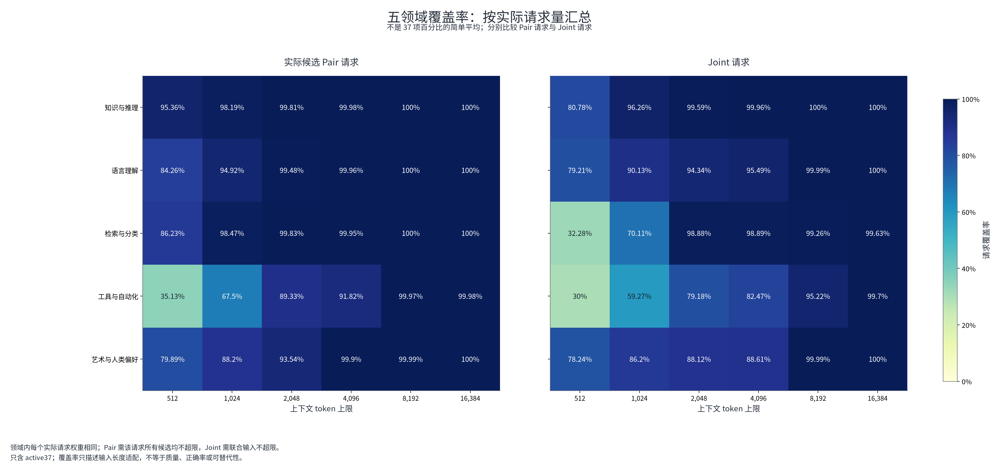
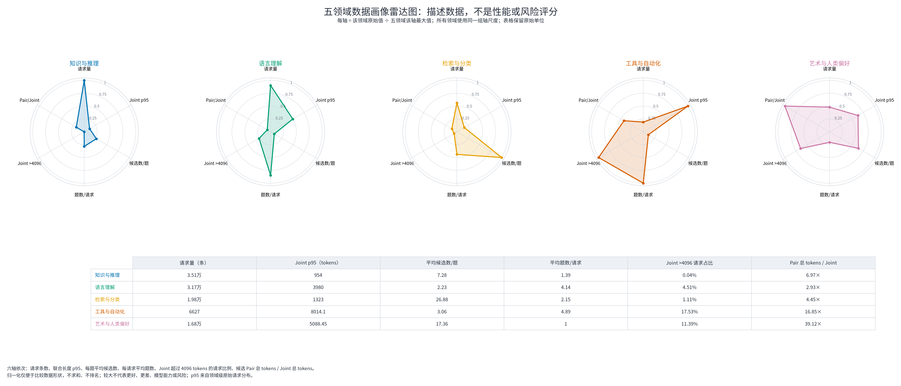

# JEV Decision Index 数据分析｜汇报版

**范围：37 项公开 benchmark，约 11 万条请求、27 万道问题、219 万个候选匹配对。**

**核心结论：重点不只是加长上下文，更要关注类别失衡、候选重复编码和同源样本关联。**

## 主要发现

| 关键发现 | 核心数字 | 意义 |
| --- | --- | --- |
| 输入以短文本为主，少量任务有长尾 | 4k 覆盖 99.46%；仍超限 590 条，其中 API-Bank 508 条 | 短输入分桶，长尾单独处理 |
| 原生类别比例差异很大 | ACOS 正类 0.56%；英语讽刺 14.29%；RAGTruth 幻觉类 34.93% | 候选展开后的 50:50 不代表原生类别均衡 |
| 编码负担集中在少数任务 | POP909＋API-Bank 占逐候选编码量 73.68%，分数权重仅 5.73% | 优先减少候选之间的重复编码 |
| 请求数不等于独立样本数 | RAGTruth 的 2,700 条回答来自 450 个源 prompt；GSM8K 每道原题有两个版本 | 数据划分与结果分析保留来源分组 |
| 部分任务存在明显构造线索 | BPoMP 按“选较长候选”即可命中 79.07% | 高分不一定完全来自目标能力 |

长度按当前 Qwen3 候选匹配模型的实际输入统计；BPoMP 的长度规则是请求级描述性参照，不是模型成绩。

## 图表概览

多数领域在较短上下文下已能覆盖大部分请求，工具任务的长尾更突出。

不同领域的候选量、问题量和输入长度差异明显；雷达图描述数据结构，不代表模型能力。

## 后续重点

1. **先提效：**优先优化 POP909、API-Bank 的重复编码。

2. **再配数据：**按原生类别安排曝光，不只调整候选匹配对的正负比例。

3. **分组分析：**按源问题、文档或用户看效果，避免同源样本掩盖泛化差异。

[完整统计与 37 项明细见附件](APPENDIX.md)。
