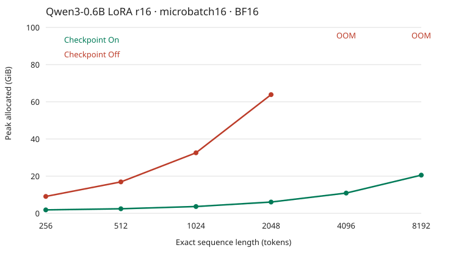

# 输入长度、checkpointing与显存：实测研究报告

## 主要结果

- 旧medium实际为192–205 tokens，long_real_pairs为2527–2807；对应padding为4.84%和3.11%。
- 物理microbatch16时，2048 tokens的峰值allocated由63.85降到6.07 GiB，节省90.5%；8192 tokens开启checkpointing后为20.55 GiB。
- 整齐输入关闭checkpointing时，2944 tokens通过、3072发生OOM。真实混长输入还会触发padding-mask执行路径；同shape的对照显示，这一路径把microbatch8的峰值从44.29升到50.05 GiB。
- 配置迁移主要看物理batch×补齐长度；两组实测8×2048和16×1024的显存几乎相同。有效batch通过梯度累计保持。

## medium和long_real_pairs的实际数据

| Profile | 实际长度范围 | 均长 | 中位长度 | 物理batch tensor shapes | 有效 / padded tokens | Padding |
|---|---:|---:|---:|---|---:|---:|
| medium | 192–205 | 197.94 | 197.5 | 16×208 + 16×208 | 6,334 / 6,656 | 4.84% |
| long_real_pairs | 2527–2807 | 2608.31 | 2579.0 | 16×2576 + 16×2808 | 83,466 / 86,144 | 3.11% |

medium的代码先筛192–384，再取前32对，结果实际集中于192–205，全部来自ANLI r1。long_real_pairs取目标池最长32对，全部来自RAGTruth Summary。每组物理microbatch16、累计2次。[逐条64条输入及padding](ORIGINAL-INPUTS.md)与[CSV](original-inputs.csv)已保存。

## 256–8192长度阶梯

设置：NVIDIA H800 NVL，CUDA可见93.09 GiB；Qwen3-0.6B分类模型、LoRA r16/alpha32、BF16、causal SDPA、物理microbatch16，累计2次。每档同32对真实长文本裁到精确长度，padding为0。每格两个独立进程，各预热1次、计时3次前向+反向。

| 每条长度 tokens | On峰值allocated GiB | Off峰值allocated GiB | On有效tokens/s | Off有效tokens/s | On节省显存 | On耗时 / Off耗时 |
|---|---:|---:|---:|---:|---:|---:|
| 256 | 1.85 | 9.09 | 17,024 | 31,236 | 79.6% | 1.83× |
| 512 | 2.46 | 16.91 | 29,400 | 39,375 | 85.5% | 1.34× |
| 1,024 | 3.66 | 32.56 | 29,798 | 40,922 | 88.8% | 1.37× |
| 2,048 | 6.07 | 63.85 | 29,251 | 39,960 | 90.5% | 1.37× |
| 4,096 | 10.90 | OOM | 27,518 | — | — | — |
| 8,192 | 20.55 | OOM | 24,227 | — | — | — |

512–2048 tokens时，开启checkpointing后的耗时增加约34–37%，显存节省85.5–90.5%。256-token档耗时增加83%；长输入下用重算换显存的收益更大。

关闭checkpointing的128-token步长搜索：2560、2816、2944通过，3072发生OOM；开启后已通过8192。8192档的allocated峰值20.55 GiB、allocator reserved峰值23.00 GiB。



## 为什么真实2807 tokens会OOM，而整齐2816能通过

### 同样的tokens和shape，只改变padding mask

用原来同32条真实长输入，全部补齐至2808，保持token IDs和物理batch不变：

| 物理microbatch | Mask | Checkpoint | 结果 | 峰值allocated GiB | 峰值reserved GiB |
|---|---|---|---|---:|---:|
| 16 | 真实padding mask | Off | OOM | OOM | OOM |
| 16 | 全1 mask定位对照 | Off | 通过 | 87.29 | 88.22 |
| 8 | 真实padding mask | Off | 通过 | 50.05 | 50.82 |
| 8 | 全1 mask定位对照 | Off | 通过 | 44.29 | 44.78 |

microbatch8仅切换mask就增加5.76 GiB，即13.0%。全1 mask用于定位执行开销；正式训练保留真实padding mask。

### 已跟踪到的执行路径

| 运行路径 | Q头数 | SDPA接收的K/V头数 | 原生GQA | SDPA mask |
|---|---:|---:|---|---|
| 全1 mask，整齐路径 | 16 | 8 | 开启 | None，使用is_causal=True |
| 真实padding mask | 16 | 16 | 关闭，先repeat_kv | 显式4D mask |

运行时对同一组2×256输入抓取了全部28层的SDPA参数。真实padding路径中的K/V已由8头展开到16头；对应transformers 5.5.0的`integrations/sdpa_attention.py:28–62`。两种路径实测都调用cuDNN attention，额外开销出现在mask与K/V展开这一执行路径。[实际调用形状](attention-dispatch.json)已保存。

### allocator和物理batch对照

| 真实2527–2807-token输入 | 物理microbatch | 结果 | allocated GiB | reserved GiB | 有效tokens/s |
|---|---:|---|---:|---:|---:|
| Checkpoint Off，默认allocator | 16 | OOM | OOM | OOM | — |
| Checkpoint Off，expandable_segments | 16 | OOM | OOM | OOM | — |
| Checkpoint Off，减小microbatch | 8 | 通过 | 49.94 | 67.91 | 29,885 |
| Checkpoint On | 16 | 通过 | 8.39 | 10.90 | 21,944 |

默认allocator在第二个microbatch前向OOM时，reserved但未使用的显存有17.41 GiB；改expandable_segments后仍OOM，统一padding至2808后也仍OOM。本轮直接解决方法是开启checkpointing，或者把物理microbatch从16降到8。

## 怎么推广到其他输入、batch和显卡

### 用物理驻留tokens估算整齐输入显存

对本套Qwen3-0.6B/LoRA配置，令B为物理microbatch、L为补齐后的sequence tokens，x=B×L/16384，M单位GiB：

- Checkpoint On：M ≈ **1.243 + 2.412 × x**。
- Checkpoint Off：M ≈ **1.266 + 31.291 × x**。

已测的8×2048和16×1024都驻留16384 tokens：On均为3.66 GiB，Off均为32.56 GiB。1024长度从microbatch8增到16再到32时，On为2.46/3.66/6.04 GiB，Off为16.91/32.56/63.82 GiB。

### 配置选择

- 保持有效batch32：microbatch16累计2次；microbatch8累计4次。
- 对真实混长输入，使用上节保留padding mask的测量列；按长度分桶减少padding，并减少shape切换。
- 显卡容量对照reserved峰值和CUDA进程开销；allocated数值用于比较张量开销。
- 换模型时，用同脚本测几档长度重新生成曲线；把层数、隐藏维度、精度和attention实现一起记录。

附带显存计算器，例如：

```bash
python estimate_memory.py --microbatch 8 --length 2048 --checkpoint off --effective-batch 32
```

输出估算allocated为32.557 GiB，累计4次。前向/反向分项和完整系数见[SCALING-ANALYSIS.md](SCALING-ANALYSIS.md)。

## 数据与执行记录

本轮共49个显存/速度测量单元，加一组28层attention参数追踪。主阶梯与batch对照耗时10.6分钟。测量覆盖拼batch、H2D、前向、分类loss、反向、梯度清零；optimizer更新次数为0，未保存模型权重。

- [原始测量总表](REPORT.md)：全部长度阶梯、batch对照、allocated/reserved。
- [混长对照](MIXED-LENGTH-DIAGNOSIS.md)：allocator、固定padding、microbatch对照。
- [49个单元CSV](all-measurements.csv)：状态、长度、padding、显存和吞吐。
- `cases/`、`mixed-diagnostics/`、`mask-diagnostics/`：逐次结果、OOM阶段和完整日志。
- `original-profiles.json`、`original-inputs.csv`：旧profile逐条长度及原始row索引。
- `manifest.json`、`publication.json`：输入与代码hash、环境和输出文件。
