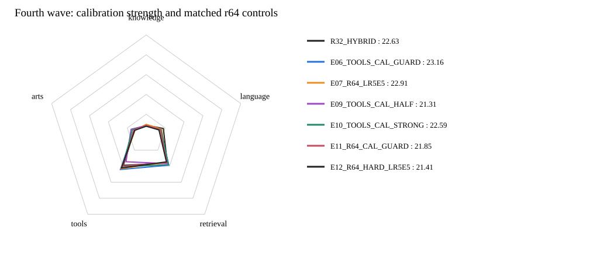

# 第四波：最佳配方局部搜索与r64匹配控制

**累计当前最好：E06_TOOLS_CAL_GUARD，公共总分23.16；相对此前最好+0.00。**
第四波正式评分完成4/4；未评分的模型不作胜出判断。

| 模型 | Knowledge | Language | Retrieval | Tools | Arts | 公共总分 | 对此前最好 | 覆盖率 |
|---|---:|---:|---:|---:|---:|---:|---:|---:|
| R32_HARD | 8.23 | 14.34 | 36.83 | 38.04 | 14.08 | 21.57 | -1.59 | 100.00% |
| R32_HYBRID | 9.02 | 18.19 | 36.11 | 38.94 | 12.54 | 22.63 | -0.53 | 100.00% |
| E06_TOOLS_CAL_GUARD | 8.43 | 14.87 | 38.75 | 44.20 | 12.98 | 23.16 | +0.00 | 100.00% |
| E07_R64_LR5E5 | 9.87 | 16.34 | 35.28 | 43.16 | 11.85 | 22.91 | -0.25 | 100.00% |
| E09_TOOLS_CAL_HALF | 8.66 | 14.68 | 36.82 | 34.49 | 15.96 | 21.31 | -1.85 | 100.00% |
| E10_TOOLS_CAL_STRONG | 7.93 | 15.54 | 38.24 | 40.49 | 14.63 | 22.59 | -0.57 | 100.00% |
| E11_R64_CAL_GUARD | 8.92 | 14.83 | 35.46 | 39.94 | 13.15 | 21.85 | -1.31 | 100.00% |
| E12_R64_HARD_LR5E5 | 7.94 | 13.47 | 34.62 | 42.29 | 12.15 | 21.41 | -1.75 | 100.00% |

## 本波配方

- E09_TOOLS_CAL_HALF：保持r32领域保护，Tools校准截距为已胜出E06的0.5倍，学习率仍1e-4。
- E10_TOOLS_CAL_STRONG：保持r32领域保护，Tools校准截距为E06的1.5倍，学习率仍1e-4。
- E11_R64_CAL_GUARD：r64/alpha128、LoRA及head学习率5e-5，精确复用E06有效目标，检验两条有效改动的组合。
- E12_R64_HARD_LR5E5：r64/alpha128、LoRA及head学习率5e-5，保留全部原始来源监督，为E07及E11补齐同LR的HARD。

全部使用未经本项目微调的原始Qwen backbone和同一未训练分类头；r64复用既有共享未训练适配器。固定同一100万pair、seed42、batch128、一遍与实际FA3。
领域保护保持Knowledge/Tools权重0.5、Retrieval 0.25、Arts 0。Tools原截距约−1.28；E09约−0.64、E10约−1.92，只在训练来源q/y拟合的截距附近局部搜索。
E12未完成评分前，不计算r64新LR的KD净收益；完成后分别给出E07−E12与E11−E12。E11与E06之差同时含rank和学习率变化，不称为纯容量因果效应。
这是基于此前公共benchmark结果的自适应搜索，不是未见过的独立测试；无新Teacher标注，保留全部来源软分数。
无新Teacher标注；不跑额外测试、烟测、哈希。全部以同37项公共benchmark正式评分，不是accuracy或私测Full，单seed探索不声称统计显著。

## 同学习率r64配对结果

| 蒸馏配方 | 匹配HARD | HYBRID | KD净增益 |
|---|---:|---:|---:|
| E07_R64_LR5E5 | 21.41 | 22.91 | +1.50 |
| E11_R64_CAL_GUARD | 21.41 | 21.85 | +0.44 |
