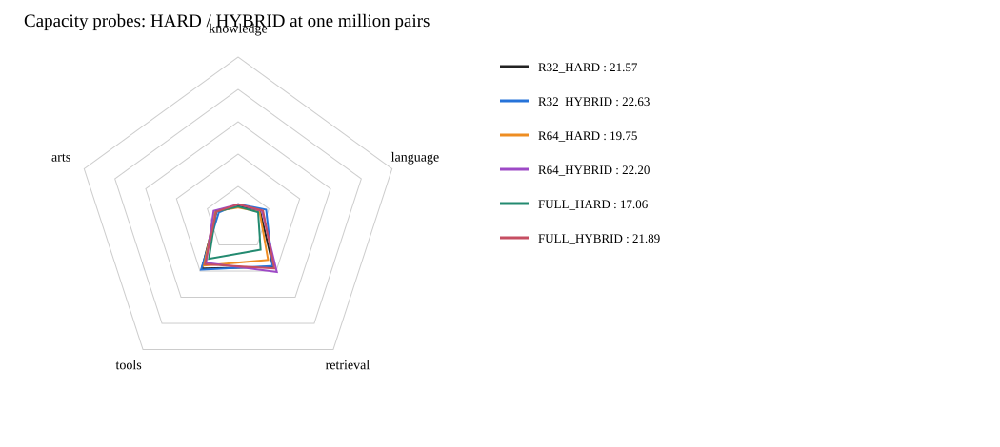

# 第二波：Student容量与蒸馏收益

本容量对照中最高学生分数：**R32_HYBRID / 22.63**。
本容量对照中最高混合蒸馏分数：**R32_HYBRID / 22.63**。
新容量条件已完成正式评分4/4；未成对完成时，不判断该容量的KD净收益。

| 模型 | Knowledge | Language | Retrieval | Tools | Arts | 公共总分 |
|---|---:|---:|---:|---:|---:|---:|
| R32_HARD | 8.23 | 14.34 | 36.83 | 38.04 | 14.08 | 21.57 |
| R32_HYBRID | 9.02 | 18.19 | 36.11 | 38.94 | 12.54 | 22.63 |
| R64_HARD | 6.95 | 13.95 | 31.51 | 35.79 | 14.99 | 19.75 |
| R64_HYBRID | 8.85 | 15.57 | 40.71 | 33.64 | 15.89 | 22.20 |
| FULL_HARD | 7.53 | 13.00 | 23.65 | 30.64 | 14.23 | 17.06 |
| FULL_HYBRID | 8.95 | 16.19 | 38.00 | 34.83 | 14.21 | 21.89 |

## 容量内成对比较

| 配方 | HARD | HYBRID | KD净增益 | 相对r32的KD增益变化 |
|---|---:|---:|---:|---:|
| r32 | 21.57 | 22.63 | +1.06 | +0.00 |
| r64 | 19.75 | 22.20 | +2.45 | +1.39 |
| full | 17.06 | 21.89 | +4.83 | +3.77 |

全部从相同原始Qwen backbone和同一未训练分类头开始，保持同一100万pair、顺序、batch128、一遍及显式FA3。
r64为alpha128；全参backbone LR1e-5、head LR1e-4。全参对r32的绝对差同时包含训练方式与配方差异，不称为纯容量因果效应。
如果HARD与HYBRID一起提高，应首先归因为Student训练更充分，不能直接声称Teacher蒸馏更有效。
复用已有Teacher缓存，没有新增标注；不跑额外测试、烟测、哈希。结果为单seed快速探索的37项公共评分，不是accuracy或私测Full。

