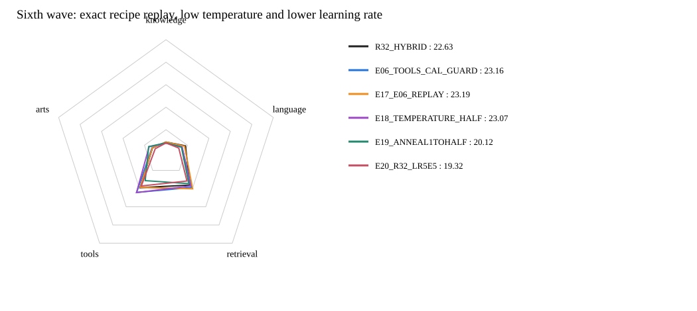

# 第六波：E06重跑、低温KD与r32学习率

**累计当前最好：E17_E06_REPLAY，公共总分23.19，对历史最好+0.03。**
本波正式评分完成4/4；未评分的方案不作胜出判断。

| 模型 | Knowledge | Language | Retrieval | Tools | Arts | 公共总分 | 对历史最好 | 对本波重跑 |
|---|---:|---:|---:|---:|---:|---:|---:|---:|
| R32_HARD | 8.23 | 14.34 | 36.83 | 38.04 | 14.08 | 21.57 | -1.59 | -1.62 |
| R32_HYBRID | 9.02 | 18.19 | 36.11 | 38.94 | 12.54 | 22.63 | -0.53 | -0.56 |
| E06_TOOLS_CAL_GUARD | 8.43 | 14.87 | 38.75 | 44.20 | 12.98 | 23.16 | +0.00 | -0.03 |
| E17_E06_REPLAY | 9.06 | 17.28 | 40.27 | 38.60 | 12.69 | 23.19 | +0.03 | +0.00 |
| E18_TEMPERATURE_HALF | 8.00 | 15.03 | 37.11 | 44.38 | 15.71 | 23.07 | -0.09 | -0.12 |
| E19_ANNEAL1TOHALF | 8.31 | 14.44 | 34.53 | 31.27 | 16.09 | 20.12 | -3.04 | -3.07 |
| E20_R32_LR5E5 | 8.18 | 11.94 | 31.65 | 37.12 | 9.98 | 19.32 | -3.84 | -3.87 |

## 四组用途

- E17_E06_REPLAY：保持E06的全部配置，仅run_root不同；原trainer、原有效目标、原ready、seed42、LR1e-4。完整训练后正式评分，不是测试／烟测。
- E18_TEMPERATURE_HALF：固定T0.5，KD师生同时除T并乘T²，source监督保持T1。
- E19_ANNEAL1TOHALF：全局step的T由1线性降至0.5，首步T1直接使用原E06混合目标。
- E20_R32_LR5E5：原E06有效目标及原trainer，只把LR由1e-4降至5e-5。

低温同时改变软目标和梯度尺度，不称为只改变Teacher锐度；不重复Teacher原生1.44，温度Teacher logit精确复用第五波缓存。
E17只是一遍同seed复现，不足以估计方差或证明统计稳定；若与历史23.16不一致，应先调查运行差异，不能只保留较高分宣称稳定涨分。
E20尚无同LR的r32 HARD，不能用原LR的21.57计算KD净收益；对本波重跑的差值仅用于工程候选选择。

全部从相同原始Qwen backbone与未训练分类头／r32初始化出发，非从已训练E06继续；同100万pair、同order、batch128、一遍、7813步、显式FA3。
无新增Teacher标注／下载／依赖，不跑额外测试、烟测、哈希；使用同37项公共benchmark的自适应单seed搜索，不是accuracy或私测Full。

## 实际重跑观察

E17重跑23.19，历史E06为23.16，差值+0.03。
