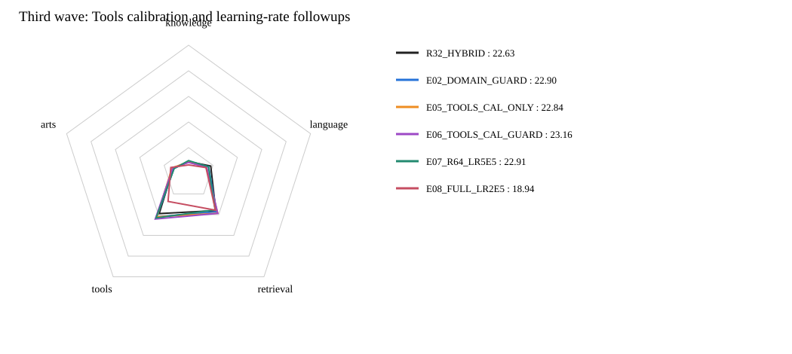

# 第三波：Tools局部校准与学习率修正

**累计当前最好：E06_TOOLS_CAL_GUARD，公共总分23.16；相对此前最好+0.26。**
第三波正式评分完成4/4；未评分的模型不作胜出判断。

| 模型 | Knowledge | Language | Retrieval | Tools | Arts | 公共总分 | 对此前最好 | 覆盖率 |
|---|---:|---:|---:|---:|---:|---:|---:|---:|
| R32_HARD | 8.23 | 14.34 | 36.83 | 38.04 | 14.08 | 21.57 | -1.33 | 100.00% |
| R32_HYBRID | 9.02 | 18.19 | 36.11 | 38.94 | 12.54 | 22.63 | -0.27 | 100.00% |
| E02_DOMAIN_GUARD | 8.94 | 16.44 | 37.17 | 42.12 | 11.98 | 22.90 | +0.00 | 100.00% |
| E05_TOOLS_CAL_ONLY | 8.88 | 14.56 | 38.62 | 42.11 | 13.51 | 22.84 | -0.06 | 100.00% |
| E06_TOOLS_CAL_GUARD | 8.43 | 14.87 | 38.75 | 44.20 | 12.98 | 23.16 | +0.26 | 100.00% |
| E07_R64_LR5E5 | 9.87 | 16.34 | 35.28 | 43.16 | 11.85 | 22.91 | +0.01 | 100.00% |
| E08_FULL_LR2E5 | 6.49 | 14.26 | 35.67 | 27.22 | 14.58 | 18.94 | -3.96 | 100.00% |

## 本波配方

- E05_TOOLS_CAL_ONLY：只校准Tools的Teacher logit截距，其余Teacher概率不变，全域Teacher权重0.5。
- E06_TOOLS_CAL_GUARD：在E05上叠加领域权重，Knowledge/Tools 0.5、Retrieval 0.25、Arts 0。
- E07_R64_LR5E5：保持原HYBRID，r64/alpha128的LoRA和分类头学习率一起由1e-4降至5e-5。
- E08_FULL_LR2E5：保持原HYBRID，全参backbone学习率由1e-5升至2e-5，分类头仍为1e-4。

全部使用未经本项目微调的原始Qwen backbone和同一未训练分类头；r64复用既有共享未训练适配器。固定同一100万pair、seed42、batch128、一遍与实际FA3。
Tools截距只从训练来源q/y拟合，约为−1.28；不使用benchmark gold，不证明真实label shift。保留全部来源监督及其软分数。
E07/E08是绝对质量搜索，尚无新学习率下的匹配HARD，不能以旧HARD计算新配方KD净收益。胜出后再补控制。
无新Teacher标注；不跑额外测试、烟测、哈希。全部以同37项公共benchmark正式评分，不是accuracy或私测Full，单seed探索不声称统计显著。

