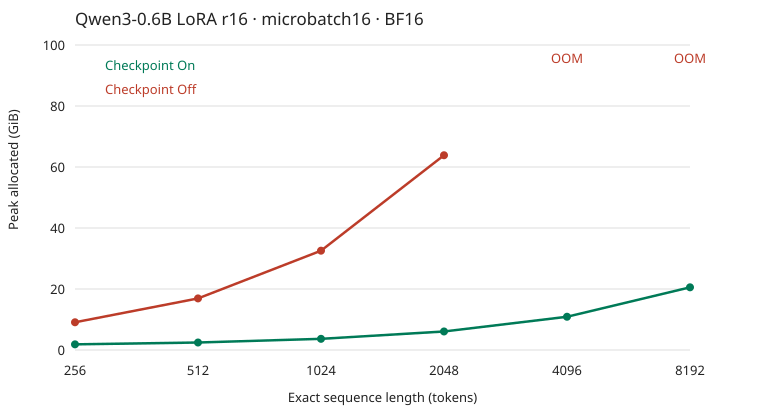
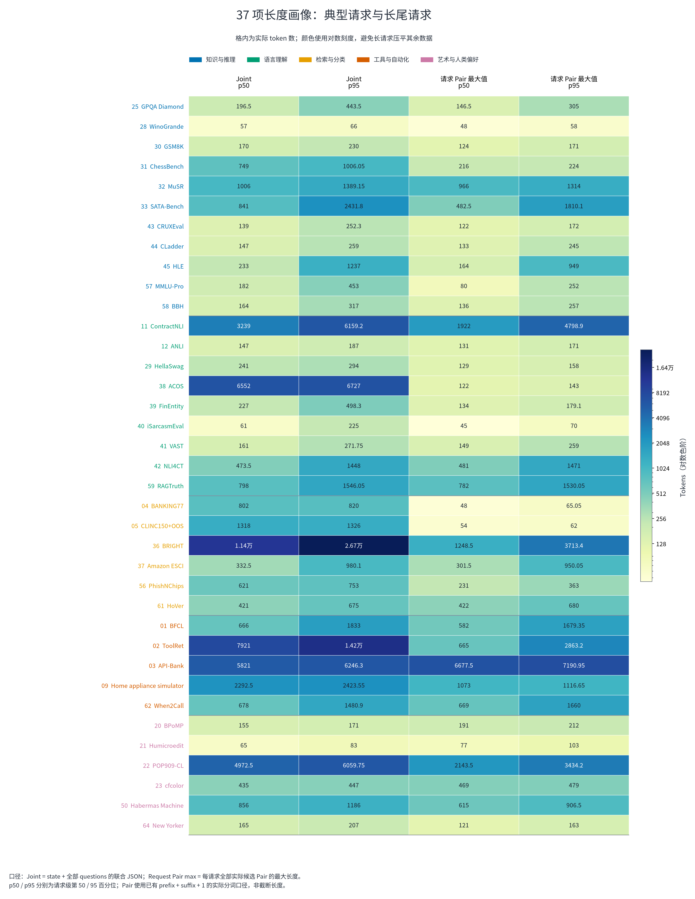

# Jev 决策模型实验工作记录

**目标：面向 [Jev Decision Index](https://huggingface.co/spaces/multimodalart/jev-decision-index) 冲榜，围绕数据、模型结构、训练效率、评测方法、专科融合与 Teacher 蒸馏开展验证和研究，逐步形成有效的训练方案。**

记录范围：2026.10.27—2026.11.02。本文根据当前文件夹中的实验报告、训练完成记录和评分文件整理；服务器暂时无法连接，未补写未同步的结果。

## 一、实验记录

### 最新结果

目前已形成两条实验线：**Language 单维优化**与**跨领域四专科训练、混合训练及融合**。两条线的分数口径不同，分别记录。

| 项目 | 当前本地可确认的结果 |
|---|---|
| Language 单维最高单次 | **36.33**，Qwen3-0.6B＋LoRA rank32 |
| Language 重复验证配方 | **35.05±0.96**，4 个续训 seed；起始基线为 17.74 |
| 四科训练轮次最高公共总分 | **22.82**，四科混合模型 MIXED_ALL |
| 四科训练轮次最佳融合 | **21.46**，等权有效权重平均，低于混合模型 1.36 分 |
| 跨领域评测规模 | **10 个方案，37 项任务，每方案约 11.01 万条请求，覆盖率均为 100%** |
| Teacher 蒸馏 | HARD 已正式启动；Teacher 资产准备有中断记录，尚无三组完成成绩 |
| 线上排名 | 当前本地未见可确认的官方私测 Full 成绩或线上排名记录 |

说明：Language Skill、五维公共总分与内部分类准确率不是同一种指标。后期公共结果来自本地重建的 Decision Index 0.3 公开输入，不包含私测 Full 或官方单卡延迟验收；不能将 36.33 与 22.82 直接比较。

### 已完成工作概览

本阶段不仅进行了模型训练，还完成了**社区方案与训练来源调研、标签与评测语义核查、受控消融、多 seed 复验、输入长度与显存机制研究，以及融合和蒸馏接口验证**。

- **完整参评方案：114 个。** 其中 104 个为历史 Language 方案，10 个为后期跨领域方案；包含融合、集成及 4 个工程链路验证终点，不等于 114 次独立完整训练。
- **专项短训：8 个。** 用于 batch 与学习率研究，仅评开发集，不冒充完整公开评测。
- **资源研究：49 个显存／速度测量单元，另有 9 个真实 batch／长尾吞吐条件。** 资源探针与能力训练分开统计。
- **研究对象：37 项活跃公开任务。** 对其输入结构、原生类别、候选展开、来源关联与计算负担进行了全量画像。

验证和探索工作的具体内容见第二部分；没有涨分、未通过复验或发现原假设不成立的结果同样保留。

### 10.27——调研社区方案与榜单规则，核查可用训练来源

围绕 Perplexity、StartLux、Mammoth、Mapika、Bobcat、Jebadiah、Sieve、Nimble、Together 及 d3 系列，整理数据构成、决策读出、注意力方式、监督目标、校准与融合方法，区分“作者披露了什么”“代码实际提供什么”和“能否直接取得同版本训练数据”。

重点完成以下核查：

- 榜单虽然定义六类，但只有**五个独立计分领域**，Games 已合入 Knowledge，不能重复计分。
- Tasksource 的 label-NLI、typed、procedural 等是不同数据产品；full／default 等配置存在重叠，不能直接累计规模。
- 社区转换器中的 validation／test、评测结果仓库和作者列出的 held-out loader，不能因可下载就当训练数据。
- 核对 Language 九项任务的实际训练入口、标签语义和上下文要求；FinEntity 没有可直接使用的官方独立 train，需另找金融情感代理来源。

**本轮产出是可用来源清单、模型方案对照及数据接入依据，为后续正式训练减少无效下载、错误转换和评测混入风险。** 社区模型的已发表效果是研究参照，不算作本项目复现成绩。

### 10.27——构建初版训练数据，打通小模型分类与评测流程

#### 构建初版数据

以 Tasksource 的 `zero-shot-label-nli` 为基础，将任务统一成“输入文本＋候选描述＋是否匹配”的文本对分类格式。完成重复、冲突标签、跨划分正文关联及部分评测来源风险的过滤后，得到：

- 训练集约 **181.38 万对**。
- 验证集约 **2.46 万对**，内部测试集约 **2.50 万对**。

这里的“对”是一次候选匹配判断，不等于同样数量的独立原题。

#### 打通训练流程

采用 **Qwen3-0.6B＋二分类线性头＋LoRA rank16**，使用 Unsloth 完成四卡 DDP 训练、检查点选择、模型导出和评测。有效 batch 为 128，学习率为 1e-4，训练 1 epoch，约 100 分钟。

模型不是生成答案字母，而是对每个候选进行匹配打分，再还原为完整问题的候选概率。

#### 评测结果与结论

内部测试准确率为 **82.40%**，但 Decision Index 的 Language Skill 仅为 **17.74**。Language 九项评测完成约 3.17 万条请求，覆盖率 100%。

**本轮建立了真实的小模型分类基线，同时发现同源分类准确率不能代表外部决策能力。** 后续优先补齐目标任务数据，而不是只在原池上继续训练。

### 10.27—10.28——补齐语言任务数据，对比因果与双向注意力

#### 实验设计

固定共同起始模型与新增 **5,000 万有效 token** 的训练预算，对比原始数据、目标任务数据，以及 causal／bidirectional attention。各主要条件使用 3 个匹配续训 seed。

先加入 ANLI、HellaSwag，再补充 ACOS、RAGTruth 和原生英语讽刺数据，形成扩充目标池。

| 数据与注意力方案 | Language Skill，3 seed 均值 |
|---|---:|
| 原始数据继续训练＋因果注意力 | 17.40 |
| 原始数据继续训练＋双向注意力 | 11.51 |
| 加入 ANLI／HellaSwag＋因果注意力 | 24.92 |
| 加入 ANLI／HellaSwag＋双向注意力 | 15.67 |
| 进一步扩充目标数据＋因果注意力 | **30.75** |

#### 实验结论

**同预算下，补齐真实目标任务比继续训练原数据更有效。** 加入 ANLI／HellaSwag 后提高 7.52 分，进一步扩充后再提高 5.83 分。

直接切换双向注意力在两种数据条件下均下降，因此当前 0.6B LoRA 续训路线保留因果注意力。该结果不代表双向结构普遍无效，也没有回答独立适配预热或全参训练后的效果。

### 10.28——调整数据配比与采样，验证 LoRA 容量

#### 优化数据分布

围绕旧数据回放、目标任务曝光和讽刺类别失衡，完成任务采样指数、数据混合比例及讽刺配额对照。依据验证集选择：

- 旧数据与目标数据按 **20:80 的实际 token 比例**混合。
- 原题级任务采样指数采用 **0.5**。
- 原生英语讽刺做类别平衡，并分配目标池 **5% 的 token 配额**。

组合配方的 rank16 版本在 4 个续训 seed 上达到 **33.74±0.52**。

#### 增加 LoRA 容量

保持相同数据和新增训练预算，将 LoRA 从 rank16 扩至 rank32：

| 配方 | Language Skill，4 seed |
|---|---:|
| 联合数据／采样配方＋rank16 | 33.74±0.52 |
| 相同配方＋rank32 | **35.05±0.96** |

四个匹配 seed 均有提升，平均提高 **1.31 分**；最高单次为 **36.33**。

#### 实验结论

**数据覆盖、采样分布和适配容量需要一起考虑。** rank32 成为后续研究的主要容量配置，但 VAST 等任务仍有退步，不能只看总分判断所有能力都改善。

### 10.28—10.29——完成小池快筛、正负比例与训练效率研究

#### 小池快速筛选

整理约 **11.74 万对** Language 训练缓存，对任务配额、旧数据比例、讽刺策略、采样指数及 rank64 进行短预算筛选。完成 **39 个正常快筛终点**，每个新增约 1,700 万或 2,000 万有效 token。

部分候选提高了公开分数，但同时损害讽刺、grounding 或迁移指标，未形成足以替换原 rank32 配方的稳定改进。

这批探索还包括第二 seed 复验与分因素归因：采样指数 1 和 0.75 的初筛信号未能同时通过后续验证；删除旧数据回放、关闭原生讽刺平衡等方案也暴露了能力取舍。因此，工作成果不仅是找到赢家，也包括**排除看似涨分但不稳定的方向**。

#### 正负匹配比例对照

固定约 2,000 万 token 预算，改变匹配／不匹配文本对的重复比例：

| 实际匹配对占比 | 自然验证集 Macro-F1 | Language Skill |
|---:|---:|---:|
| 36.46% | 90.90% | 29.05 |
| 45.51%，自然展开 | **90.97%** | 29.49 |
| 55.37% | 90.15% | **31.23** |
| 64.11% | 88.11% | 30.68 |

**增加正样本曝光提高了匹配召回，但损害不匹配召回；公开分数与自然验证指标并不同步。** 本轮没有据此宣布最佳正负比例。

#### 训练效率与输入长度

- 真实混长训练测量中，单卡 **microbatch32×梯度累积4** 优于更小或更大的物理 batch，作为有效 batch128 的实用起点。
- 输入长度诊断中，1024 token 是总体指标的折中候选，2048 更能保护长文本；该诊断不等于训练长度最优结论，正式公开评测不据此截断。
- 完成梯度检查点与长度资源测量：激活重算明显节省显存，但存在重算耗时，不能把“省显存”直接写成“更快”。

另完成 **有效 batch128／256×学习率 5e-5／1e-4×两个 seed** 的 8 个短训。该短预算下，batch128＋1e-4 的原生任务 dev 宏均值为 **42.56%**，优于其他候选；扩大 batch 没有明显吞吐收益。该数值不是 Language Skill，也不直接替代完整预算下的配方。

### 10.29——按语言数据家族训练专家，完成首轮模型融合

#### 实验设计

围绕 ANLI、HellaSwag、ACOS、英语讽刺、RAGTruth 五个数据家族，各训练一个约 **300 万 token** 的专家；另训练约 **1,500 万 token** 的混合模型，使其总数据曝光与五专家之和一致。

比较概率集成、有效权重平均与 TIES。权重融合包含训练过的分类头，不直接平均 LoRA 的 A／B 矩阵。

| 方案 | Language Skill |
|---|---:|
| 相同总曝光的混合训练 | **31.07** |
| TIES | 24.39 |
| 五专家概率集成 | 20.62 |
| 等权有效权重平均 | 20.35 |

#### 实验结论

**本轮固定融合均未超过混合训练。** HellaSwag 专家出现了本族优势，但专科训练没有普遍成功，不能预设“先训练专家再融合”一定更强。

本轮是 **Language 内五个数据家族**的实验，不是五个官方大领域的专家实验，也不是与前期 5,000 万 token 配方等预算的比较。

### 10.30—10.31——扩充跨领域数据，分析完整公开评测集

#### 构建跨领域候选匹配池

将 Tasksource、原生 typed decision 数据、公开训练来源和程序规则场景统一为候选匹配格式，形成约 **3,278.70 万对**的五领域总池。

按后续实验调整，取消 Language 专家及其在混合模型中的训练曝光，实际使用 Knowledge、Retrieval、Tools、Arts 四科，共 **1,817.37 万对、约 40.42 亿输入 token**。Language 原数据保留，但不进入该轮训练；评测仍保留官方五领域。

四个专家各自完整训练本方向数据，混合模型使用四科并集，避免因混合模型少见数据而产生不公平比较。

#### 分析 37 项公开任务

对当前公开评测输入进行长度、类别、候选量和来源关联分析，覆盖约 **11.01 万条请求、27.22 万道问题、218.69 万个候选匹配对**。主要发现：

- 当前候选匹配输入按请求统计，4k 可覆盖 **99.46%**，但 API-Bank 等仍有长尾。
- ACOS 原生正类仅约 **0.56%**，不能只通过展开后的 pair 比例判断类别是否均衡。
- POP909 与 API-Bank 占逐候选编码量约 **73.68%**，减少重复编码比单纯加长上下文更值得优先研究。
- RAGTruth 等任务存在多条请求共享同一来源，划分与分析需保留来源组。

**本轮将重点从单纯增加样本量，转向有效覆盖、原生类别分布和重复编码成本。**

### 11.01——完成四专科、全量混合训练与五种融合评测

#### 完成正式训练

采用 **Qwen3-0.6B＋共同初始化二分类头＋因果注意力＋LoRA rank32／alpha64**，有效 batch128，学习率 1e-4，训练 1 epoch。

完成知识、检索、工具、艺术四个专家与一个混合模型。混合模型完整处理四科约 **1,817.37 万对、40.42 亿 token**，训练约 **13.68 小时**；完成记录中，其 pair 与 token 总量均等于四专家之和。

#### 混合训练与融合结果

| 方案 | 知识推理 | 语言理解 | 检索分类 | 工具自动化 | 艺术偏好 | 公共总分 |
|---|---:|---:|---:|---:|---:|---:|
| 四科混合训练 | **9.69** | **17.44** | **46.26** | 26.08 | **17.78** | **22.82** |
| 等权有效权重平均 | 8.47 | 16.60 | 35.24 | **37.85** | 10.10 | **21.46** |
| TIES | 7.14 | 14.40 | 40.81 | 24.29 | 8.27 | 19.00 |
| Task Arithmetic | 3.87 | 7.08 | 34.44 | 13.39 | 5.77 | 12.75 |
| DARE＋TIES | 3.83 | 6.40 | 29.77 | 19.22 | 6.33 | 12.75 |
| DARE＋Task Arithmetic | 1.56 | 2.88 | 16.55 | 8.67 | 5.38 | 6.58 |

四专家、混合模型及五种融合共 **10 个方案**，均完成同一批 37 项任务、约 11.01 万条请求的评测，完成记录均为 100% 覆盖。

#### 专科训练是否有效

| 专家对应方向 | 专家本方向 Skill | 混合模型同方向 Skill | 专家相对混合 |
|---|---:|---:|---:|
| 知识推理 | 12.63 | 9.69 | +2.94 |
| 检索分类 | 42.58 | 46.26 | −3.68 |
| 工具自动化 | 34.70 | 26.08 | +8.62 |
| 艺术偏好 | 18.10 | 17.78 | +0.32 |

#### 实验结论

**混合训练仍是本轮公共总分最好的方案；专科模型的局部优势没有被固定融合完整保留。** 最佳融合为权重平均，距离混合训练差 1.36 分，但其工具分数反而提高 11.77 分，说明融合存在明显的领域取舍。

本轮不支持直接照搬 DARE 稀疏化获得提升。结果仍是单个训练 seed、固定融合参数下的观察；同时，该轮未训练 Language，起点与数据也不同于前期 Language 主线，不能把语言分数差全部解释成遗忘。

### 11.01—11.02——启动 Teacher 蒸馏，等待完成对照

#### 已落实的工作

选用 **KnowLine 31B Gen1** 作为 Teacher，以本轮混合模型为共同 Student 起点，保持完整四科数据，准备三组匹配续训：

| 组别 | 监督方式 | 本地可确认进度 |
|---|---|---|
| HARD | 原始标签 | 已正式启动，尚未见完成成绩 |
| SOFT | Teacher 概率分布 | 标注与训练脚本已部署，尚未见启动及完成成绩 |
| HYBRID | 原始监督＋Teacher 概率 | 标注与训练脚本已部署，尚未见启动及完成成绩 |

三组固定同一起点、数据顺序、有效 batch128 和学习率 5e-5，计划完整训练一遍；仅改变监督方式。Teacher 使用独立环境，按 Student 实际可见文本产生匹配概率。

#### 当前状态

11.01 的详细记录确认 HARD 已开始正式训练，Teacher 完整资产仍在准备。11.02 的本地监控记录显示 **Teacher 资产准备在完成前停止**，随后服务器连接出现异常，无法继续核实远端状态。

**本轮只能记录为“蒸馏已启动、结果待补”，不能判断 Teacher 蒸馏优于原始标签。** 早期约 1 万对的小批软标签输出记录不等于本轮千万级四科标注已经完成；另有 8×A800 迁移规划，但没有据此补写新机器实测结果。

## 二、验证与研究探索

这部分工作回答的是：**改动是否真的生效、分数为什么变化、计算瓶颈在哪里，以及哪些路线值得继续。** 不以是否涨分作为唯一产出标准。

### 1. 数据、标签与评测语义核查

针对不同来源接入同一个二分类模型时容易产生的语义错误，完成来源与实际字段检查，并在训练、评测与后续蒸馏中明确转换关系：

| 研究问题 | 已完成的核查／探索 | 形成的认识 |
|---|---|---|
| 原始标签能否直接沿用 | 核对 Tasksource 实载标签、ANLI 三类关系，以及不同阶段模型的类别配置 | 标签数字相同不代表含义相同；早期与新四科模型的匹配类别索引不同，必须按实际配置处理 |
| 多分类如何转换成匹配 | 分开保留原题、完整候选、匹配 pair 和 token 统计 | 一道题展开多对不等于增加独立监督；候选多的任务会放大曝光与计算量 |
| 软标签能否统一当硬标签 | 检查 typed choice／score 分布与 noul 的 true 概率表示 | 概率、候选顺序和题型语义必须对齐，不能机械取 argmax 或反转概率顺序 |
| 某数据集是否真有可用 train | 核对原始划分、文件、上游任务和评测来源关系 | 数据卡、仓库名或文件名中的 train 不足以保证与当前测试隔离 |
| 正负比例究竟指什么 | 分开统计原生类别、候选匹配类别、采样出现次数与 token 份额 | 原生讽刺平衡与 pair 正负重采样不是同一种实验 |

**这些核查的价值是避免“格式能够跑通，但模型实际上在学另一道题”。** 已确认的来源与映射形成了后续数据处理依据；扩充池仍需继续做来源质量与隔离复核，不将局部核查表述为所有来源均无风险。

### 2. 注意力实现与梯度计算验证

早期先完成 **32 步四卡分类试跑**，确认 LoRA 和分类头能够更新、保存并重载，再进入完整训练与公开评测。分类权重、标签解释与候选打分路径分别检查，避免只因训练 loss 能下降就认为整个决策链路正确。

对 Qwen3-0.6B 和固定版本 Transformers 的源码进行核查，确认该模型是 **28 层普通 full attention**，与榜单部分大模型的 hybrid attention 不同，不能照抄“只解除 full-attention 子层”的配置解释。

进一步检查发现，**只修改 config 的因果开关不能作为双向化已经生效的证据**：模块级开关、mask 构造以及实际 backend 共同决定计算行为。这项源码研究为因果／双向受控实验提供了实现检查依据。

在已完成的技术测量中，还比较了激活重算开关与不同梯度累计拆分的梯度：同权重重算开／关的该样本梯度相对差为零，物理 batch32 与 16×2 的 BF16 相对差约 **0.23%**。这属于特定样本的数值一致性检查，不是所有输入逐位相同的证明。

### 3. 输入长度对能力与速度的影响研究

不是简单比较“长输入更好还是短输入更快”，而是固定同一权重、同一批 **1,667 对**分层样本，对 256／512／1024／2048／4096／完整输入进行推理对照，并按来源和原始长度桶分析。

- 输入上限设为 1024 时，总体加权 Macro-F1 相对完整输入仅下降 **0.18 个百分点**。
- 但原长 1024—2047 的桶下降 **12.11 个百分点**，说明总体均值会掩盖长尾损失。
- 2048 的总体下降约 **0.02 个百分点**，是更保守的候选。

**研究结论是短输入主力与长尾需要区别处理，而不是据总体均值把所有输入统一裁短。** 本轮改变的是推理输入长度，没有证明训练长度最优，也未将诊断截断用于正式公开评测。

### 4. Batch、激活重算与 OOM 机制研究

完成真实训练窗口、整齐长文本压力条件，以及长度×物理 batch×激活重算的专项测量，并追踪运行时注意力参数。

| 专项 | 已得到的实测结果 | 对训练配置的意义 |
|---|---|---|
| 真实 batch 吞吐 | microbatch32 比 16 快约 18.56%，比 64 快约 14.51% | 不能把“显存没用满”当作扩大物理 batch 的理由 |
| 激活重算 | microbatch16、2048 token 时，allocated 峰值由 **63.85 降至 6.07 GiB**；对应耗时约增 37% | 明确用重算换显存的成本，而不是将其视为免费加速 |
| 长输入边界 | 当前配置关闭重算时，整齐 2944 token 通过、3072 OOM；开启后测至 8192 | 为该模型和后端建立实际资源边界 |
| 混长与整齐输入差异 | 相同 shape 下，真实 padding mask 路径开销更高；microbatch8 峰值由 44.29 增至 50.05 GiB | 真实混长压力不能被无 padding 测试替代 |
| 运行时路径追踪 | 两路均实际调用 cuDNN attention；真实 padding 路径的 K／V 由 8 头展开至 16 头 | 将问题定位到 mask／GQA 执行差异，而不只归咎于显存碎片 |

在此基础上，按**物理 batch×补齐长度**拟合了当前配置的显存估算关系，并形成配置计算脚本。49 个资源测量单元仅做前后向、不更新权重，与包含 optimizer step 的 batch 吞吐实验分开解释；拟合不能不经测量就套用到其他模型或后端。

### 5. 多 seed 复验、任务保护与负结果研究

探索不只停留在单次最高分，还对主要数据／注意力条件做 3 seed 对照，对联合采样与 rank16／32 做 4 seed 验证；小池中对有信号的方向追加第二 seed、较大验证面板和旧任务迁移代理。

保留的关键负结果包括：

- **双向化没有自然涨分**：当前 LoRA 续训预算下，两种数据条件均下降。
- **rank 越大不一定越稳**：rank64 的公开分数提升可能伴随讽刺能力退步，未替代 rank32。
- **采样初筛赢家未必可复现**：任务指数 1／0.75 的部分信号未通过匹配复核。
- **增加正匹配样本不等于总体更好**：匹配召回与不匹配召回存在明确取舍。
- **纯目标数据不一定优于保留回放**：去掉旧池的探索没有形成兼顾目标任务与迁移的稳定收益。

**这些结果缩小了后续搜索范围，也避免将验证面板偶然波动或单任务收益误判成通用提升。** 多个续训 seed 共享同一起始模型，仍不等同于多次独立全流程训练。

### 6. 专科收益、融合正确性与公平比较研究

先研究 Language 内的数据家族专家，再扩展到跨领域四专家；同时区分“专家能否在本方向胜过混合”与“融合后能否保留优势”两个问题。

- 按实际源样本、标签和有效 token 核对混合训练曝光，避免以少训练的混合模型作为不公平控制。
- 权重融合操作有效模型增量并包含已训练分类头，不直接平均 LoRA A／B。
- 对语言首轮融合核对计算公式与保存精度，并区分单模型权重融合和多模型概率集成的部署成本。
- 交叉检查本族 dev、公开任务与其他方向，发现专科优势并不普遍，融合损失也不是所有任务同向。

**两轮研究都支持当前混合训练更适合作为总体基线，但不能将其外推为所有专家策略或融合方法无效。** 后期权重平均明显改善工具分数，就是需要继续解释的局部收益。

### 7. 公开评测集的数据挖掘与构造线索研究

除长度与类别统计外，进一步检查了来源关联、标签歧义和简单线索：

- **样本并非完全独立**：RAGTruth 的 2,700 条回答来自 450 个源 prompt；When2Call 的 1,295 个唯一 BFCL 来源 ID 全部与 BFCL 交叠。
- **部分候选未被判断**：ToolRet／BRIGHT 的未标注相关性不能直接当成可靠负例。
- **可见输入可能存在歧义**：发现 VAST 等任务少量同一可见输入对应不同标签的情况，也识别到 pair 表示可能丢失辅助字段语义的问题。
- **构造线索值得关注**：BPoMP 仅“选更长候选”的描述性命中率就达到 **79.07%**，提示模型高分可能部分受数据线索影响。
- **候选重复编码是重要成本**：当前 pair 总 token 量约为 joint 内容的 **13.26 倍**；该值是编码负担之比，不是已实现的加速倍数。

这些工作为数据清理、分组验证和后续编码优化提供了直接依据，没有将描述性规则当作模型成绩或新增训练方案。

### 8. 蒸馏可行性、评测看板与实验方法沉淀

核查 Teacher 的原生概率输出、候选语义、read-twice 和已折入权重的温度处理，并据 Student 的二分类输出空间设计 HARD／SOFT／HYBRID 对照，避免把多选分布直接当作每个 pair 的独立匹配概率。

同步整理模型、数据与代码迁移要求，以及 8×A800 的阶段资源和环境方案。**方案与接口研究已经形成，Teacher 全量标注质量和蒸馏净收益仍待正式结果验证。**

另外建立实验看板，支持九任务雷达图、单次／seed 均值、阶段与预算筛选、差值对比和图表导出；归档逐方案分数、原生任务指标和实际训练曝光，使后续比较能追溯到相同口径，而不是只留一个总分。

## 三、数据集与实验资产产出

各阶段有继承、抽样或候选展开关系，**以下规模不能相加，也不能全部当作独立原题数**。

| 阶段 | 规模 | 主要产出与改进 |
|---|---:|---|
| 初版 D0 | 约 181.38 万训练对 | 建立 Tasksource 二分类匹配基线，保留验证与内部测试划分 |
| 语言目标池 D2 | 约 52.44 万训练对 | 补齐 ANLI、HellaSwag、ACOS、讽刺和 RAGTruth；dev 约 6.44 万对 |
| Language 快筛池 | 约 11.74 万对 | 从 D0／D2 整理可复用缓存，支撑配额、容量和比例对照 |
| 五领域总池 | 约 3,278.70 万对 | 汇总 typed、Tasksource、公开训练来源及程序场景，完成格式统一与全局去重记录 |
| 四科正式训练池 | 约 1,817.37 万对 | 排除本轮取消的 Language 训练曝光，用于四专家、混合训练及后续蒸馏 |
| 公开评测分析集 | 约 11.01 万请求 | 37 项任务的长度、标签、候选量、来源关联与五领域统计；仅作评测与分析 |

四科正式训练池构成：

| 方向 | 候选匹配对 | 输入 token |
|---|---:|---:|
| 知识推理 | 约 307.35 万 | 约 5.24 亿 |
| 检索分类 | 约 1,104.76 万 | 约 15.72 亿 |
| 工具自动化 | 约 157.97 万 | 约 6.90 亿 |
| 艺术偏好 | 约 247.29 万 | 约 12.56 亿 |
| **合计** | **约 1,817.37 万** | **约 40.42 亿** |

程序补充覆盖工作流规则、数值约束、音乐符号、诗歌结构与棋步合法性。**结构规则监督不能等同于真实人类审美偏好，棋步合法性也不能等同于最优棋步策略。**

除数据外，已形成分类训练与评测流程、实验对比看板、长度与资源研究报告，以及两轮专科／混合／融合对照。上述属于本地研究资产，不等同于已在 Hub 发布的数据集或模型。

## 四、实验方向与下一步

### 数据：优先质量、配比与有效覆盖

- [x] 建立通用候选匹配数据与语言目标任务池。
- [x] 扩展跨领域训练池，完成四科全量训练。
- [x] 分析 37 项公开任务的长度、类别失衡和重复编码成本。
- [ ] 继续核查扩充来源的标签语义、评测隔离和程序数据质量。
- [ ] 按原生任务与来源组调整曝光，避免候选展开量大的来源主导训练。
- [ ] 完成全量 Teacher 概率标注，检查与原标签的分歧及校准情况。

### 模型与融合：保留有效基线，解释局部收益

- [x] 完成当前 0.6B 路线的因果／双向注意力对照。
- [x] 完成 rank16／32 对照，并探索 rank64。
- [x] 完成语言家族融合，以及跨领域四专家的五种权重融合。
- [ ] 分析为何工具专科和权重平均存在局部优势，而整体融合仍落后。
- [ ] 通过独立验证集与匹配 seed 确认融合参数，避免直接按公开分数反复调权。
- [ ] 对更大基座、其他决策头或注意力结构另做受控实验；现有 0.6B 结果不替代这些验证。

### 训练与冲榜：先完成蒸馏，再形成提交候选

- [x] 打通 LoRA 分类训练、模型保存、重载与公开评分。
- [x] 完成 batch、输入长度及激活重算的效率研究。
- [ ] 服务器恢复后先核实 HARD 与 Teacher 资产状态，再续接原有阶段。
- [ ] 完成 HARD／SOFT／HYBRID，在相同预算下报告蒸馏净收益。
- [ ] 优先优化候选重复编码，再评估模型规模、共享编码或其他读出方式。
- [ ] 对最终候选补齐官方提交所需的可复现推理、单卡延迟与私测流程。

**阶段结论：本阶段既完成了 0.6B 单维优化、千万级候选匹配训练和跨领域融合，也系统研究了标签与评测语义、注意力实现、长度长尾、batch／显存机制、采样稳定性及融合取舍。产出不仅是更高分模型，还包括可复用的验证方法、资源配置依据和被排除的不稳定方向。目前证据支持任务数据适配、rank32 和混合训练；Teacher 蒸馏仍待匹配对照给出结论。**

---

### 本地依据

- [初版分类基线](language-baseline-20261027.md)与[Language 阶段实验汇总](language-understanding-study-20261029.md)。
- [社区数据来源核查](../data_sources.md)、[注意力源码核查](../research/attention/audit.md)与[语言任务来源核查](../research/language-axis/audit.md)。
- [Batch 吞吐测量](batch-benchmark-20261028/results.md)、[长度诊断](length-label-benchmark-20261029/BENCHMARK-REPORT.md)与[显存机制研究](checkpoint-length-scaling-20261029/RESEARCH-REPORT.md)。
- [语言家族专家与融合结果](../research/lu-specialist-fusion-20261029T152144Z/FUSION-REPORT.md)。
- [37 项公开数据分析](benchmark-data-mining-20261031/REPORT.md)。
- [四专科与融合结果](../artifacts/five-specialists-20261030/report/REPORT.md)、对应各模型的训练／评测完成 JSON 与评分文件。
- [四科范围调整记录](cluster-followup-20261031/four-specialists-change.md)、[蒸馏执行记录](cluster-followup-20261031/distillation-implementation-20261101/EXECUTION.md)及本地监控状态。

核对范围为本地归档及数值一致性；本次未连接服务器、未重新训练、未重跑模型推理或官方评分。
