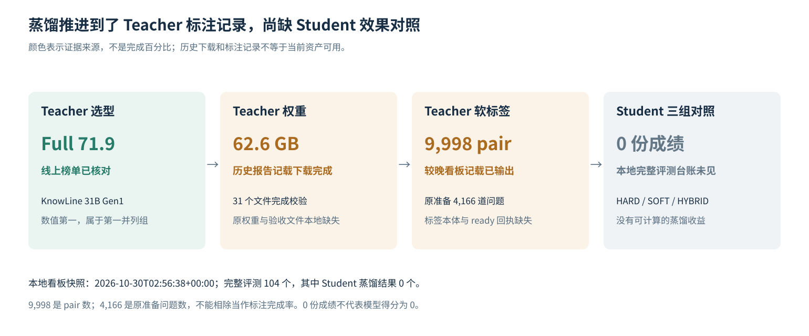
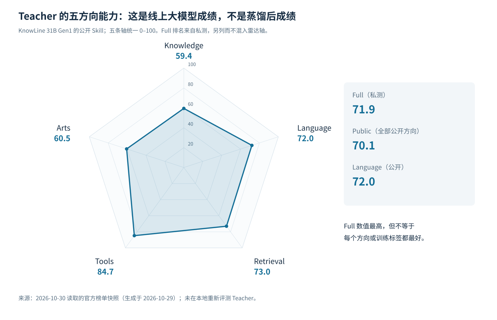
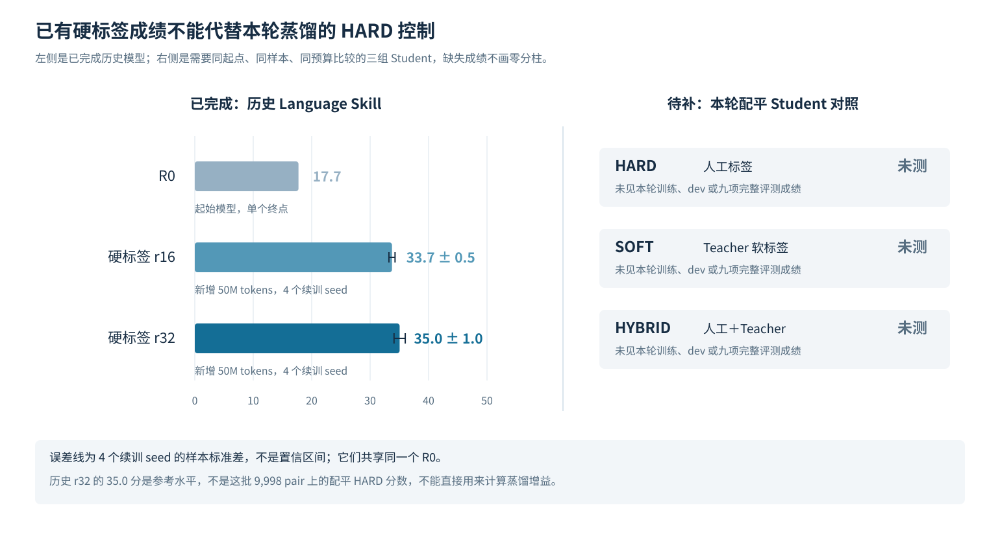

# 榜首 Teacher 蒸馏：能否超过人工标签训练？

## 核心结论

**目前证据不够，尚不能判断蒸馏能否训练出比人工标签更好的 Qwen3-0.6B。** 本地归档有 Teacher 下载与软标签输出的进展记录，但没有人工标签、Teacher 软标签、混合监督三组 Student 的完成成绩。

- **Teacher 选择有依据。** 2026-10-30 读取的最新可取得榜单快照中，KnowLine 31B Gen1 的 Full 为 **71.9**，数值最高、属于第一并列组；Language 公开 Skill 为 **72.0**。这支持将其作为候选 Teacher，但不直接证明它在本批训练数据上的标签优于人工标签。
- **历史记录已推进到软标签输出。** 旧报告记载约 **62.6 GB、31 个文件**下载校验完成；较晚看板记载 **9,998 对完整候选软标签已输出**。权重验收文件、软标签本体和 ready 回执当前未保存在本地，尚不能直接复用或检验标注质量。
- **Student 效果仍缺关键对照。** 本地 **104 个完整 Language 评测方案**中，没有 HARD、SOFT、HYBRID 的完成成绩。已有硬标签主线为 **35.0±1.0**，但它不是这批蒸馏数据上的配平 HARD 控制，不能拿来直接计算蒸馏增益。

本文整理的是**蒸馏进展、现有成绩与研究缺口**，不是蒸馏成功或失败的结果报告。本次未下载大权重、重新标注、训练 Student 或重评模型。

## 一、下载与标注有历史完成记录，三组 Student 尚无成绩

| 环节 | 已有记录 | 当前可用证据 |
|---|---|---|
| Teacher 选型 | KnowLine 31B Gen1，Full 71.9 | 本次重新读取官方榜单核对 |
| 权重下载 | 2026-10-30 02:30 UTC，约 62.6 GB、31 文件校验完成 | 历史报告；原权重与原始验收文件本地缺失 |
| 训练问题准备 | 9,998 pair，原准备 4,166 道问题 | 历史准备记录；完成问题数及映射待原 manifest 确认 |
| Teacher 软标签 | 02:56 UTC 看板记载已输出 9,998 pair | 有完成线索；软标签本体与 ready 回执缺失 |
| HARD：人工标签 Student | CPU 入口准备记录 | 未见训练、dev 或完整 Language 成绩 |
| SOFT：Teacher 软标签 Student | CPU 入口准备记录 | 未见训练、dev 或完整 Language 成绩 |
| HYBRID：混合监督 Student | CPU 入口准备记录 | 未见训练、dev 或完整 Language 成绩 |



“软标签已输出”不只是计划文案：原看板生成器仅在 `teacher-labels-ready.json` 存在时才写入这句话。不过，当前缺少该回执与标签文件，无法检查候选顺序、概率、失败项或 Teacher 与人工标签的分歧。看板的 `running` 状态又是固定写入，不能据此认定现在仍有训练任务运行。

**9,998 是文本对数，4,166 是原准备问题数，两者不是同一个单位。** 当前不能据此推导完成率，也不能把 9,998 对当作同样数量的独立题目。

## 二、当前榜首仍是 KnowLine 31B，但“榜首”不等于本批标签最好

本次读取的官方榜单数据生成于 **2026-10-29 14:04 UTC**，版本为 Decision Index 0.4.1；按 Full 数值排序，而不是将 JSON 数组中的第一条误认为榜首。

| 模型 | Full，私测 | Public，公开总分 | Language 公开 Skill |
|---|---:|---:|---:|
| **KnowLine 31B Gen1** | **71.9** | 70.1 | 72.0 |
| Fastino GLiDE 1.2 | 71.5 | 72.0 | 75.5 |
| Sieve 31B v3 | 71.1 | 71.7 | 71.6 |

这三项属于榜单第一并列组。KnowLine 的 Full 数值最高，但不是每个公开方向都最高；例如表中的 GLiDE Language 更高。因此，合理做法是**固定已选 Teacher，先完成匹配对照**，而不是因某个分项排序反复更换 Teacher。



雷达图只展示 Teacher 的线上公开能力：Knowledge **59.4**、Language **72.0**、Retrieval **73.0**、Tools **84.7**、Arts **60.5**。它不是 Student 成绩，也不代表已经证明这些能力可以迁移。

当前可公开访问的仓库是 [`PelaAI/KnowLine-31B-Gen1`](https://huggingface.co/PelaAI/KnowLine-31B-Gen1)，约 31.3B 参数、BF16，模型卡声明权重为 Apache-2.0。它的原生输出就是各候选选项的概率，适合做**输出分布蒸馏**，不要求 Teacher 和 Qwen Student 使用相同 tokenizer 或架构。

需要保留的推理条件是：作者短文本默认 read twice，温度 **1.44 已折入权重**，score 类型另有前端处理。直接绕过原生前端获取另一种概率，或再重复施加温度，都可能改变蒸馏目标。本次核对的是当前公开版本；历史下载的准确 revision 尚未找回，不能用当前版本号补写成历史版本。

## 三、硬标签主线已有稳定参照，但不能冒充蒸馏控制组

已有 Qwen3-0.6B 的人工标签训练结果如下。Language Skill 使用本地冻结的 Decision Index 0.3 协议；每个参评终点均完成 **31,715 请求、100% 覆盖**。

| 已完成模型 | 训练范围 | seed 数 | Language Skill |
|---|---|---:|---:|
| R0 起始分类模型 | 清洗后 Tasksource 训练；所选 checkpoint 曝光约 342M tokens | 1 | 17.7 |
| 联合数据/采样配方，LoRA r16 | 共享 R0，新增 50M tokens | 4 | 33.7±0.5 |
| 联合数据/采样配方，LoRA r32 | 共享 R0，新增 50M tokens | 4 | **35.0±1.0** |

`±` 为续训 seed 的样本标准差，不是置信区间；四个续训 seed 共享同一个 R0。历史最高单次为 **36.3**，不替代四 seed 均值。



这些结果可用于选择 Student 的已有架构和观察历史水平，但**没有在同一批 9,998 pair、同一预算下完成 HARD 控制**。未来短预算蒸馏即使低于历史 35.0 分，也可能高于同预算 HARD；反之，超过某个旧模型也可能来自数据、预算或目标函数变化。研究问题必须用本轮配平对照回答。

Teacher 的 Full 71.9 与 Student 的 Language 35.0 也不是同一种分数，不能相减或相除，解释为能力差距、知识保留率或蒸馏效率。

## 四、文章中的方法可以对应本项目，但还要完成这三个匹配训练

你提供的正文描述的是“软标签＋人工监督”的蒸馏，这与本项目的原生候选概率可以对接。**软标签提供的是答案分布，不是教师真实思考过程；本轮也不是隐藏层蒸馏或推理轨迹蒸馏。** 蒸馏与 LoRA 微调不冲突：前者改变监督来源，后者决定更新哪些参数。

最小对照应固定同一个 Qwen3-0.6B 起点、同一批文本与完整候选、同一采样顺序、实际 token 预算、batch、LR 和 seed，只改变监督：

| 组别 | 监督目标 | 当前 Language 成绩 | 要回答的问题 |
|---|---|---|---|
| HARD | 人工标签 CE | 未测 | 这批数据正常监督能达到什么水平 |
| SOFT | Teacher 概率 KL | 未测 | 仅模仿 Teacher 是否优于人工标签 |
| HYBRID | 人工 CE＋Teacher KL | 未测 | 保留人工标签时，软标签是否有额外收益 |

设 `y` 为人工目标、`q_T` 为 Teacher 分布、`p_S` 为 Student 在**相同语义输出空间**的分布，可比较：

```text
HARD:   H(y, p_S)
SOFT:   KL(q_T || p_S)
HYBRID: (1 − λ) H(y, p_S) + λ KL(q_T || p_S)
```

以下是**后续建议，不是已执行配置**：首轮先保留 Teacher 原生已校准概率，不额外升温；HYBRID 权重在训练前固定，例如 λ=0.5，不根据公开 benchmark 反复搜索。

最重要的接口条件是：**多选一题的候选概率，不等于每个文本对独立的“匹配概率”。** 单选题可让 Student 的候选分数归一化后学习同一分布；yes/no 和多标签任务则保持各自概率语义。若因此从原 pair CE 改成整题目标，HARD 也必须使用同一新目标，不能把目标函数变化的收益全算给蒸馏。

### 最有价值的下一步是找回标签、完成三组，而不是重下 Teacher 或扩网格

1. **先恢复原始标注资产。** 找回 Teacher 身份、revision、原生前端配置、ready、软标签和原题/候选映射；核对确实来自允许的 train，与评测隔离。找回可用标签后无需重复下载约 63 GB 权重、重新标注同一批数据。
2. **检查 Teacher 在这批数据上给出了什么。** 按任务检查概率归一化、候选覆盖、Teacher 与人工标签的一致性和置信度；保留分歧及错误，不只挑 Teacher 答对的题。当前缺少标签本体，尚不能画真实的分歧率、entropy 或校准分布图。
3. **完成同预算 HARD／SOFT／HYBRID。** 原生任务 dev、自然 pair 指标用于判断，完整 Language 九项用于报告，同时看关键任务是否退步。有收益再补匹配 seed，不同时叠加新数据、LR、rank、融合等改动。

最终直接报告 `SOFT−HARD` 和 `HYBRID−HARD` 的总体及逐任务差值。只有这些对照有结果，才能回答“Teacher 是否比人工标签更有用”。三组 Student 都是同一个 0.6B 架构，蒸馏即使提高质量，也不自动让它比 HARD Student 更快；相对 31B Teacher 的推理节省仍需同硬件实测。

## 数据与来源

- **历史 Teacher 记录：**[实验路线状态](../experiment-roadmap-status-20261029.md)、[02:56 UTC 看板快照](../experiment-dashboard/data.json)、[看板生成逻辑](../experiment-dashboard/build_data.py)。本地缺失目录为 `research/lu-teacher-distillation-20261029/`，本次未连接旧集群核查外部备份。
- **Student 成绩清点：**[95 个历史终点](../language-understanding-study-20261029/runs-through-pair-ratio.csv)＋[9 个融合阶段方案](../../research/lu-specialist-fusion-20261029T152144Z/dashboard-runs.csv)，与看板 104 个完整方案交叉核对；未把阶段名称 `student_distillation` 的定义当作存在 Student 成绩。
- **当前 Teacher：**[固定版本榜单](https://huggingface.co/spaces/multimodalart/jev-decision-index/resolve/c130faf65f82e81d3bdefb01e758c712dc5c5199/data/index.json)、[固定版本模型卡](https://huggingface.co/PelaAI/KnowLine-31B-Gen1/raw/8f052a8130e599b53e5324c34f0f5ff90696e1c6/README.md)、[原生推理说明](https://huggingface.co/PelaAI/KnowLine-31B-Gen1/raw/8f052a8130e599b53e5324c34f0f5ff90696e1c6/INFERENCE.md)、[本次选取的公开字段](teacher-snapshot.json)。Full 取较新的榜单数据，未沿用模型卡中较旧的“尚未上榜”状态。
- **蒸馏方法参考：**[智泊 AI 的文章](https://zhuanlan.zhihu.com/p/1914629163857473685)，本次依据你粘贴的正文理解，不将文章示例或其他模型结果写成本项目实验结果。
- **本次产物：**[完整精度与源文件 SHA256](analysis-facts.json)、[历史硬标签参照 CSV](historical-hard-label-baselines.csv)、[三组 Student 状态 CSV](student-comparison-status.csv)、[Teacher 五方向 CSV](teacher-public-areas.csv)、[绘图脚本](generate_figures.py)。三组缺失分数保留为 null／未测，不填零，也未生成虚构的 Student 雷达图。
